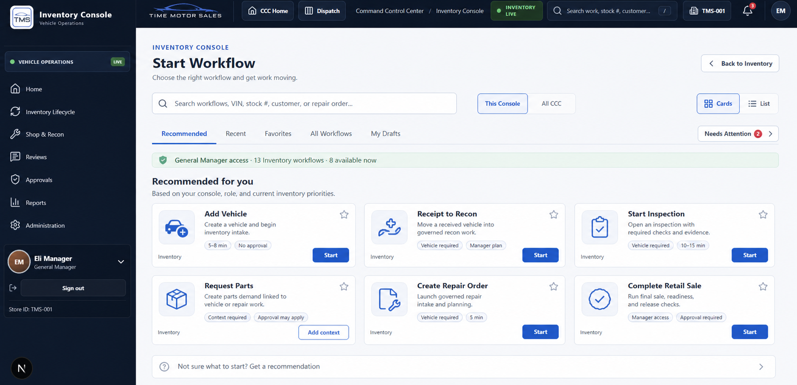

# CCC Enterprise Workflow Launcher — Source of Truth

**Document owner:** Time Motor Sales Command Control Center  
**Version:** 1.0 planning baseline  
**Effective date:** 2026-07-19  
**Status:** Approved planning source of truth; documentation only  
**Approved Inventory visual:** [`inventory-start-workflow-launcher-approved-source-of-truth-v1.png`](inventory/assets/inventory-start-workflow-launcher-approved-source-of-truth-v1.png)  
**Implementation effect:** None. This document does not activate a workflow, grant authority, apply a migration, or prove that a listed capability is live.

---

## 1. Decision

The Command Control Center (CCC) will use one enterprise workflow-launcher architecture across every console.

The launcher will:

- open in the active console's context;
- make that console's work easiest to find;
- allow authorized discovery of workflows across the CCC;
- support Cards and List presentation modes;
- provide universal workflow and business-context search;
- show only truthful availability and permission states;
- route execution to the domain that owns the record and rules;
- preserve drafts, recovery instructions, receipts, and audit evidence; and
- expand through governed vertical slices instead of a single large release.

The launcher is a catalog, discovery, eligibility, and routing layer. It is not a new system of record, a generic mutation engine, or a replacement for Dispatch Tasks, Appointments, Customers, Vehicles, Inventory, Repair Orders, Parts, or other authoritative domains.

This file is the official source of truth for:

1. workflow-launcher product behavior;
2. workflow registry architecture;
3. current and target workflow catalog;
4. implementation roadmap and milestone gates; and
5. governance, safety, recovery, and success criteria.

Where this document conflicts with a domain's approved command or authority contract, the domain contract controls execution. This document controls how that capability is registered, discovered, presented, launched, and governed in the CCC.

---

## 2. Governing sources

This plan extends, and does not replace:

- [`PRODUCT_SPEC.md`](PRODUCT_SPEC.md)
- [`MVP_SCOPE.md`](MVP_SCOPE.md)
- [`ARCHITECTURE.md`](ARCHITECTURE.md)
- [`CURRENT_IMPLEMENTATION_STATUS.md`](CURRENT_IMPLEMENTATION_STATUS.md)
- [`enterprise-optimization/COMMON_WORK_AND_SERVICE_MODEL.md`](enterprise-optimization/COMMON_WORK_AND_SERVICE_MODEL.md)
- [`enterprise-optimization/CONSOLE_SOURCE_AUTHORITY_MAP.md`](enterprise-optimization/CONSOLE_SOURCE_AUTHORITY_MAP.md)
- [`enterprise-optimization/ENTERPRISE_REGISTRY_CATALOG.md`](enterprise-optimization/ENTERPRISE_REGISTRY_CATALOG.md)
- [`ENTERPRISE_TASKS_MODULE.md`](ENTERPRISE_TASKS_MODULE.md)
- [`appointments/README.md`](appointments/README.md)
- [`customers/README.md`](customers/README.md)
- [`projects/PROJECTS_MODULE_GUIDE.md`](projects/PROJECTS_MODULE_GUIDE.md)
- [`manager-review/README.md`](manager-review/README.md)
- [`STAFF_EXECUTION_HANDOFF_ENGINE.md`](STAFF_EXECUTION_HANDOFF_ENGINE.md)

The canonical CCC work relationship remains:

```text
Business Outcome
  -> Service / Capability
  -> Owning Console
  -> Workflow Definition
  -> Governed Launch
  -> Domain Command or Intake
  -> Work Item / Domain Record
  -> Decision, Event, and Evidence
  -> Outcome and Receipt
```

---

## 3. Product experience

### 3.1 Approved Inventory Start Workflow visual



The image above was approved on 2026-07-19 and is the binding visual and interaction source of truth for the Inventory Console Start Workflow landing page. Implementation should preserve its information hierarchy, density, shell relationship, labels, control placement, card composition, and progressive-disclosure approach unless a later approved revision explicitly supersedes it.

Binding visual decisions:

- preserve the existing Inventory Console sidebar and shared CCC top bar;
- keep workflow discovery—not the recommendation questionnaire—as the primary page purpose;
- place Search, `This Console / All CCC`, and `Cards / List` above the catalog;
- provide Recommended, Recent, Favorites, All Workflows, My Drafts, and Needs Attention collections;
- present role and availability context in a slim plain-language strip without internal routes, versions, migrations, or database errors;
- use compact cards with title, outcome, context, approval/time metadata, favorite control, owner, and a clear next action;
- keep “Get a recommendation” as a secondary expandable path; and
- preserve truthful context-required, permission-required, unavailable, and not-released states when implemented.

The six visible cards illustrate the approved first-screen composition; they do not limit the complete Inventory catalog and do not change the implementation state of any workflow.

### 3.2 Page purpose

The Start Workflow page answers five questions in order:

1. What outcome does the user need?
2. Which workflow is appropriate in the current console and context?
3. Is the user authorized and is the required context available?
4. What will be created or changed before the user commits?
5. How can the work be resumed or recovered if it cannot finish now?

The page must feel like an enterprise launcher, not another operational dashboard.

### 3.3 Default composition

1. **Compact title row** — console name, Start Workflow, and Back to Console.
2. **Primary search** — “Search workflows, outcomes, VIN, stock #, customer, repair order…”
3. **Scope control** — `This Console` by default and `All CCC` when the user is authorized.
4. **Presentation control** — `Cards` and `List`. Use “Cards,” not “Board,” because Board already means active work lifecycle elsewhere in the product.
5. **Collection tabs** — Recommended, Recent, Favorites, All Workflows, My Drafts, and Needs Attention.
6. **Optional context bar** — selected vehicle, customer, appointment, task, repair order, location, or other recognized context.
7. **Workflow results** — grouped by outcome/category, with unavailable items clearly separated.
8. **Detail drawer** — purpose, prerequisites, time estimate, approvals, records created, recovery, owner, and version.
9. **Launch confirmation** — a short confirmation only when the action has material consequences or ambiguity.

### 3.4 Workflow card

Every card must show:

- workflow title and one-sentence outcome;
- owning console and category;
- availability label;
- estimated completion time when meaningful;
- required context such as Vehicle, Customer, Task, or Appointment;
- approval indicator;
- primary action: Start, Resume, Request Access, Add Context, or View Details; and
- a concise reason when unavailable.

Technical identifiers, schema versions, internal migration messages, and policy diagnostics belong in the detail drawer or an administrator view—not in the main employee-facing card.

### 3.5 List view

The List view supports scanning a large catalog. Columns are:

| Column | Purpose |
| --- | --- |
| Workflow | Name and concise outcome |
| Console | Authoritative operating area |
| Category | Intake, execute, decide, review, close, administer, or report |
| Context | Required record or selection |
| Availability | Current runtime state and reason |
| Approval | None, conditional, or required |
| Updated | Registry version date |
| Action | Start, Resume, Add Context, Request Access, or Details |

### 3.6 Search and ranking

Search covers workflow name, outcome, description, synonyms, supported identifiers, and configured business intent. Ranking is deterministic and explainable:

1. exact workflow-name match;
2. exact business-intent or identifier match;
3. active-console relevance;
4. satisfied context and eligibility;
5. role and permission visibility;
6. favorites and recent successful use; and
7. stable registry order as the final tie-breaker.

Search and recommendations must never infer authorization. Recommendations help a user find work; they do not silently create, approve, assign, schedule, or complete it.

### 3.7 Progressive disclosure

The first screen stays simple. Validation details, policy ownership, input/output contracts, audit events, version history, integration health, and recovery diagnostics are available on demand. This preserves an elite, low-friction experience without hiding material consequences.

---

## 4. Registry and runtime architecture

### 4.1 Central Enterprise Workflow Registry

Each workflow is registered once with this minimum contract:

| Field | Required meaning |
| --- | --- |
| `workflowId` | Stable, never-reused enterprise identifier |
| `version` | Immutable published definition version |
| `title` / `outcome` | User-facing name and result |
| `owningConsole` / `capability` | Domain and service responsible for execution |
| `category` | Intake, execute, decide, review, close, administer, or report |
| `searchTerms` | Governed names, synonyms, and business intents |
| `implementationState` | Live, Partial, or Planned |
| `visibilityPolicy` | Who may discover the definition |
| `authorityPolicy` | Who may launch and under which conditions |
| `requiredContext` | Required organization, location, and domain records |
| `inputContract` | Required user input and validation |
| `outputContract` | Records, commands, tasks, events, and receipts created |
| `approvalPolicy` | None, conditional, manager, or domain-specific approval |
| `launchAdapter` | Approved domain route or command boundary |
| `idempotencyPolicy` | Duplicate-prevention rule |
| `recoveryPolicy` | Draft, retry, rollback, handoff, and support path |
| `auditPolicy` | Required actor, reason, correlation, prior/new values, and evidence |
| `owner` | Product and operational owner |
| `lifecycle` | Draft, published, deprecated, suspended, or retired |

Registry membership makes a workflow discoverable. It does not authorize execution.

### 4.2 Separate truth dimensions

Do not combine implementation truth and momentary availability into one badge.

**Implementation state**

- `LIVE` — an evidenced, domain-owned launch path exists.
- `PARTIAL` — foundations or UI exist, but the complete governed launch is not yet proven.
- `PLANNED` — approved direction only; it must not appear launchable in production.

**Runtime state**

- `AVAILABLE` — authorized and required context is satisfied.
- `CONTEXT_REQUIRED` — selectable context is missing.
- `PERMISSION_REQUIRED` — discoverable but not executable by this user.
- `DEPENDENCY_UNAVAILABLE` — a required governed dependency is unhealthy.
- `SUSPENDED` — intentionally disabled by an authorized owner.
- `NOT_RELEASED` — definition is planned or behind an unapproved release gate.

### 4.3 Runtime components

| Component | Responsibility |
| --- | --- |
| Workflow Registry | Versioned definitions and governance metadata |
| Search Index | Names, outcomes, synonyms, and supported identifiers |
| Context Resolver | Resolves current console, location, user, and selected domain records |
| Eligibility and Authority Evaluator | Server-side visibility, permission, policy, and prerequisite decisions |
| Recommendation Ranker | Deterministic, explainable suggestions after eligibility |
| Launch Router | Sends the request to the domain-owned page or command adapter |
| Draft and Resume Service | Saves incomplete intake without creating contradictory domain truth |
| Receipt and Audit Service | Returns outcome, created records, correlation ID, and next action |
| Preference Service | Favorites, recent use, and saved presentation mode |
| Health Projection | Read-only dependency availability; never raw infrastructure errors for ordinary users |

### 4.4 Execution boundary

```text
Launcher UI
  -> Registry query
  -> Context + authority evaluation
  -> Workflow-specific intake
  -> Domain-owned command/service
  -> Domain transaction
  -> Event/outbox/audit evidence
  -> Launch receipt + next route
```

The launcher may compose domain capabilities, but it may not bypass their policy, validation, concurrency, idempotency, or transaction boundaries. A cross-console workflow uses an orchestrator with explicit compensating and recovery rules; it does not write directly to several domain repositories from the browser.

### 4.5 Drafts, retries, and recovery

- A draft is not an authoritative completed transaction.
- Retry must reuse the original idempotency key when the business intent is unchanged.
- Partial cross-domain completion must produce a visible receipt and assigned recovery action.
- Users see plain-language recovery guidance; administrators may inspect correlation and dependency details.
- Saved work must never be discarded because an optional advisory, recommendation, or analytics dependency is unavailable.
- Every failed launch must distinguish validation, permission, conflict, dependency, and unknown failure classes.

---

## 5. Enterprise workflow catalog

This is the canonical workflow-family inventory. Individual registry definitions may divide a family into smaller versions, but they may not change its owning domain or claim a stronger implementation state without evidence in `CURRENT_IMPLEMENTATION_STATUS.md`.

### 5.1 Dispatch, Tasks, and daily execution

| ID | Workflow | Primary result | Baseline |
| --- | --- | --- | --- |
| CCC-WF-DSP-001 | Generate Daily Dispatch Board | Idempotent board day and governed generated work | Live |
| CCC-WF-DSP-002 | Create General Task | Validated task with owner, due time, priority, and context | Live |
| CCC-WF-DSP-003 | Start Task From Template | Task and required checklist/update contract | Live |
| CCC-WF-DSP-004 | Submit Concern | Concern record and decomposed resolution work when applicable | Live |
| CCC-WF-DSP-005 | Assign or Reassign Work | Authorized ownership decision with evidence | Live |
| CCC-WF-DSP-006 | Claim Available Work | Eligible user acquires claimable work | Live |
| CCC-WF-DSP-007 | Request Assignment | Auditable request routed to an authorized manager | Live |
| CCC-WF-DSP-008 | Accept and Start Work | Execution acknowledgement and governed status transition | Partial |
| CCC-WF-DSP-009 | Update Work / Add Evidence | Comment, required update, checklist, attachment, or context evidence | Live |
| CCC-WF-DSP-010 | Report Blocker or Waiting State | Structured condition, reason, ownership, and follow-up | Live |
| CCC-WF-DSP-011 | Request Collaboration | Governed collaborator participation | Live |
| CCC-WF-DSP-012 | Submit for Manager Review | Ready-for-review state with completion evidence | Live |
| CCC-WF-DSP-013 | Approve or Return Work | Manager decision, reason, next state, and audit event | Live |
| CCC-WF-DSP-014 | Complete Work | Policy-validated completion | Live |
| CCC-WF-DSP-015 | Link or Create Appointment | Linked appointment draft retaining task context | Live |
| CCC-WF-DSP-016 | Start Day | Staff-day acknowledgement and declared blockers | Planned |
| CCC-WF-DSP-017 | Find Recommended Next Work | Explainable, eligible work recommendation | Planned |
| CCC-WF-DSP-018 | End-of-Day Handoff | Immutable daily work summary and carryover | Planned |
| CCC-WF-DSP-019 | Review Team Execution Health | Manager conditions without employee grading | Planned |
| CCC-WF-DSP-020 | View or Export Operational Activity | Permission-filtered evidentiary read/report | Partial |

### 5.2 Projects

Projects currently derive much of their presentation from shared Task facts and do not yet own durable Project truth.

| ID | Workflow | Primary result | Baseline |
| --- | --- | --- | --- |
| CCC-WF-PRJ-001 | Create Project | Project record, membership, policy, and initial workflow | Planned |
| CCC-WF-PRJ-002 | Add Existing Task to Project | Explicit governed project-task relationship | Planned |
| CCC-WF-PRJ-003 | Create Project Work | Shared Task with explicit project and stage | Planned |
| CCC-WF-PRJ-004 | Configure Project Stages | Versioned project workflow definition | Planned |
| CCC-WF-PRJ-005 | Move Work Between Stages | Audited stage transition without replacing Task status | Planned |
| CCC-WF-PRJ-006 | Review Project Health | Explainable health conditions and intervention path | Planned |
| CCC-WF-PRJ-007 | Close or Archive Project | Controlled closeout with open-work reconciliation | Planned |
| CCC-WF-PRJ-008 | Open Project Workspace | Current derived board/list/workspace experience | Partial |

### 5.3 Appointments

| ID | Workflow | Primary result | Baseline |
| --- | --- | --- | --- |
| CCC-WF-APT-001 | Create Appointment Draft | Audited unscheduled appointment draft | Live |
| CCC-WF-APT-002 | Find Availability | Ranked, explainable people/resource time options | Live |
| CCC-WF-APT-003 | Schedule Draft | Conflict-evaluated scheduled appointment | Live |
| CCC-WF-APT-004 | Reschedule Appointment | Impact preview, governed command, and updated reservations | Live |
| CCC-WF-APT-005 | Bulk Reschedule | Dry run and controlled all-or-partial execution | Live |
| CCC-WF-APT-006 | Add Participants and Resources | Governed requirements, proposals, holds, and reservations | Live |
| CCC-WF-APT-007 | Override Scheduling Warning | Manager reason and durable override evidence | Live |
| CCC-WF-APT-008 | Confirm or Decline | Attendance-intent transition | Live |
| CCC-WF-APT-009 | Check In / No Show | Attendance event and governed downstream effects | Live |
| CCC-WF-APT-010 | Start / Wait / Finish Appointment Work | Execution-state transition | Live |
| CCC-WF-APT-011 | Record Outcome and Follow-up | Outcome plus linked task or appointment draft when needed | Live |
| CCC-WF-APT-012 | Add to Waitlist / Unscheduled Queue | Permission-safe request and promotion candidates | Live |
| CCC-WF-APT-013 | Create Recurring Appointment | Series with bounded occurrences and exceptions | Partial |
| CCC-WF-APT-014 | Cancel Appointment | Authorized cancellation, reason, and reservation handling | Live |
| CCC-WF-APT-015 | Administer Appointment Types and Rules | Database-backed catalogs, automation, and policies | Partial |

### 5.4 Customers, leads, promises, and resolutions

Customer identity is implemented, while most durable Customer Console operations remain milestone work. The visible Customer shells must not be mistaken for complete command workflows.

| ID | Workflow | Primary result | Baseline |
| --- | --- | --- | --- |
| CCC-WF-CUS-001 | Create or Match Customer | Governed customer identity or duplicate-safe match | Partial |
| CCC-WF-CUS-002 | Open Customer 360 | Permission-filtered customer relationship view | Partial |
| CCC-WF-CUS-003 | Create Lead / Opportunity Follow-up | Owned commercial follow-up work | Planned |
| CCC-WF-CUS-004 | Transition Lead | Validated lifecycle transition and reason | Planned |
| CCC-WF-CUS-005 | Create Customer Case | Case, owner, SLA policy, and source context | Planned |
| CCC-WF-CUS-006 | Pause or Resume Case SLA | Authorized reason and time-control evidence | Planned |
| CCC-WF-CUS-007 | Escalate or Resolve Case | Resolution decision, outcome, and follow-up | Planned |
| CCC-WF-CUS-008 | Create and Fulfill Customer Promise | Due commitment, ownership, fulfillment evidence | Planned |
| CCC-WF-CUS-009 | Run Customer Resolution | Guided resolution steps across linked work | Partial |
| CCC-WF-CUS-010 | Override Customer Decision | Manager decision and audit evidence | Planned |
| CCC-WF-CUS-011 | Link Customer, Vehicle, Appointment, and Task | Explicit governed relationships | Partial |
| CCC-WF-CUS-012 | Administer Customer Rollout and Policies | Controlled feature, SLA, and policy activation | Planned |

### 5.5 Inventory lifecycle

These definitions preserve the existing Inventory launcher catalog while moving it toward the enterprise registry contract.

| ID | Workflow | Primary result | Baseline |
| --- | --- | --- | --- |
| CCC-WF-INV-001 | Add Vehicle | Canonical vehicle and inventory intake | Live |
| CCC-WF-INV-002 | Start Acquisition | Acquisition case and governed appraisal path | Live |
| CCC-WF-INV-003 | Start Inventory-to-Frontline | Vehicle readiness workflow | Live |
| CCC-WF-INV-004 | Launch Receipt-to-Recon | Work packet and linked recon execution | Live |
| CCC-WF-INV-005 | Start Inspection | Inspection work and evidence requirements | Live |
| CCC-WF-INV-006 | Request Inventory Recon | Recon request linked to unit and ownership | Live |
| CCC-WF-INV-007 | Create Repair Order | Governed repair-order intake | Live |
| CCC-WF-INV-008 | Report Inventory Blocker | Structured blocker and recovery owner | Live |
| CCC-WF-INV-009 | Request Inventory Approval | Approval request with context and evidence | Live |
| CCC-WF-INV-010 | Create Inventory Task | Shared Task linked to inventory context | Live |
| CCC-WF-INV-011 | Complete Retail Sale | Retail-completion commands and release checks | Live |
| CCC-WF-INV-012 | Request Parts | Parts demand linked to inventory or repair work | Live |
| CCC-WF-INV-013 | Review Workflow Operations | Operational workflow and outbox/recovery view | Live |
| CCC-WF-INV-014 | Plan Next Inventory Action | Manager-published next plan and readiness guidance | Live |
| CCC-WF-INV-015 | Record Technician Work Session | Governed start, pause, resume, and closeout | Live |
| CCC-WF-INV-016 | Handoff Inventory Work | Accepted handoff with required context | Live |
| CCC-WF-INV-017 | Start Disposition / Wholesale | Governed exit-path decision and execution | Partial |

### 5.6 Shop, repair orders, quality, and parts

| ID | Workflow | Primary result | Baseline |
| --- | --- | --- | --- |
| CCC-WF-SHP-001 | Plan Repair Order | Labor, parts, ownership, timing, and release plan | Live |
| CCC-WF-SHP-002 | Dispatch Repair Work | Governed technician assignment and execution handoff | Live |
| CCC-WF-SHP-003 | Record Labor / Production Progress | Execution evidence and production state | Live |
| CCC-WF-SHP-004 | Request Estimate or Approval | Decision request with scope and evidence | Live |
| CCC-WF-SHP-005 | Reserve, Release, or Replace Parts | Parts commitment tied to governed demand | Live |
| CCC-WF-SHP-006 | Operate Parts Counter | Issue, return, transfer, and reconcile parts | Live |
| CCC-WF-SHP-007 | Manage Parts Locations and Ledger | Authoritative location and movement evidence | Live |
| CCC-WF-SHP-008 | Mark Delivery Readiness | Readiness checks and unmet-condition explanation | Live |
| CCC-WF-SHP-009 | Run Quality Control | Inspection, pass/fail decision, evidence, and rework | Live |
| CCC-WF-SHP-010 | Authorize Vehicle Release | Authorized release decision and evidence | Live |
| CCC-WF-SHP-011 | Create Comeback | Linked corrective work and accountability trail | Live |
| CCC-WF-SHP-012 | Close Service Financials | Governed service and parts closeout | Live |
| CCC-WF-SHP-013 | Plan Shop Capacity | Capacity plan with explainable constraints | Live |
| CCC-WF-SHP-014 | Review Shop Metrics and Exceptions | Operational read model and intervention launch points | Live |

### 5.7 Vehicles and controlled output

| ID | Workflow | Primary result | Baseline |
| --- | --- | --- | --- |
| CCC-WF-VEH-001 | Find Vehicle | Permission-filtered discovery across canonical identifiers | Live |
| CCC-WF-VEH-002 | Open Vehicle 360 | Canonical vehicle and linked operational context | Live |
| CCC-WF-VEH-003 | Update Vehicle Through Command | Validated, auditable vehicle change | Live |
| CCC-WF-VEH-004 | Add Vehicle Evidence | Governed document, image, or fact evidence | Live |
| CCC-WF-VEH-005 | Generate Controlled Vehicle Output | Versioned output with source and approval trace | Live |
| CCC-WF-VEH-006 | Review Portal Approval | Approval decision for governed external-facing change | Live |
| CCC-WF-VEH-007 | Import or Reconcile Vehicle Data | Controlled import, match, exception, and recovery | Partial |

### 5.8 Sales, marketing, and advertising

Today these Dispatch sidebar areas primarily organize shared Tasks by department. They are retained as console-operating destinations, but a visible tab does not establish an independent authoritative domain.

| ID | Workflow | Primary result | Baseline |
| --- | --- | --- | --- |
| CCC-WF-SAL-001 | Create Sales Follow-up | Customer/vehicle-linked owned Task | Partial |
| CCC-WF-SAL-002 | Qualify and Advance Lead | Governed commercial stage and next action | Planned |
| CCC-WF-SAL-003 | Schedule Sales Appointment | Appointment linked to customer, vehicle, and source work | Partial |
| CCC-WF-SAL-004 | Record Sales Outcome | Outcome, next action, and linked customer/vehicle evidence | Planned |
| CCC-WF-MKT-001 | Create Marketing Work | Campaign/listing/content Task with owner and due time | Partial |
| CCC-WF-MKT-002 | Plan Campaign | Objective, audience, channel, budget, approvals, and work | Planned |
| CCC-WF-MKT-003 | Review Marketing Asset | Evidence-based approve, return, or revise decision | Planned |
| CCC-WF-MKT-004 | Publish Campaign or Content | Approved publication request and receipt | Planned |
| CCC-WF-MKT-005 | Review Campaign Performance | Source-aware performance readout and next action | Planned |
| CCC-WF-ADV-001 | Create Vehicle Advertisement | Vehicle-linked advertising work and required facts | Partial |
| CCC-WF-ADV-002 | Validate Listing Readiness | Required media/facts/pricing/channel checks | Planned |
| CCC-WF-ADV-003 | Approve Advertisement | Manager/compliance decision with evidence | Planned |
| CCC-WF-ADV-004 | Publish, Update, or Retire Listing | Controlled channel action and result receipt | Planned |
| CCC-WF-ADV-005 | Resolve Listing Exception | Owned recovery work for channel or data failure | Planned |

### 5.9 Manager Review, administration, governance, and integrations

| ID | Workflow | Primary result | Baseline |
| --- | --- | --- | --- |
| CCC-WF-MGR-001 | Review Ready Work | Approve, return, reassign, or request evidence | Live |
| CCC-WF-MGR-002 | Review Blocked, Aging, or Risk Work | Explainable intervention and next owner | Partial |
| CCC-WF-MGR-003 | Review Customer or Operational Risk | Durable review case and decision | Planned |
| CCC-WF-MGR-004 | Review Approval Queue | Cross-domain, permission-filtered decisions | Partial |
| CCC-WF-ADM-001 | Manage Users, Roles, and Duties | Governed access and responsibility configuration | Live |
| CCC-WF-ADM-002 | Manage Task Templates and Rules | Versioned work-generation policy | Live |
| CCC-WF-ADM-003 | Review Authority and Audit Evidence | Permission-filtered governance operations | Live |
| CCC-WF-ADM-004 | Run Program Validation | Evidence-based readiness and conformance checks | Live |
| CCC-WF-ADM-005 | Manage Retention or Reconciliation | Controlled background governance operation | Live |
| CCC-WF-ADM-006 | Configure Integration | Governed provider setup without secret exposure | Partial |
| CCC-WF-ADM-007 | Manage Webhook / Integration Security | Signing, rotation, validation, and health | Partial |
| CCC-WF-ADM-008 | Approve Knowledge or Policy Content | Versioned approval and publication | Live |
| CCC-WF-ADM-009 | Suspend or Restore Workflow Definition | Authorized registry lifecycle change | Planned |

### 5.10 Planned CCC consoles

The following are catalog placeholders only. These consoles are not authoritative until a separate domain source, owner, policy, retention, event, and integration contract is approved.

| Console | Planned workflow families | Baseline |
| --- | --- | --- |
| Time & Attendance | Clock exception, schedule change, timecard review, leave request, manager approval | Planned |
| People & HR | Onboarding, offboarding, policy acknowledgement, training assignment, employee-record request | Planned |
| Compliance | Compliance review, exception, attestation, corrective action, evidence package | Planned |
| Legal & Accounting | Invoice/expense review, contract request, legal hold, reconciliation, close checklist | Planned |
| Library & Training | Publish knowledge, assign training, complete assessment, acknowledge policy, retire content | Planned |
| Insights | Build governed view, schedule report, investigate metric, create action from insight | Planned |

These workflows must remain `NOT_RELEASED` until the source-authority map and implementation-status record are updated with evidence.

---

## 6. Roadmap and milestone gates

Each milestone is a reviewable vertical slice. A later milestone may not weaken an earlier gate.

### CCC-WFL-000 — Approve the source of truth

**Deliverable:** This document is reviewed as the launcher planning baseline.  
**Gate:** Product, architecture, domain ownership, and planned-versus-live terminology are accepted.  
**No-code outcome:** No production behavior changes.

### CCC-WFL-010 — Establish the registry foundation

**Deliverable:** Typed registry contract, lifecycle rules, validation, versioning, and registry tests.  
**First migration:** Express the existing Inventory workflow catalog through the registry adapter without changing its command behavior.  
**Gate:** Duplicate IDs, invalid ownership, missing recovery, and planned-as-live definitions fail validation.

### CCC-WFL-020 — Deliver the launcher shell

**Deliverable:** Simple header, primary search, This Console / All CCC scope, Cards / List modes, categories, details, loading, empty, and honest unavailable states.  
**Gate:** Keyboard, screen-reader, responsive, and performance acceptance; no raw infrastructure messages in employee-facing UI.

### CCC-WFL-030 — Add context, eligibility, and authority

**Deliverable:** Server-side context resolver and authority evaluator for organization, location, role, permissions, and domain prerequisites.  
**Gate:** UI visibility cannot bypass domain authorization; every unavailability state has a stable reason code and safe explanation.

### CCC-WFL-040 — Add drafts, resume, receipts, and recovery

**Deliverable:** Workflow-specific drafts, idempotent retry, launch receipts, correlation, and recovery ownership.  
**Gate:** Dependency interruption never silently duplicates a business action or loses a saved draft.

### CCC-WFL-050 — Onboard Dispatch and Manager Review

**Deliverable:** Task intake, concern, assignment, blocker, collaboration, review, approval/return, completion, and linked appointment workflows.  
**Gate:** Existing Task and Manager Review policies remain authoritative; no parallel task lifecycle is introduced.

### CCC-WFL-060 — Complete Inventory onboarding

**Deliverable:** All evidenced Inventory, Vehicle, acquisition, frontline, work-packet, approval, retail, and disposition definitions use the enterprise registry.  
**Gate:** Existing Inventory routes continue to work; optional advisory failure cannot take down the launcher.

### CCC-WFL-070 — Onboard Appointments and Customers

**Deliverable:** Appointment command workflows and only evidence-supported Customer workflows.  
**Gate:** Scheduling conflicts, reservations, warning overrides, privacy, and Customer implementation states remain truthful.

### CCC-WFL-080 — Onboard Shop, Repair Orders, Quality, and Parts

**Deliverable:** Repair, production, parts, quality, comeback, release, and financial-close launch definitions.  
**Gate:** Vehicle release, parts ledger, repair order, and approval authority cannot be bypassed by the launcher.

### CCC-WFL-090 — Add personal productivity without surveillance

**Deliverable:** Favorites, Recent, My Drafts, saved Cards/List choice, and explainable Recommendations.  
**Gate:** No employee score, inferred attitude, hidden comparison, or recommendation-only automation.

### CCC-WFL-100 — Add governance and operations

**Deliverable:** Definition approval, suspension, deprecation, dependency health, audit search, and administrator diagnostics.  
**Gate:** Only authorized owners can publish or suspend definitions; every registry change is versioned and auditable.

### CCC-WFL-110 — Pilot and harden

**Deliverable:** Limited-role pilot, accessibility evidence, search tuning, performance budgets, failure drills, support playbook, and rollback plan.  
**Gate:** Pilot acceptance, no unresolved high-severity control gaps, and measured recovery behavior.

### CCC-WFL-120 — Expand by source authority

**Deliverable:** Projects, Sales, Marketing, Advertising, then future CCC consoles only as their authoritative domain contracts mature.  
**Gate:** A source-authority entry, domain owner, retention policy, command boundary, audit events, and implementation evidence exist before release.

---

## 7. Definition of ready for a workflow

A workflow cannot enter implementation until it has:

- a stable workflow ID and owner;
- a single plain-language outcome;
- a named authoritative domain;
- visibility and launch-authority rules;
- required context and validation;
- input and output contracts;
- approval and separation-of-duty rules;
- idempotency and concurrency expectations;
- failure classes and a recovery owner;
- audit/evidence requirements;
- privacy, accessibility, and retention review; and
- a declared implementation state based on repository evidence.

## 8. Definition of done for a released workflow

A workflow is `LIVE` only when:

1. the registry definition passes validation;
2. the domain command or intake is implemented and authorized server-side;
3. success, validation, conflict, permission, dependency, retry, and recovery paths are tested;
4. duplicate submission is controlled;
5. a durable event or audit record exists where required;
6. the UI is responsive and accessible;
7. the result receipt identifies what happened and what happens next;
8. operational health and support ownership are documented;
9. `CURRENT_IMPLEMENTATION_STATUS.md` records the evidence; and
10. planned or unsupported parts remain visibly unavailable rather than simulated with production-looking data.

---

## 9. Non-goals and guardrails

- No universal endpoint that can mutate any domain from arbitrary metadata.
- No browser-side permission enforcement as the final control.
- No duplicate Task, Customer, Vehicle, Appointment, Project, or Inventory system of record.
- No automatic approval, assignment, scheduling, publication, or completion merely because a workflow was recommended.
- No production-visible planned workflows that look actionable.
- No mandatory recommendation dependency for basic workflow discovery.
- No raw database, Prisma, provider, secret, or stack-trace messages in ordinary UI.
- No global workflow-builder product in the first implementation phases.
- No employee ranking, behavior inference, or productivity surveillance.
- No activation of external providers or workplace automations without separate approval.
- No future console launch until source authority is explicit.

---

## 10. Measures of success

Measure the workflow system, not employee worth:

- median time from launcher open to correct workflow selection;
- search success and zero-result rate;
- successful launch and completion rates by workflow version;
- validation, permission, conflict, and dependency failure rates;
- draft recovery and safe retry success;
- duplicate-action prevention;
- wrong-workflow abandonment and return-to-search rate;
- recommendation acceptance with an explainable reason;
- support incidents and mean recovery time; and
- accessibility, responsiveness, and page-interaction performance.

Metrics must be permission-filtered, retained only as required, and interpreted by workflow/context—not as raw cross-role employee comparisons.

---

## 11. Architecture decisions recorded

| Decision | Rationale |
| --- | --- |
| One registry, domain-owned execution | Consistent discovery without a second business-logic platform |
| Active console first, All CCC optional | Fast local operation with authorized enterprise reach |
| Cards and List, not Board and List | Avoids collision with operational lifecycle boards |
| Search by workflow and business context | Users often know the vehicle/customer/outcome, not the formal process name |
| Separate implementation and runtime states | Prevents “unavailable” from hiding whether capability is unbuilt, unauthorized, or temporarily unhealthy |
| Deterministic eligibility before recommendations | Safety, explainability, and reproducibility |
| Draft and receipt are first-class concepts | Enterprise recovery and continuity |
| Planned catalog entries are never launchable | Honest product state |
| Future consoles require source authority | Prevents attractive shells from becoming accidental systems of record |

---

## 12. Change control

- Amend this document when the launcher architecture, catalog ownership, milestone sequence, or release gates change.
- Record actual implementation only in `CURRENT_IMPLEMENTATION_STATUS.md` after evidence exists.
- Add or change a workflow definition through an owned, versioned review; never recycle an ID.
- Deprecation must state replacement, migration, retention, and retirement dates.
- Emergency suspension must preserve discovery for authorized support users and provide a safe employee-facing explanation.
- Domain documents may add stronger workflow rules. They may not bypass the common authority, evidence, recovery, privacy, or audit requirements.
