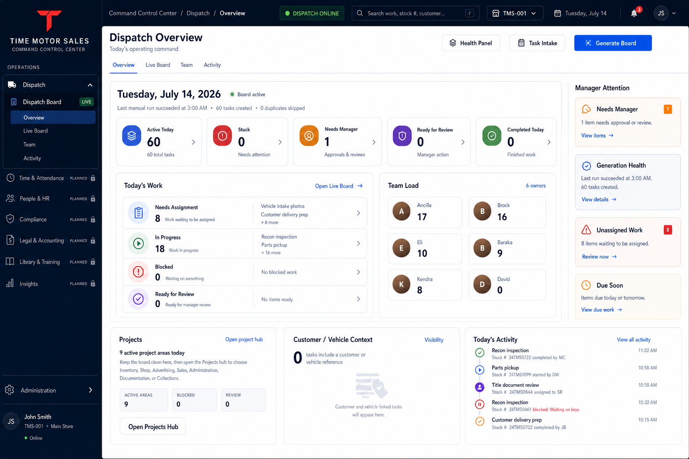

# Command Control Center Shell UI Source of Truth

**Status:** Approved planning source of truth  
**Approved:** 2026-07-14  
**Scope:** Time Motor Sales Command Control Center global shell and Dispatch Overview  
**Implementation state:** Initial CCC shell and Dispatch Overview hierarchy implemented; deeper overview composition remains iterative

The expanded Dispatch Live Board navigation is governed by [`DISPATCH_LIVE_BOARD_NAVIGATION_UI_SOURCE_OF_TRUTH.md`](DISPATCH_LIVE_BOARD_NAVIGATION_UI_SOURCE_OF_TRUTH.md). Its approved single-line design supersedes the earlier four-tab treatment for that specific navigation scope.

The approved shell-containment model is implemented: the global CCC sidebar appears only on authenticated CCC Home at `/command-center`. Operational consoles suppress the global sidebar, retain the global command bar, and provide an explicit **CCC Home** return control.

## Approved mockup

[](ui-mockups/command-control-center-shell-dispatch-overview.png)

The approved image is stored at:

`docs/ui-mockups/command-control-center-shell-dispatch-overview.png`

## Product direction

Time Motor Sales Command Control Center is the future-ready umbrella shell for the company's operating workspaces. Dispatch Board is the flagship operating module and the only module presented as live in this approved concept.

The shell establishes a durable information hierarchy without requiring the broader Command Control Center program to be implemented before Dispatch Board is settled.

## Governing hierarchy

```text
Time Motor Sales Command Control Center
  Dispatch (LIVE)
    Dispatch Board
      Overview
      Live Board
      My Tasks
      Tasks
      Projects
      Appointments
      Vehicles
      Customers
      Manager Review
      Team
      Activity
  Time & Attendance (PLANNED)
  People & HR (PLANNED)
  Compliance (PLANNED)
  Legal & Accounting (PLANNED)
  Library & Training (PLANNED)
  Insights (PLANNED)
  Administration
```

## Approved shell decisions

1. Use **Time Motor Sales Command Control Center** as the umbrella product identity.
2. Keep **Dispatch Board** as the only live operational module until another module is intentionally approved and implemented.
3. Show future modules as deliberately **Planned** and unavailable; never present empty or simulated functionality as live.
4. Keep the global shell stable: brand, workspace hierarchy, search, store context, business date, notifications, identity, and administration.
5. Keep Dispatch-local navigation inside the Dispatch module using the exact destinations and order governed by the [Dispatch Live Board Navigation UI Source of Truth](DISPATCH_LIVE_BOARD_NAVIGATION_UI_SOURCE_OF_TRUTH.md).
6. Treat **Dispatch Overview** as the manager's daily launch and readiness surface.
7. Treat **Live Board** as the deeper execution surface for operating and updating the day's work.
8. Show the global CCC module sidebar only on **CCC Home**. Never populate global CCC module navigation inside an operational console.
9. Keep the global command bar visible inside consoles, including Time Motor Sales identity, breadcrumb, store context, search, notifications, identity, and an explicit return to **CCC Home**.
10. Treat **CCC Home** and a console's **Overview** as different destinations: CCC Home exits the console; Overview remains inside it.

## Dispatch Overview content contract

The approved overview prioritizes real Dispatch capabilities:

- Board date, active state, and latest generation evidence.
- Health Panel, Task Intake, and Generate Board actions.
- Active Today, Stuck, Needs Manager, Ready for Review, and Completed Today metrics.
- Today's Work summary with a clear handoff to Live Board.
- Team Load shown through factual owner/task counts; do not infer capacity percentages without an approved capacity model.
- Manager Attention based on deterministic, evidence-backed conditions.
- Project-area summary.
- Customer and vehicle reference coverage.
- Today's Activity from recorded application events.

## Data and behavior rules

- The mockup governs presentation hierarchy, navigation placement, density, and visual treatment.
- Live APIs, server-side policies, read models, and audit records remain authoritative for data and behavior.
- Do not ship sample counts, invented performance scores, unsupported SLA metrics, or fictional health indicators.
- Loading, stale, empty, unavailable, permission-denied, and failure states must be explicit.
- Generate Board and scheduler-health evidence must remain visible; they are not replaced by generic operating-health decoration.
- Any quick action or future drag-and-drop behavior must preserve status-transition rules, blocker reasons, permissions, review gates, and activity history.
- Table and board presentations may coexist in Live Board because dense comparison and workflow scanning serve different operating needs.

## Relationship to other mockups

This record governs the **global Command Control Center shell** and the **Dispatch Overview composition**. The workspace mockups registered in [`ENTERPRISE_WORKSPACE_UI_SOURCE_OF_TRUTH.md`](ENTERPRISE_WORKSPACE_UI_SOURCE_OF_TRUTH.md) continue to govern their respective module interiors.

The [Dispatch Live Board Navigation UI Source of Truth](DISPATCH_LIVE_BOARD_NAVIGATION_UI_SOURCE_OF_TRUTH.md) governs the contextual navigation shown inside Live Board and takes precedence over this record's earlier four-tab treatment for that scope.

When a module-level mockup conflicts with this record only in global shell chrome, navigation hierarchy, or umbrella product naming, this Command Control Center shell record takes precedence. Domain workflows and backend contracts are not superseded.

## Change control

Future changes to the approved shell should update:

1. The source mockup image.
2. This decision record.
3. The enterprise workspace mockup registry when navigation or precedence changes.
4. Implementation-status documentation only after behavior is actually implemented and verified.

## Current implementation status

The initial implementation establishes:

- Command Control Center umbrella branding.
- An authenticated CCC Home at `/command-center`, where the global module sidebar and enterprise console launcher are available.
- Console containment that removes the global CCC sidebar from operational workspaces and restores it on CCC Home.
- A persistent CCC Home control and linked breadcrumb in the global command bar on console routes.
- A persistent CCC command bar with breadcrumb, Dispatch status, search, store context, notifications, and identity.
- Dispatch Board as the only live module in the primary shell.
- Deliberately locked Planned states for future CCC modules.
- The approved single-line Dispatch navigation: Overview, Live Board, My Tasks, Tasks, Projects, Appointments, Vehicles, Customers, permission-aware Manager Review, Team, and Activity.
- Persistent Dispatch console navigation across the full Dispatch route family, including nested task, project, customer, and vehicle workspaces.
- A dedicated Live Board sub-view at `/board?view=live`, with synchronized sidebar, breadcrumb, and local tabs plus a persistent return tab to Dispatch Overview.
- Dispatch Overview framing around the existing live board date, generation health, Task Intake, Generate Board, task metrics, team load, project context, customer/vehicle context, task table, manager attention, and activity behavior.
- Responsive shell behavior without page-level horizontal overflow at the mobile validation breakpoint.

The implementation preserves existing route and backend behavior. It does not claim that Time & Attendance, People & HR, Compliance, Legal & Accounting, Library & Training, or CCC Insights are implemented.

The expanded navigation is implemented in the Live Board header and synchronized with the existing Dispatch destinations in the application sidebar. Manager Review remains limited to authorized managers, and narrower layouts retain access through horizontal navigation overflow.
