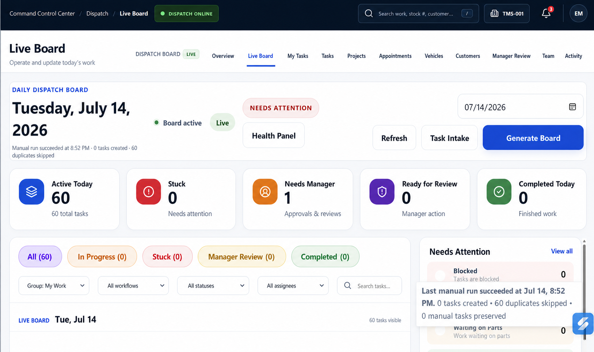

# Dispatch Live Board Navigation UI Source of Truth

**Status:** Approved source of truth  
**Approved:** 2026-07-14  
**Scope:** Persistent Dispatch Board console navigation within the Time Motor Sales Command Control Center shell
**Implementation state:** Implemented and verified in the CCC Dispatch shell

## Approved mockup

[](ui-mockups/dispatch-live-board-navigation-source-of-truth.png)

The approved image is stored at:

`docs/ui-mockups/dispatch-live-board-navigation-source-of-truth.png`

This image and record are the authoritative visual and product reference for navigation throughout the Dispatch Board console. Live Board is the active example shown in the approved image.

## Canonical navigation

The navigation must use the existing Dispatch destinations, in this exact order:

```text
Dispatch Board — LIVE
  Overview
  Live Board
  My Tasks
  Tasks
  Projects
  Appointments
  Vehicles
  Customers
  Manager Review
  Team
  Activity
```

## Approved design decisions

1. Use one horizontal navigation line at desktop widths.
2. Do not add a second launcher row or duplicate navigation below the page heading.
3. Show **Live Board** as the active destination while the user is operating the live board.
4. Use only the existing Dispatch destinations listed above. Do not invent, rename, or simulate modules.
5. Treat this as contextual navigation within Dispatch Board, not as global Command Control Center navigation.
6. Preserve the compact **Dispatch Board — Live** context treatment shown in the mockup.
7. Keep the canonical order when permissions hide a destination. **Manager Review** is available only to authorized users.
8. At narrower widths, the navigation may scroll, progressively collapse, or move into an accessible overflow control, but it must preserve the same order, active state, and access to every permitted destination.
9. Keep this navigation available across Dispatch destinations and nested workspaces so opening Tasks, Projects, Vehicles, Customers, or another Dispatch area never exposes the global CCC sidebar.
10. Provide a separate persistent **CCC Home** control in the global command bar. **CCC Home** exits Dispatch; **Overview** remains inside Dispatch.

## Intended destination map

| Destination | Intended route |
| --- | --- |
| Overview | `/board` |
| Live Board | `/board?view=live` |
| My Tasks | `/my-tasks` |
| Tasks | `/tasks` |
| Projects | `/projects` |
| Appointments | `/appointments` |
| Vehicles | `/vehicles` |
| Customers | `/customers` |
| Manager Review | `/manager-review` |
| Team | `/staff` |
| Activity | `/activity` |

The route map records current product intent. Implementation must verify existing application routes, permissions, and URL conventions before changing navigation behavior. Where practical, navigation should retain relevant board date or work context without carrying stale filters into unrelated workspaces.

## Product and data boundaries

- This record governs visual hierarchy, destination naming, order, placement, selected-state treatment, and responsive access.
- Existing backend services, route policies, permissions, business rules, and audit history remain authoritative for behavior and data.
- The mockup does not authorize placeholder pages, fabricated values, or bypassing role restrictions.
- Navigation changes must not alter Dispatch workflows or backend contracts without separate approval.

## Precedence

For Dispatch Live Board contextual navigation, this record supersedes the earlier four-tab treatment in [`COMMAND_CONTROL_CENTER_SHELL_UI_SOURCE_OF_TRUTH.md`](COMMAND_CONTROL_CENTER_SHELL_UI_SOURCE_OF_TRUTH.md).

It does not supersede that record's global Command Control Center shell, Dispatch Overview composition, umbrella product identity, or backend boundaries.

## Change control

Any future change to this approved navigation must update:

1. The approved mockup image.
2. This source-of-truth record.
3. The enterprise workspace registry when scope or precedence changes.
4. Implementation-status documentation only after the revised behavior is implemented and verified.
