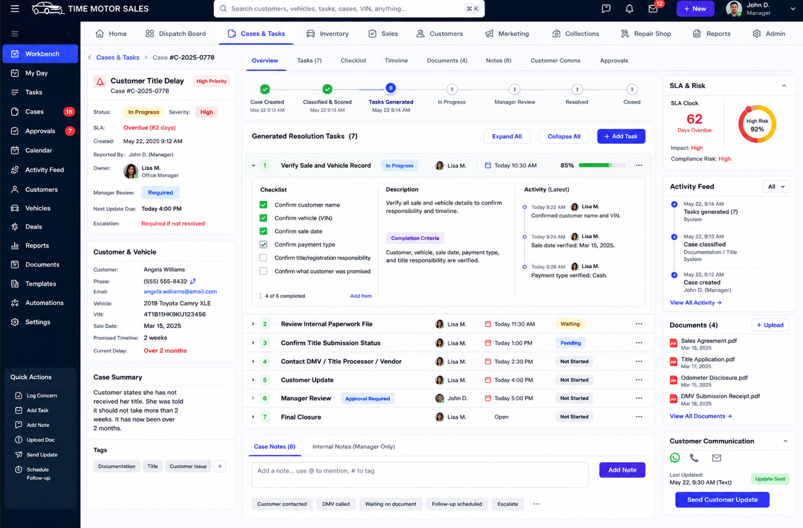

# Tasks Console UI Source of Truth

## Canonical Reference

The canonical detailed task/workbench design is:

This image is the default visual acceptance reference for `/tasks/[id]`. Implementations should adopt its information hierarchy, density, relative panel proportions, typography, and visible workflow controls before introducing alternative layouts.

## Required Structure

1. A dark global command bar occupies the true top edge of the workbench.
2. A light workflow and department strip appears directly below it with Home, Dispatch Board, Cases & Tasks, Inventory, Sales, Customers, Marketing, Collections, Repair Shop, Reports, and Admin.
3. A dark task-workbench navigation rail provides Workbench, My Day, Tasks, Cases, Approvals, Calendar, Activity Feed, Customers, Vehicles, and quick actions.
4. The working area uses three operational panels: case context, resolution execution, and command/risk context.
5. The center panel contains the case lifecycle, generated resolution tasks, Expand All, Collapse All, Add Task, an expanded task checklist/description/activity row, and compact case notes.
6. The right panel contains SLA and risk, activity, documents, customer communication channels, and workflow commands.

## Typography Contract

- Operational copy must be comfortably readable at normal browser zoom.
- Task titles, section titles, statuses, owners, due times, and action labels use semibold or bold weight.
- Supporting metadata may be smaller but must not drop below the workbench's documented readable scale.
- Density should come from spacing and alignment, not from illegibly small type.

## Checklist Contract

- Concern-engine tasks use their persisted, template-versioned concern checklist.
- Standalone and manually created tasks use the deterministic adaptive checklist blueprint selected from task title, description, and workflow area.
- Specialized blueprints cover repair/safety, title/documentation, customer contact, collections, inventory, and sales work, with a general operational fallback.
- AI assistance is not required for the MVP deterministic paths. A future AI module may suggest a draft only when no high-confidence rule matches; users must preview and approve it before persistence.

## Acceptance Gate

A workbench refinement is not complete until the canonical desktop composition, readable typography, live task controls, adaptive checklist content, and responsive behavior have browser proof.
