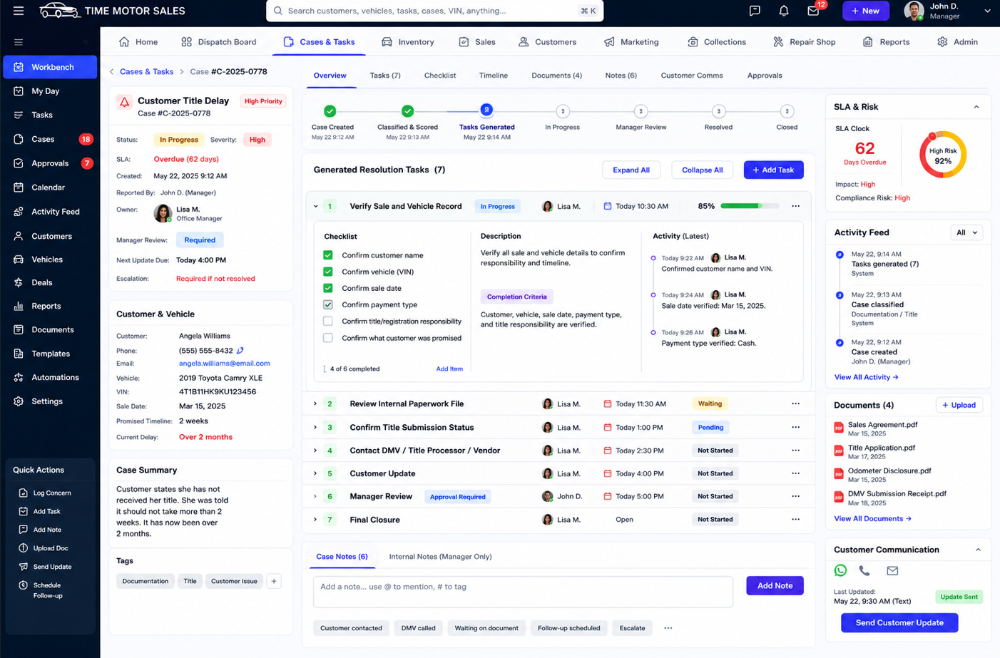

# Tasks Console UI Source of Truth

## Canonical Reference

The canonical detailed task/workbench design is:

This image is the default visual acceptance reference for `/tasks/[id]`. Implementations should adopt its information hierarchy, density, relative panel proportions, typography, and visible workflow controls before introducing alternative layouts.

## Required Structure

1. A dark global command bar occupies the true top edge of the workbench.
2. A light workflow and department strip appears directly below it with Home, Dispatch Board, Cases & Tasks, Inventory, Sales, Customers, Marketing, Collections, Repair Shop, Reports, and Admin.
3. A dark task-workbench navigation rail provides Workbench, My Day, Tasks, Cases, Approvals, Calendar, Activity Feed, Customers, Vehicles, and quick actions.
4. The working area uses three operational panels: case context, resolution execution, and command/risk context.
5. The center panel contains the case lifecycle, generated resolution tasks, Expand All, Collapse All, Add Task, an expanded task checklist/description/activity row, and compact case notes.
6. The right panel contains SLA and risk, activity, documents, customer communication channels, and workflow commands.

## Typography Contract

- Operational copy must be comfortably readable at normal browser zoom.
- Task titles, section titles, statuses, owners, due times, and action labels use semibold or bold weight.
- Supporting metadata may be smaller but must not drop below the workbench's documented readable scale.
- Density should come from spacing and alignment, not from illegibly small type.

## Checklist Contract

- Concern-engine tasks use their persisted, template-versioned concern checklist.
- Standalone and manually created tasks use the deterministic adaptive checklist blueprint selected from task title, description, and workflow area.
- Specialized blueprints cover repair/safety, title/documentation, customer contact, collections, inventory, and sales work, with a general operational fallback.
- AI assistance is not required for the MVP deterministic paths. A future AI module may suggest a draft only when no high-confidence rule matches; users must preview and approve it before persistence.

## Acceptance Gate

A workbench refinement is not complete until the canonical desktop composition, readable typography, live task controls, adaptive checklist content, and responsive behavior have browser proof.

## Task intake: actionable creation requirements

For `/tasks/intake`, scope and context appear directly in the capture form for non-quick tasks. Staff choose **Specific customer or vehicle**, **Inventory / multiple vehicles**, or **Operations / action plan**. Monthly plans can cover the whole operation or selected areas such as inventory, service and sales. Scope details default to the task description, with an optional override. Operating-area choices are collapsed until needed to keep capture compact.

Broad plans have real inventory/operational context: save `contextScope`, `contextDetails` and `contextAreas` with `contextOmitted: false`. They do not require a fabricated single vehicle reference or a declaration that vehicles are irrelevant. The **Operations / Action Plan** intake type starts with operations-wide scope. Specific references belong on the tasks that carry out the plan. The explicit no-linked-context checkbox remains available for work that truly does not need a customer/vehicle link. Quick tasks retain optional context in Task tools.

The server validates scope/area choices and rejects contradictory broad-scope/omitted-context declarations. Record-specific work still requires its context decision; assignment and approval permissions remain enforced. Scope is retained in the existing task template snapshot, exposed by the task read model, and displayed in task details. Older intake requests and saved tasks remain compatible. No database migration is required.

An attempted incomplete submission must show plain-language correction instructions and a working button for every missing requirement. Buttons reveal the appropriate tool when needed, then scroll and focus the actual input, approval checkbox, or field group. The readiness review also links to those controls. Validation messages derive from current values, so correcting one item removes that warning without another failed submission. Save/retry preserves the task title, description, owner, deadline and choices.

Regression proof: `npm run test:task-intake-ui` exercises restored manager-planning drafts, direct approval/context corrections, an explicit no-context choice, linked customer context, completion-detail corrections, quick-task creation, and retained entries after an API failure at desktop and mobile widths. The browser suite also covers operations-wide plans with an Inventory management subtask template, inventory-wide plans without fabricated vehicle links, and restored operating scope. Requests are synthetic and do not save real tasks. Focused task-intake unit/server-validation tests and an authenticated local form review with the real server payload normalizer complement the browser fixtures.
