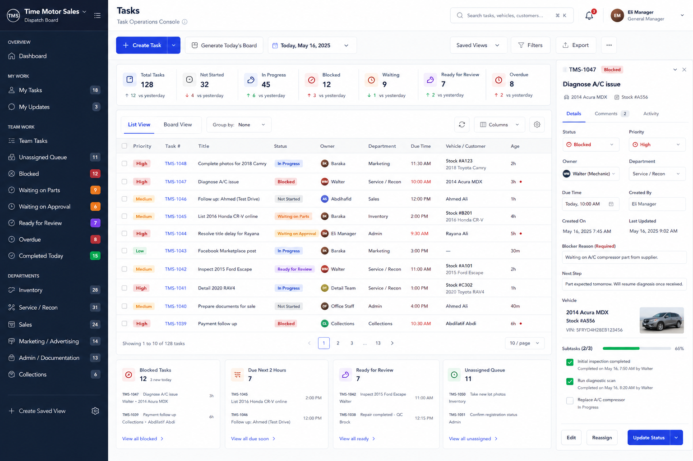

# Tasks UI Source Of Truth

**Document:** Tasks UI Source Of Truth  
**Last updated:** 2026-07-09  
**Status:** Active visual reference for Enterprise Tasks Module refinement  
**Parent product:** Time Motor Sales Dispatch Board

---

## 1. Purpose

This document defines the approved visual source of truth for the manager-facing Tasks experience inside the broader Dispatch Board.

Use it to:

- keep the `/tasks` experience visually aligned during implementation
- preserve the enterprise task-operations-console feel shown in the approved mockup
- separate authoritative layout guidance from non-authoritative placeholder content
- give Codex and human contributors one stable visual reference when refining the Tasks module

---

## 2. Approved reference image

Reference image:

- [`docs/images/TASKS_UI_SOURCE_OF_TRUTH.png`](/C:/Users/timem/OneDrive/Documents/GitHub/Dispatch%20Board/docs/images/TASKS_UI_SOURCE_OF_TRUTH.png)

Preview:



---

## 3. What is authoritative in this mockup

The mockup is authoritative for the following UI decisions:

- a manager-first task operations console that lives inside the shared Dispatch Board shell
- left navigation, top utility bar, central task workspace, and right-side task detail inspector
- a top command row with task creation, board generation, date context, saved views, filters, and export actions
- a KPI strip near the top with compact operational summary cards
- a dense main task table that still remains readable at a glance
- a right-side task detail rail that supports quick inspection and action without leaving the console
- a bottom operational follow-through row for exception queues and attention panels
- clean white cards, compact spacing, high scan value, and dealership-friendly enterprise density

---

## 4. What is not authoritative

The mockup should not be treated as truth for:

- exact task counts, KPI values, timestamps, or age numbers
- exact staff names, task titles, stock numbers, or customer references
- any action that is not yet implemented in the repository or approved roadmap
- fake queue data, placeholder subtasks, or placeholder vehicle imagery presented as production-ready features
- final API, schema, or server workflow decisions when they conflict with the module guide

If the mockup and implementation reality differ, preserve the visual intent while staying honest about real system state.

---

## 5. Visual rules we should preserve

When refining the Tasks console, preserve these traits from the mockup:

- the page should read as a command center, not a generic CRUD admin screen
- the most important controls should be visible without requiring a long first scroll
- summary cards should stay compact, comparable, and easy to scan
- the main task list should favor enterprise density without becoming cramped
- the right inspector should support action and context, not repeat the full table
- status, priority, and exception colors should help operational scanning without becoming noisy
- the bottom queue cards should feel like follow-through surfaces, not a second main workspace

---

## 6. Implementation guidance

Use this image as the visual source of truth for:

- `/tasks` layout proportions
- section ordering
- control grouping
- information density
- table-to-detail-rail relationship
- enterprise polish

Do not use this image as the source of truth for:

- inventing new data fields not grounded in the module guide
- implying completed queue, reporting, or export workflows that do not yet exist
- replacing the already-working board, My Tasks, or task-detail flows without a documented reason
- moving the Tasks module outside the parent Dispatch Board architecture

---

## 7. Relationship to the module guide

This document complements, but does not replace:

- [`docs/ENTERPRISE_TASKS_MODULE.md`](/C:/Users/timem/OneDrive/Documents/GitHub/Dispatch%20Board/docs/ENTERPRISE_TASKS_MODULE.md)

Use the module guide for:

- architecture
- milestone planning
- ownership boundaries
- implementation order
- honesty about what is already implemented

Use this document for:

- visual alignment
- UX refinement
- layout sanity checks
- manager-console fidelity

---

## 8. Working rule for future Tasks UI work

For every `/tasks` refinement task, use this rule:

```text
Use docs/images/TASKS_UI_SOURCE_OF_TRUTH.png as the visual source of truth
for layout, density, hierarchy, and enterprise task-console polish.

Use docs/ENTERPRISE_TASKS_MODULE.md as the implementation source of truth
for boundaries, architecture, milestones, and feature honesty.
```

