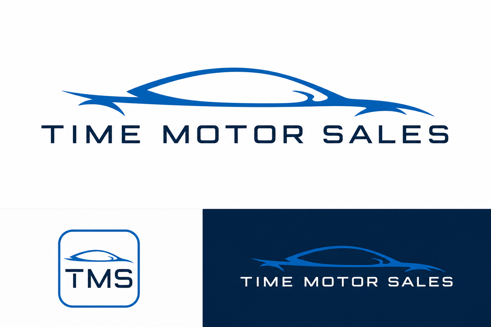

# Time Motor Sales Logo and CCC Brand Source of Truth

**Status:** Approved and implemented  
**Approved:** 2026-07-14  
**Scope:** Time Motor Sales Command Control Center, every operational console, authentication, and application/browser identity  
**Supersedes:** The temporary red `T` shell mark and text-only CCC branding

## Approved brand concept

The image above is the approval record for the responsive Time Motor Sales logo system. It governs the visual character, proportions, typography direction, automotive contour, compact mark, and dark-background treatment.

## Brand decision

Time Motor Sales retains the recognizable blue vehicle-profile identity while adopting a stronger, more legible, responsive enterprise treatment. The system uses:

- a simplified blue vehicle contour
- a strong geometric `TIME MOTOR SALES` wordmark
- an enterprise navy, automotive blue, and white palette
- a compact rounded-square `TMS` application mark
- a reversed horizontal treatment for dark CCC surfaces

No console may invent a separate company logo, recolor the mark to match its module, distort it, add a slogan, or replace it with a letter placeholder.

## Governed production assets

| Asset | Application path | Approved use |
| --- | --- | --- |
| Primary horizontal | `/brand/time-motor-sales-horizontal.png` | Light backgrounds, authentication, documents, and approved light surfaces. |
| Reversed horizontal | `/brand/time-motor-sales-horizontal-reversed.png` | Dark CCC command bar, CCC Home hero, and dark enterprise surfaces. |
| Compact mark | `/brand/time-motor-sales-mark.png` | Sidebars, collapsed navigation, narrow screens, and app identity. |
| Browser icon | `/brand/favicon-64.png` | Browser and compact application identity. |
| Apple touch icon | `/brand/apple-touch-icon.png` | Supported mobile saved-app identity. |

The reusable application component is `src/components/brand/time-motor-sales-logo.tsx`. New consoles must consume this shared component rather than embedding their own asset reference.

## Placement contract

1. The global CCC command bar displays the reversed horizontal identity on wide screens.
2. The command bar changes to the compact mark when space is constrained.
3. CCC Home and every operational console inherit the command-bar identity through the shared application shell.
4. CCC Home and console sidebars display the compact mark beside the relevant shell or console name.
5. The CCC Home hero may display the reversed horizontal identity as the primary enterprise signature.
6. Authentication displays the primary horizontal identity on its light surface.
7. Browser metadata uses the approved compact mark.
8. The logo always links to CCC Home when it is used as global shell navigation.

Console identity remains adjacent text. For example, the Dispatch console may say `Dispatch Board`, but it may not turn the corporate logo into a Dispatch-specific mark.

## Responsive behavior

- **Wide shell:** reversed horizontal identity in the command bar.
- **Medium and narrow shell:** compact TMS mark in a light, high-contrast plaque.
- **Sidebar:** compact mark remains visible when sidebar labels collapse.
- **Mobile navigation:** the command-bar mark remains visible even while the console sidebar is closed.

The logo must never be compressed non-proportionally, cropped through the vehicle contour or wordmark, or reduced until its lettering becomes illegible.

## Accessibility

- A logo that is the only accessible name for a control uses `Time Motor Sales` or `Time Motor Sales Command Control Center Home` as its accessible label.
- A logo beside equivalent visible text is decorative and uses an empty alternative description.
- Dark surfaces use the reversed treatment; navy text is not placed directly on the dark CCC background.
- Focus visibility belongs to the surrounding link or control and must not be removed.

## Color and treatment rules

- Use the approved blue, navy, and white treatment.
- Use flat color; do not introduce chrome, bevels, shadows, glows, or console-specific gradients inside the mark.
- Preserve clear space around the logo.
- Do not place the standard navy wordmark on a dark background.
- Do not place the reversed white wordmark on a light background.

## Master-artwork boundary

The approved concept and implemented assets are high-resolution transparent PNG artwork suitable for the current CCC application. A future professional brand-production pass should create mathematically clean SVG and vector-PDF masters from this approved design without changing its identity. That vectorization is a production-format improvement, not permission to redesign the logo.

## Change control

Changes to the vehicle contour, TMS mark, wordmark, color system, proportions, or placement contract require explicit approval and an update to this source-of-truth record. Routine responsive sizing that preserves these rules does not require a brand redesign decision.
