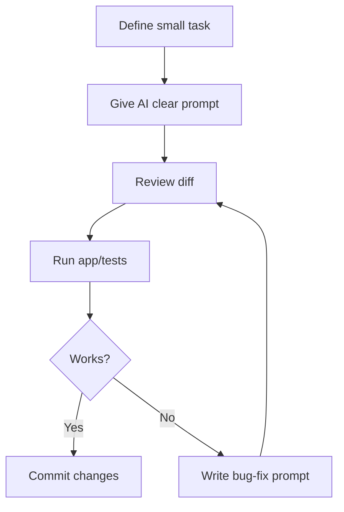

# Roadmap for Building an App Through Vibe Coding with Codex

You should treat **vibe coding with Codex** as a structured loop:

> **You are the product lead. Codex is the implementation partner.**

The mistake is letting Codex “just build the app.” The better workflow is to define the product, split it into small milestones, give Codex one scoped task at a time, review every diff, test it, commit it, then move on.

Codex works best when you give it clear task context, constraints, and completion criteria. A strong prompt usually includes:

- **Goal**
- **Context**
- **Constraints**
- **Done when**

---

## Phase 0 — Define the App Before Coding

Before opening Codex, write a lightweight product spec. This prevents the project from becoming a messy pile of random AI-generated features.

The AI can write code fast, but you are responsible for:

```txt
What should be built?
What should not be built?
What is broken?
What is acceptable?
What should be committed?
```

---

### The best vibe-coding loop



---

### Approach Apps/Websites in Layers

Do not start by asking AI to “build the whole app.”

Use this order:

```txt
1. Product Spec
2. MVP Scope
3. Architecture
4. Roadmap
5. Project scaffold
6. Core data model
7. Main workflow
8. UI shell
9. Error states
10. Tests
11. Polish
12. Packaging/deployment
```

---

### Good Project Docs for Vibe Coding

Create these early:

```txt
README.md
ARCHITECTURE.md
ROADMAP.md
AGENTS.md
docs/
  PRODUCT_SPEC.md
  MVP_SCOPE.md
  SETUP.md
```

Purpose:


| File              | Purpose                                  |
| ----------------- | ---------------------------------------- |
| `README.md`       | What the project is and how to run it    |
| `PRODUCT_SPEC.md` | What the app is supposed to do           |
| `MVP_SCOPE.md`    | What belongs in the first usable version |
| `ARCHITECTURE.md` | Frontend/backend/database structure      |
| `ROADMAP.md`      | Ordered tasks                            |
| `AGENTS.md`       | Rules for Codex/AI agents                |
| `SETUP.md`        | Installation and dev instructions        |

For a new app, your first documents should answer:

```md
# Product Spec

## What is this app?
A short explanation of the app in plain English.

## Who is it for?
The target user.

## Core problem
What problem does the app solve?

## MVP features
Only the minimum features needed for the first usable version.

## Non-goals
Things we are intentionally not building yet.

## Tech stack
Frontend:
Backend:
Database:
Auth:
Deployment:
Testing:

## Success criteria
The app is considered usable when...
```

For example, for a producer asset management app:

```md
The MVP lets a music producer add local sample folders, scan audio files, view metadata, search/filter the library, tag samples, and preview waveforms.
```

Do **not** start with “build me a full app.” Start with documents.

---

## Phase 1 — Set Up Codex Rules with `AGENTS.md`

Codex should have durable project instructions. Use `AGENTS.md` to define architecture rules, test expectations, coding standards, and project workflow.

Create an `AGENTS.md` like this:

```md
# AGENTS.md

## Project rules

- Read `README.md`, `ARCHITECTURE.md`, and `ROADMAP.md` before making changes.
- Do not make broad rewrites unless explicitly requested.
- Prefer small, reviewable commits.
- Keep frontend, backend, and database changes separated when possible.
- Do not add new dependencies without explaining why.
- Update tests when changing behavior.
- Update docs when changing architecture or setup.
- After changes, run the relevant test/typecheck/lint commands.
- If a task is ambiguous, create a plan first and ask for confirmation before editing.

## Git rules

- Create a new branch for each issue.
- Use descriptive branch names like `feature/library-scanner` or `fix/search-overflow`.
- Do not commit secrets, `.env` files, local databases, caches, or generated build files.

## Done means

A task is done only when:
- The requested behavior works.
- Relevant tests pass.
- The code is scoped and reviewable.
- No unrelated files were changed.
- Any necessary docs were updated.
```

This becomes your project’s “constitution.”

---

## Phase 2 — Choose the Right Codex Mode Per Task

Use different reasoning levels depending on task complexity.

| Task type | Recommended Codex mode |
|---|---|
| Rename component, fix CSS, simple bug | Low / Medium |
| Add one isolated feature | Medium |
| Debug broken behavior | High |
| Refactor architecture | High |
| Plan a milestone | High / Extra High |
| Investigate race conditions, worker bugs, async issues | Extra High |
| Generate docs or prompts | Medium / High |

For your style of app building, use **Plan mode first** for anything big. Planning first lets Codex gather context, ask questions, and form a stronger implementation plan before coding.

---

## Phase 3 — Break the App into Milestones

A good vibe-coding roadmap should look like this:

```md
# Roadmap

## v0.1.0 — Project foundation
- App scaffold
- Basic frontend shell
- Backend API scaffold
- Database setup
- Dev scripts
- Basic tests

## v0.2.0 — Core data model
- Main entities
- CRUD APIs
- Database migrations
- Seed/test data
- Basic UI integration

## v0.3.0 — Main workflow
- Core user action
- Background jobs if needed
- Progress state
- Error states
- Real data displayed in UI

## v0.4.0 — Search, filters, and organization
- Search
- Tags/categories
- Sorting/filtering
- Saved views if needed

## v0.5.0 — Polish and reliability
- Responsive UI
- Loading states
- Empty states
- Error handling
- Test coverage

## v0.6.0 — Packaging/deployment
- Build process
- Install/deploy docs
- Production config
- Release checklist
```

For each milestone, create GitHub issues or task cards. Each issue should be small enough that Codex can finish it without rewriting half the app.

---

## Phase 4 — Use a Repeatable Codex Prompt Format

Use this structure for almost every task:

```md
# Task: [Short name]

## Goal
Describe exactly what should change.

## Context
Relevant files:
- `path/to/file`
- `path/to/other/file`

Relevant behavior:
- Current behavior:
- Desired behavior:

## Constraints
- Keep the change minimal.
- Do not rewrite unrelated code.
- Follow existing patterns.
- Do not add dependencies unless necessary.
- Preserve existing tests.

## Implementation guidance
Suggested approach, if you have one.

## Done when
- Behavior works as described.
- Tests pass.
- Typecheck/lint passes if available.
- No unrelated changes are included.
- Docs are updated if needed.
```

---

## Phase 5 — Start with Planning Prompts, Not Coding Prompts

For big features, first ask Codex to inspect the project and produce a plan.

Example:

```md
Read `AGENTS.md`, `ARCHITECTURE.md`, and the current codebase.

I want to implement user authentication.

Do not make code changes yet.

Please:
1. Identify the relevant frontend, backend, database, and routing files.
2. Summarize the current architecture.
3. Propose a minimal implementation plan.
4. List any risks or unclear decisions.
5. Break the work into small steps.
6. Tell me which step should be implemented first.
```

Then review the plan. Only after that, give the implementation prompt:

```md
Proceed with Step 1 only.

Keep the change minimal and reviewable.
Do not implement future steps yet.

After the change, run the relevant tests and summarize:
- Files changed
- Behavior added
- Tests run
- Remaining work
```

This habit keeps vibe coding from becoming chaos.

---

## Phase 6 — Build the App in Vertical Slices

Do not build “all backend,” then “all frontend,” then “all polish.” Instead, build one usable workflow at a time.

A vertical slice means:

```txt
Database model
→ API endpoint
→ Frontend screen
→ User action
→ Error/loading states
→ Test
```

Example for a sample library app:

```txt
Add library folder
→ Save folder to database
→ Show folder in sidebar
→ Trigger scan
→ Show scan progress
→ Display indexed files
```

This is much better than asking Codex to build ten disconnected backend models before anything works.

---

## Phase 7 — Use Git Like a Safety Net

Every Codex task should happen on a branch.

Recommended flow:

```bash
git checkout main
git pull
git checkout -b feature/library-crud
```

Then give Codex the task.

After Codex finishes:

```bash
git status
git diff
npm test
npm run typecheck
git add .
git commit -m "Add library CRUD foundation"
```

Then merge only when you are confident:

```bash
git checkout main
git merge feature/library-crud
```

For vibe coding, Git is your undo button. Commit after every successful small step.

---

## Phase 8 — Review Codex Output Before Trusting It

After every task, ask Codex to review itself:

```md
Review your own changes.

Look specifically for:
1. Unrelated edits
2. Broken edge cases
3. Race conditions
4. Missing cleanup
5. Missing tests
6. UI regressions
7. Performance issues

Do not change code yet. First report findings.
```

Then use a second prompt:

```md
Fix only the issues you found that are directly related to this task.
Keep the patch minimal.
```

You can also use a separate Codex thread as a reviewer:

```md
Review the current diff as if you are doing a pull request review.

Focus on correctness, maintainability, tests, and edge cases.
Do not rewrite the code. Give review comments only.
```

Codex can review and debug code, but you should still act as the final reviewer.

---

## Phase 9 — Keep a Living Architecture Document

Every time the app changes meaningfully, update `ARCHITECTURE.md`.

Use this prompt:

```md
Read the current codebase and update `ARCHITECTURE.md`.

Do not invent planned features as completed.

Mark each section as:
- Complete
- Partial
- Not started

Include:
- Current frontend structure
- Current backend structure
- Data models
- API endpoints
- Background jobs
- Known limitations
- Next recommended milestones
```

This is especially important when vibe coding because the codebase can drift away from the original idea.

---

## Phase 10 — Use Issue-by-Issue Development

For each feature, use this lifecycle:

```txt
1. Idea
2. Product note
3. Technical plan
4. Codex implementation
5. Manual test
6. Automated test
7. Review
8. Commit
9. Update roadmap
10. Move to next issue
```

A good issue looks like this:

```md
# Issue: Add tag filtering

## User story
As a user, I want to filter samples by one or more tags so I can quickly find sounds.

## Current behavior
Tags are displayed but cannot be used as filters.

## Desired behavior
- User can select multiple tags.
- Selected tags filter the asset list.
- User can clear selected tags.
- Empty results show a useful message.

## Technical notes
- Reuse existing tag data model if available.
- Prefer server-side filtering if pagination exists.
- Avoid local-only filtering if it conflicts with backend search.

## Done when
- Multi-select tags work.
- Selected tags persist while browsing.
- Asset results update correctly.
- Tests cover filtering behavior.
```

Then give Codex the issue.

---

# The Best App-Building Order

## 1. Product Definition

Do this yourself with ChatGPT/Codex help.

Deliverables:

```txt
PRODUCT_SPEC.md
MVP_SCOPE.md
ROADMAP.md
```

## 2. Technical Architecture

Ask Codex to help choose structure, but do not let it over-engineer.

Deliverables:

```txt
ARCHITECTURE.md
Tech stack decision
Folder structure
Data model draft
API route draft
```

## 3. Project Scaffold

Codex can create the app shell.

Deliverables:

```txt
Frontend boots
Backend boots
Database connects
Dev commands work
Basic tests run
```

## 4. Core Models

Build the app’s nouns.

Examples:

```txt
User
Project
Library
Asset
Tag
Job
Notification
```

## 5. Core Workflow

Build the main thing the user does.

Examples:

```txt
Upload file
Create project
Scan folder
Send message
Track customer
Generate invoice
```

## 6. UI Shell

Build layout after the core workflow is understood.

Examples:

```txt
Sidebar
Main content
Detail panel
Settings page
Notification center
```

## 7. Search and Organization

Add power-user features only after the core workflow works.

Examples:

```txt
Search
Filters
Tags
Sorting
Saved views
Pagination
```

## 8. Reliability

This is where most vibe-coded apps become real apps.

Add:

```txt
Error handling
Loading states
Empty states
Validation
Retries
Cancellation
Background job cleanup
Tests
```

## 9. Polish

Make it feel good.

Add:

```txt
Responsive design
Keyboard shortcuts
Better spacing
Better copy
Animations
Accessibility
```

## 10. Release

Package or deploy.

Add:

```txt
Build scripts
Deployment guide
Environment variable docs
Release checklist
```

---

# How to Avoid Common Vibe Coding Problems

## Problem 1: Codex Changes Too Much

Use this constraint:

```md
Make the smallest possible change. Do not refactor unrelated code. If you think a larger refactor is needed, explain it first instead of doing it.
```

## Problem 2: Codex Breaks Working Features

Tell it:

```md
Before editing, identify existing behavior that must be preserved. After editing, list the behavior you verified still works.
```

## Problem 3: Features Work “Kind Of” But Have Edge-Case Bugs

Use:

```md
Now test this feature against edge cases:
- Empty state
- Large dataset
- Slow network/background job
- Failed request
- User cancels midway
- Repeated clicks
- Page refresh
- Concurrent actions
```

## Problem 4: UI Gets Cluttered

Use:

```md
Improve the UI while preserving behavior.

Priorities:
1. Reduce visual clutter.
2. Group related controls.
3. Hide advanced controls behind menus/dropdowns.
4. Preserve keyboard/mouse usability.
5. Make the layout responsive.
6. Avoid horizontal overflow.
```

## Problem 5: You Run Out of Codex Usage

Do more planning in ChatGPT first, then give Codex smaller, more precise implementation tasks.

Do not spend Codex time asking vague architecture questions when you can prepare the prompt outside Codex.

---

# Recommended Weekly Workflow

## Day 1 — Plan

- Pick one milestone.
- Break it into 3–6 issues.
- Write prompts for each issue.
- Decide what “done” means.

## Days 2–4 — Implement

For each issue:

```txt
Create branch
Run Codex plan
Approve implementation
Test manually
Ask Codex to self-review
Fix issues
Commit
```

## Day 5 — Stabilize

- Run full test suite.
- Fix regressions.
- Update docs.
- Clean up UI rough edges.

## Day 6 — Dogfood

Use the app like a real user.

Write down:

```txt
What felt broken?
What felt confusing?
What was slow?
What required too many clicks?
What crashed?
```

## Day 7 — Refine Roadmap

Update:

```txt
ROADMAP.md
ARCHITECTURE.md
Known bugs
Next milestone
```

---

# Recommended Codex Prompt Templates

## New Feature Prompt

```md
# Task: Implement [feature name]

Read `AGENTS.md`, `ARCHITECTURE.md`, and relevant files first.

## Goal
Implement [specific feature].

## Current behavior
[Describe what currently happens.]

## Desired behavior
[Describe what should happen.]

## Constraints
- Keep the change minimal.
- Follow existing architecture.
- Do not add new dependencies unless necessary.
- Do not rewrite unrelated files.
- Preserve existing behavior.
- Add or update tests where appropriate.

## Done when
- [Specific behavior works.]
- [Relevant tests pass.]
- [UI/API handles loading, empty, and error states if applicable.]
- Summarize files changed and tests run.
```

## Bug Fix Prompt

```md
# Task: Fix [bug]

Read `AGENTS.md` first.

## Bug
[Describe the bug.]

## Reproduction steps
1. ...
2. ...
3. ...

## Expected behavior
[What should happen.]

## Actual behavior
[What happens instead.]

## Constraints
- Diagnose root cause before changing code.
- Do not apply a superficial workaround unless necessary.
- Keep fix minimal.
- Add regression test if possible.

## Done when
- Bug no longer reproduces.
- Existing behavior still works.
- Relevant tests pass.
- Explain root cause and fix.
```

## Refactor Prompt

```md
# Task: Refactor [area]

Do not change behavior.

## Goal
Improve maintainability of [specific area].

## Constraints
- No user-facing behavior changes.
- No broad rewrites.
- Keep commits small.
- Preserve tests.
- If behavior must change, stop and explain why.

## Done when
- Code is simpler or better organized.
- Tests still pass.
- You summarize what changed and why.
```

## UI Polish Prompt

```md
# Task: Polish [screen/component]

## Goal
Improve layout, spacing, responsiveness, and clarity.

## Current issues
- ...
- ...

## Constraints
- Preserve existing functionality.
- Avoid unnecessary new components.
- Avoid horizontal overflow.
- Support small and large viewport sizes.
- Keep visual style consistent with the app.

## Done when
- UI behaves correctly at common viewport sizes.
- No content is cut off.
- Important actions remain visible.
- Existing interactions still work.
```

---

# The Ideal Codex Development Loop

Use this loop over and over:

```txt
1. Ask ChatGPT to shape the idea.
2. Turn the idea into a clear Codex prompt.
3. Run Codex in Plan mode.
4. Review the plan.
5. Let Codex implement one small piece.
6. Run tests.
7. Manually test the app.
8. Ask Codex to review the diff.
9. Fix issues.
10. Commit.
11. Update docs.
12. Repeat.
```

The main mindset shift is this:

> **Do not vibe code by asking Codex to build the whole app. Vibe code by using Codex to complete one well-described issue at a time.**
