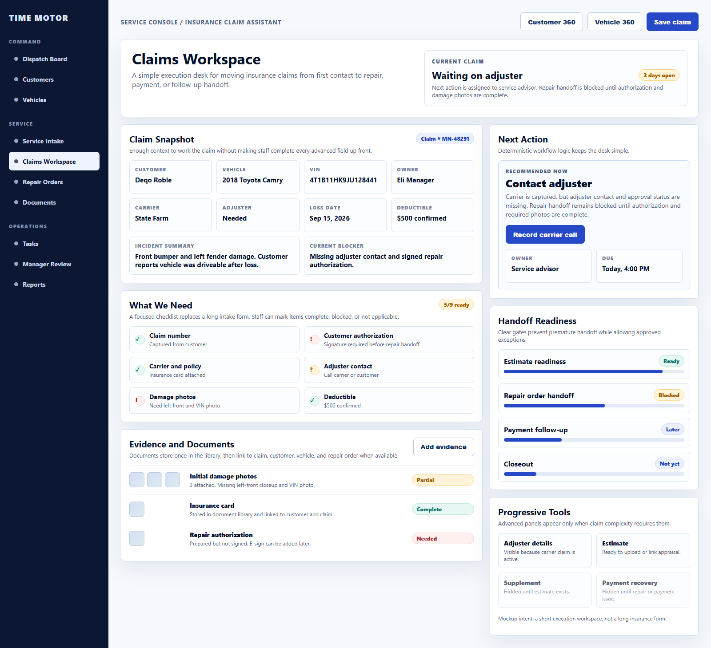
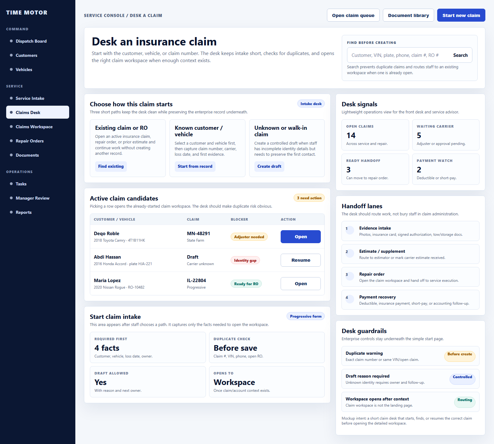
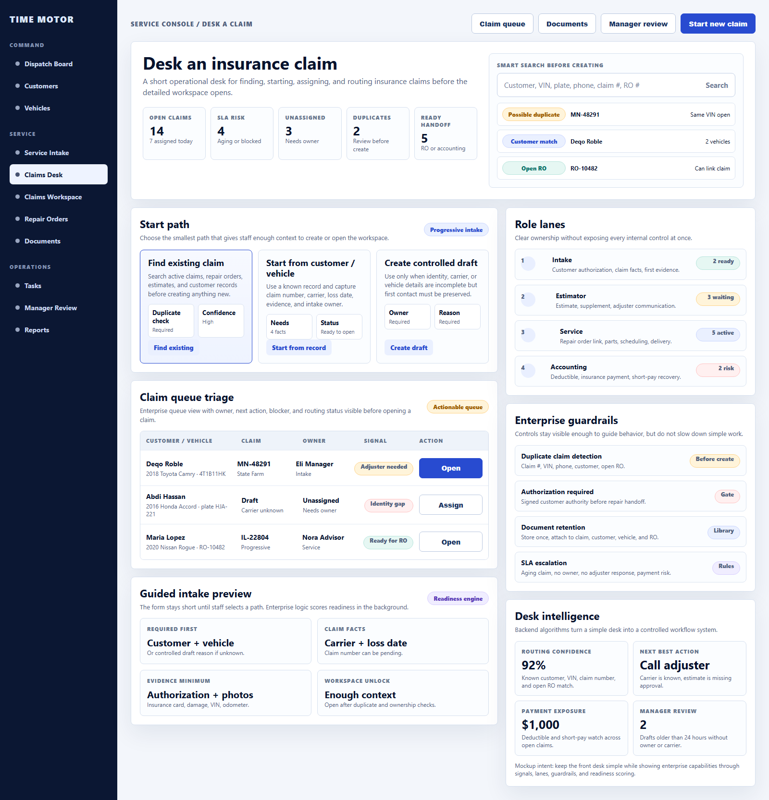

# Claims Workspace UX Source of Truth

**Status:** Adopted review baseline  
**UX principle:** simple execution first, progressive enterprise depth as complexity unfolds.

## Adopted Mockup



This image is the official visual source of truth for the first review implementation of Claims Workspace v1.

The implementation may adapt spacing, exact copy, and responsive layout to the application shell, but it must preserve the information hierarchy:

1. Claim Snapshot
2. What We Need
3. Evidence and Documents
4. Next Action
5. Handoff Readiness
6. Progressive Tools

## Desk / Start Claim Mockup



This image is the official visual source of truth for the claim landing page and the selected implementation direction.

### Enterprise Refinement Reference



This v2 mockup is retained only as a reference for background enterprise capabilities. It is not the selected primary UI direction because the v1 desk is cleaner and better suited to daily staff execution.

- command-center signals for open claims, SLA risk, unassigned work, duplicate alerts, and ready handoffs;
- smarter search results grouped by duplicate risk, customer match, and open repair order;
- role lanes for intake, estimator, service, and accounting ownership;
- visible guardrails for duplicate detection, authorization, retention, and escalation;
- desk intelligence for routing confidence, next best action, payment exposure, and manager review.

The desk page is intentionally separate from the opened claim workspace. Its job is to help staff:

1. search before creating a duplicate claim;
2. resume an existing claim, repair order, or estimate;
3. start from a known customer / vehicle record;
4. create a controlled draft when the customer, vehicle, or carrier details are incomplete.

The desk page should stay short. It should gather only the minimum facts needed to open or route the correct claim workspace.

## Primary Anchor

Claims Workspace starts from:

```text
Service Console -> Intake / Start Work -> Insurance Claim
```

It should not be anchored primarily in Start a Deal. Insurance claims can create revenue, but the operational center is service intake, claim evidence, repair readiness, and payment recovery.

## Secondary Anchors

Claims must appear where staff naturally search:

- Customer 360;
- Vehicle 360;
- Repair Order when linked;
- Document Library;
- later, a Claims queue or left-sidebar item if claim volume justifies daily dedicated navigation.

## First Screen

The first workspace view should be short and operational, not a long form.

Visible sections:

1. Claim Snapshot
2. What We Need
3. Evidence
4. Next Action
5. Handoff

## Section Contracts

### Claim Snapshot

Purpose: identify the claim quickly.

Show:

- customer;
- vehicle;
- claim number;
- carrier;
- adjuster;
- loss date;
- deductible;
- current stage;
- owner;
- blocker.

The snapshot should be compact and scannable. It should not ask staff to complete every possible claim field before they can move forward.

### What We Need

Purpose: make missing information obvious.

Checklist items:

- customer authorization;
- claim number;
- insurance carrier;
- adjuster name and contact;
- insurance card or policy reference;
- damage photos;
- VIN / odometer photo;
- estimate or appraisal;
- deductible confirmed;
- tow or storage documents if applicable;
- police report if applicable.

Checklist items should have simple states:

- needed;
- received;
- not applicable;
- blocked.

### Evidence

Purpose: collect proof without forcing staff into a long narrative.

Evidence capture should support:

- photo upload;
- document upload;
- damage-area notes;
- evidence category;
- required vs optional marker;
- attachment to claim, customer, vehicle, and repair order once linked.

### Next Action

Purpose: show the work to do now.

Allowed next-action states:

- waiting on customer;
- waiting on carrier;
- waiting on adjuster;
- ready for estimate;
- waiting on supplement;
- ready for repair order;
- waiting on deductible/payment;
- ready to close;
- manager review needed.

The workspace should always make the current owner and next action visible.

### Handoff

Purpose: move the claim from intake into execution.

Handoff targets:

- service advisor;
- estimator;
- repair order;
- parts;
- accounting / receivables;
- customer follow-up;
- manager review.

The handoff area should show whether required gates are complete. It should allow staff to see why a handoff is blocked without opening multiple tabs.

## Progressive Disclosure

Advanced panels should appear only when useful:

- **Adjuster panel** appears when carrier information is entered.
- **Supplement panel** appears after estimate upload or carrier review.
- **Payment panel** appears when deductible, payment, short-pay, or receivable status matters.
- **Repair link panel** appears after the claim is ready for repair order handoff.
- **Escalation panel** appears when the claim ages, is blocked, or needs management authority.

## Empty, Loading, and Error States

The UI must be honest:

- no fake claim data;
- no fake carrier responses;
- no fake payment status;
- no hidden required evidence;
- denied actions must explain who can perform the action;
- unavailable integrations must show manual fallback.

## Mobile and Photo Capture

The first desktop workspace can be primary, but photo capture should be designed with mobile in mind.

Expected future mobile actions:

- take exterior photos;
- take VIN and odometer photos;
- upload documents;
- mark checklist items complete;
- add a damage note.

## Visual Direction

The visual style should be calm, operational, and dense enough for repeated use.

- avoid a marketing-style hero;
- avoid a long vertical intake form;
- use compact panels and clear status markers;
- keep primary action visible;
- expose deeper panels only after context requires them;
- use existing Dispatch Board design language.
