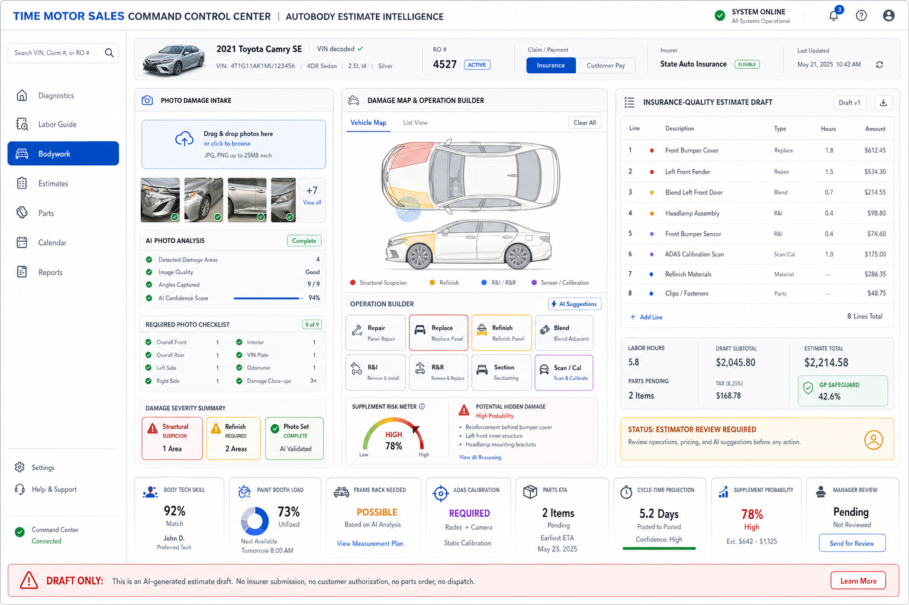

# Autobody Estimate Intelligence Landing Page UI Source of Truth

**Status:** Provisionally approved official mockup  
**Date adopted:** 2026-07-21  
**Branch:** `codex/diagnostics-dgn-039-autobody-estimate-capability-planning`  
**Applies to:** Release 3, `DGN-039` Enterprise Labor Guide expansion for autobody, collision, paint/refinish, structural/frame, ADAS/calibration, supplement, and insurance-quality estimate intelligence.

**Backend and algorithm context:** [`implementation/DGN_039_AUTOBODY_ESTIMATE_CAPABILITY_PLANNING.md`](implementation/DGN_039_AUTOBODY_ESTIMATE_CAPABILITY_PLANNING.md)

## Adopted Mockup

## Product Decision

This image is adopted as the official early landing-page UI direction for the **Autobody Estimate Intelligence** section inside the Diagnostics / Estimate Intelligence console.

It is a source of truth for product direction, information architecture, landing-page zones, user role boundaries, and enterprise visual tone. It is not yet a pixel-perfect production specification.

The mockup establishes autobody estimating as a first-class enterprise repair domain, parallel to mechanical labor intelligence, with photo-driven damage intake and insurance-quality estimate draft preparation.

## Why This Direction Is Adopted

The approved mockup correctly positions the autobody console as more than a static body labor calculator.

It captures:

- VIN, RO, claim/customer-pay, insurer, and vehicle context;
- uploaded damage photo intake;
- photo analysis status and required photo checklist;
- visible damage severity and structural suspicion;
- damage map and affected-panel visualization;
- repair, replace, refinish, blend, R&I, R&R, section, and scan/calibration operation building;
- insurance-quality estimate draft lines;
- labor hours, parts pending, subtotal, tax, and GP safeguard visibility;
- supplement probability;
- ADAS calibration and scan gate;
- body technician, paint booth, frame rack, parts ETA, cycle-time, and manager-review signals;
- clear draft-only authority boundary.

## Required Product Principles

The implemented UI must preserve these principles:

1. Photo-to-estimate assistance remains estimator-reviewed.
2. Uploaded photos may produce draft recommendations, not official estimates.
3. Damage analysis, structural suspicion, supplement probability, and ADAS triggers must be explainable.
4. Insurance-quality output must remain a draft until reviewed and approved through the proper authority.
5. Parts pending does not mean parts ordered.
6. Cycle-time projection does not mean work scheduled.
7. Body shop dispatch does not occur from this screen alone.
8. GP safeguards and manager review remain visible.
9. No unlicensed proprietary estimating data, vendor UI, or OEM procedure content may be embedded.
10. Every estimate line must be traceable to photo evidence, estimator action, operation logic, source version, or approved override.

## Required Landing Page Zones

The final implemented screen should retain these major zones:

| Zone | Purpose |
| --- | --- |
| Header / Context Bar | VIN, vehicle, RO, claim/customer-pay, insurer, system health, and last-updated status. |
| Left Sidebar | Diagnostics navigation with Bodywork clearly selected. |
| Photo Damage Intake | Damage image upload, photo thumbnails, photo quality, missing-angle checklist, and photo-analysis status. |
| Damage Severity Summary | Structural suspicion, refinish requirement, photo set completeness, and estimator attention flags. |
| Damage Map | Vehicle panel visualization, affected zones, sensor zones, and severity coloring. |
| Operation Builder | Repair, replace, refinish, blend, R&I, R&R, section, scan/calibration, and supplement operations. |
| Estimate Draft | Insurance-quality draft lines, labor hours, parts pending, subtotals, tax, GP safeguard, and estimator-review status. |
| Productivity Band | Body tech skill, booth load, frame rack, ADAS calibration, parts ETA, cycle-time, supplement probability, and manager review. |
| Authority Boundary | Draft-only warning blocking insurer submission, customer authorization, parts ordering, dispatch, and scheduling. |

## Required Backend Implications

The UI implies these backend capabilities must eventually exist before production activation:

- photo evidence ingestion and retention controls;
- photo quality and missing-angle checklist;
- damage-zone and panel mapping;
- optical damage analysis result model;
- repair-vs-replace decision support;
- refinish, blend, and material calculation model;
- R&I/R&R overlap logic;
- structural/frame suspicion and measurement requirements;
- ADAS scan/calibration triggers;
- supplement likelihood and hidden damage flags;
- insurance/customer-pay workflow separation;
- estimator and manager review records;
- draft estimate lineage and checksums;
- authority-bound handoff to existing estimate, parts, dispatch, scheduling, and authorization systems.

## Implementation Boundary

When implemented, this screen may create or revise an autobody estimate-intelligence draft only through governed estimate-intelligence and downstream estimate authority contracts.

It must not directly:

- submit an estimate to an insurer;
- present an official estimate to a customer;
- request customer authorization;
- order or reserve parts;
- assign or dispatch body technicians;
- reserve paint booth, frame rack, or calibration resources;
- schedule the repair;
- promise completion;
- close quality control;
- release the vehicle.

Those actions remain owned by their existing or future Dispatch Board authorities.

## Acceptance Notes

Before production activation, this UI direction still requires:

- estimator usability review;
- service advisor usability review;
- body technician review;
- paint/refinish workflow review;
- manager review of GP, supplement, and cycle-time language;
- accessibility contrast and keyboard checks;
- representative browser validation;
- mobile/tablet intake adaptation;
- legal/licensing review for all labor, OEM, insurer, and photo-analysis source data;
- pilot validation against real dealership bodywork cases.

