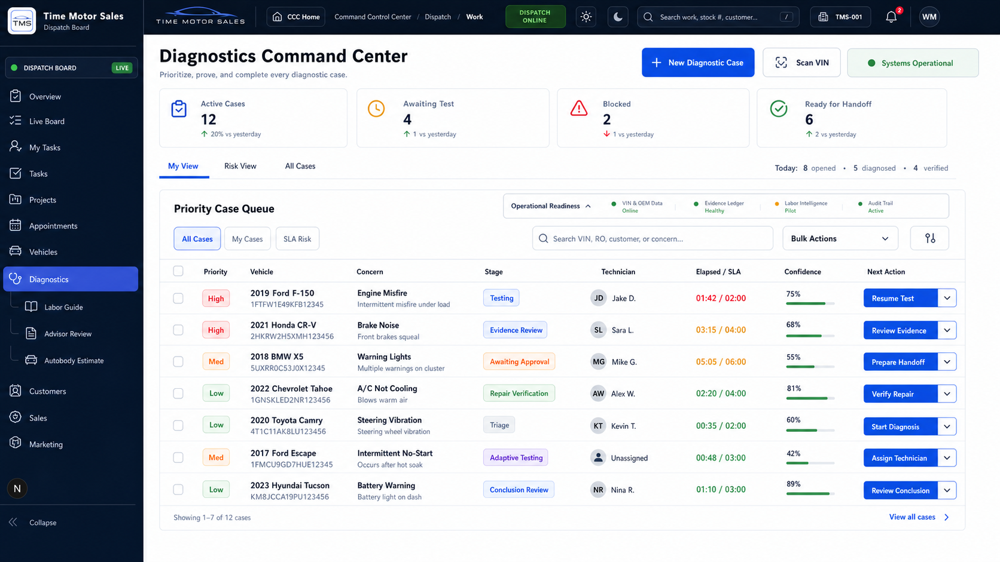

# Diagnostics Command Center UI Source of Truth

**Status:** Approved and adopted  
**Approved:** 2026-07-21  
**Route:** `/diagnostics`  
**Asset:** `docs/diagnostics/assets/diagnostics-command-center-approved-mockup.png`

## Authority

This mockup is the official visual and interaction source of truth for the Diagnostics landing page. Implementations must preserve its command-center hierarchy, queue-first operating model, compact information density, light main canvas, and existing Time Motor Sales application shell.

The visual source of truth does not authorize invented diagnostic facts, confidence percentages, SLA targets, system-health claims, or production rollout. Live values must come from governed application records. When a value is not established, the interface must state that it is not assessed or not configured.

## Required Page Structure

1. Command header with **New Diagnostic Case**, **Scan VIN**, and operational status.
2. Compact case counters for active, awaiting test, blocked, and ready for handoff.
3. Role-aware **My View**, **Risk View**, and **All Cases** tabs.
4. Full-width **Priority Case Queue** as the dominant workspace.
5. Search, operational filters, row selection, and authorized bulk actions.
6. Non-obstructive operational readiness for VIN/OEM data, evidence, labor intelligence, and the audit trail.
7. One contextual next action per row.
8. Existing Diagnostics submodules remain accessible from the left navigation; duplicate landing cards are not required.

## Live Interaction Contract

| Control | Required behavior |
| --- | --- |
| New Diagnostic Case | Opens `/diagnostics/intake`, the governed vehicle, concern, service-context, safety, authorization, triage, and case-creation workflow. |
| Scan VIN | Opens the vehicle discovery/VIN workflow with Diagnostics intent. |
| System status | Expands or collapses operational readiness without covering queue content. |
| KPI cards | Filter the queue to the selected operational condition. |
| View tabs | Apply role-aware ownership and risk scopes. |
| Search | Filters vehicle, VIN, repair order, concern, and technician fields locally and responsively. |
| Queue filters | Apply all, mine, and risk scopes without a page reload. |
| Selection | Supports individual and select-all-visible case selection. |
| Bulk actions | Execute only authorized, rollout-enabled operations and report success or failure. |
| Vehicle/case link | Opens the governed technician diagnostic workspace. |
| Contextual row action | Opens the correct case stage; unassigned cases may be assigned through the governed assignment command. |
| View all cases | Clears search and operational filters and opens the all-cases view. |

## Enterprise Backend Contract

The landing page consumes and exposes, but does not bypass:

- tenant- and location-scoped case visibility;
- role and explicit capability checks;
- feature rollout controls;
- immutable command, domain-event, and audit records;
- optimistic concurrency and idempotency;
- diagnostic case ownership and governed state transitions;
- evidence, test, reasoning, adaptive-test, conclusion, repair-handoff, advisor-estimate, and verification services;
- operational outbox and projection health;
- explicit abstention when evidence or confidence is not established.

## Responsive Contract

- Desktop keeps the full queue visible and prioritizes operational density.
- Medium screens retain the same controls and use horizontal queue scrolling where necessary.
- Small screens stack command actions, metrics, readiness, and filters while preserving all actions and accessible labels.

## Safety and Integrity Rules

- A disabled mutation must identify rollout or authority as the reason.
- The interface must never convert UI confidence styling into a diagnostic conclusion.
- No mock vehicle, VIN, technician, SLA, or diagnostic result may be inserted into the live page.
- Bulk actions must use the same governed APIs as the individual case workspace.
- The command center is a coordination surface; evidence capture, testing, conclusions, handoffs, estimates, and verification remain governed inside their dedicated workflows.
