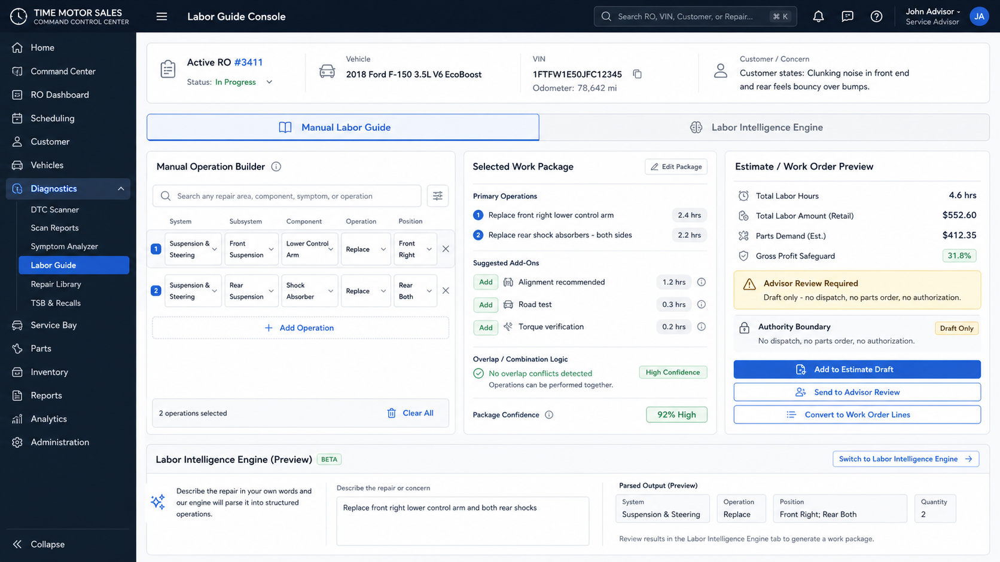

# Enterprise Dual Labor Guide UI Source of Truth

**Status:** Approved official UI mockup and implementation source of truth
**Date adopted:** 2026-07-21
**Latest adoption update:** 2026-07-21
**Branch:** `codex/diagnostics-labor-guide-optimization-audit`
**Applies to:** Release 3 labor guide optimization and the `/diagnostics/labor-guide` route.

**Backend context:** [`DIAGNOSTICS_ENTERPRISE_LABOR_GUIDE_UI_BACKEND_CONTEXT.md`](DIAGNOSTICS_ENTERPRISE_LABOR_GUIDE_UI_BACKEND_CONTEXT.md)

## Adopted Mockups

### Approved Dual-Mode Labor Guide Console

This image is the current official source of truth for the Labor Guide Console. The implemented `/diagnostics/labor-guide` route must present the Labor Guide as one console with two modes:

- **Manual Labor Guide** for exact system, subsystem, component, operation, position, and quantity selection.
- **Labor Intelligence Engine** for plain-language repair requests, customer concerns, and inspection findings that generate advisor-reviewable labor packages.

### Historical Light Background Direction

### Historical Dark Background Reference

## Product Decision

The dual-mode image is adopted as the official UI direction for the **Enterprise Labor Guide Console** inside the Diagnostics Console.

The older light-background and dark-background mockups remain retained as historical references because they established the command-center tone, active RO context, labor intelligence concepts, and authority boundaries.

These images are a source of truth for product direction, information architecture, role separation, and enterprise visual tone. They are not yet pixel-perfect production specifications.

Backend behavior, data ownership, DVI-to-estimate conversion, labor calculations, parts query boundaries, and audit requirements are governed by the companion backend context document linked above.

## Why This Direction Is Adopted

The approved dual-mode mockup captures the Labor Guide Module as a usable labor console instead of a static labor lookup table.

It correctly combines:

- VIN/YMM and active Repair Order context;
- manual system/component/operation/position labor selection;
- a Labor Intelligence Engine that can parse a natural-language request such as "replace front right lower control arm and both rear shocks";
- category-specific work package generation from either manual repair selection or Labor Intelligence Engine concern parsing;
- labor hours, parts demand, add-ons, and overlap review;
- overlap and teardown logic;
- advisor estimate and work-order preview;
- explicit authority boundary language;
- advisor review, estimate draft, work-order handoff, and RO / estimate opening for customer authorization after the draft is reviewed.

## Required Product Principles

The implemented UI must preserve these principles:

1. Labor intelligence remains explainable.
2. The advisor draft is not the official customer estimate.
3. No parts order, dispatch action, authorization, or customer promise is created from this screen alone.
4. Labor guide facts must show source, confidence, and version.
5. Dynamic labor pricing must be visible, not hidden.
6. GP safeguards must warn or require review without silently certifying profitability before parts, rate, and cost basis are available.
7. Technicians, advisors, managers, and dispatchers must see role-appropriate actions.
8. The user must not be forced to browse a system tree when they already know the requested repair.
9. Natural-language repair requests must produce structured, reviewable labor package candidates rather than opaque AI text.

## Required Landing Page Zones

The final implemented screen should retain these major zones:

| Zone | Purpose |
| --- | --- |
| Header | VIN/YMM search, vehicle identity, active RO, system health, and user context. |
| Left rail | Console navigation with Labor Guide clearly selected. |
| Mode switch | Manual Labor Guide and Labor Intelligence Engine entry points. |
| Manual operation builder | System, subsystem, component, operation, and position controls for exact line creation. |
| Labor Intelligence Engine | Plain-language repair/concern/finding input that produces structured work package candidates. |
| Selected work package | Primary operations, add-ons, overlap logic, and confidence review. |
| Estimate / work-order preview | Labor hours, labor amount, parts demand, GP safeguard, authority boundary, and downstream handoff buttons. |

## Implementation Boundary

When implemented, this screen may create or revise a Diagnostic Estimate Draft only through the governed DGN-035–037 advisor estimate foundation.

It must not directly:

- present a customer estimate;
- request customer approval;
- create a repair job;
- order or reserve parts;
- assign or dispatch a technician;
- schedule an appointment;
- promise completion.

Those actions remain owned by their existing Dispatch Board authorities.

## Live Diagnostic-System Navigation

The Labor Guide Console uses active system and operation knowledge rather than a static mockup. It must:

- cover the major mechanical, electrical, network, chassis, HVAC, ADAS, hybrid/EV, diesel, NVH, body/safety, maintenance, and collision/refinish systems;
- expand each system into selectable diagnostic operations with common concerns, initial tests, skills, tools, and verification expectations;
- search across system titles, descriptions, symptoms, aliases, and operations;
- support specific repair operations such as "replace front right lower control arm" and "replace rear shock absorbers - both sides";
- provide an "open all repair categories" manual path where systems expand into selectable operation-level choices;
- provide a governed custom-repair or custom-investigation fallback when no standard category matches instead of forcing an incorrect classification;
- update labor, scope, complexity, requirements, draft, comparison, and history panels when an operation is selected;
- load the active repair order from the authoritative repair-order service and link its RO number to the complete Repair Order Workbench;
- route advisor-draft creation to Advisor Review with the selected operation and repair-order context;
- provide a direct route back to the complete RO / estimate when the advisor is ready to seek customer authorization;
- remain advisory-only until the established estimate, authorization, parts, and dispatch authorities accept the handoff.

## Labor Intelligence Engine Acceptance

The Labor Intelligence Engine must classify user input into one of three entry types:

- Requested repair.
- Customer concern.
- Inspection finding.

For requested repairs, the engine should generate labor/estimate work package candidates directly. For customer concerns, it should prefer diagnostic or inspection workflow recommendations. For inspection findings, it should preserve evidence and recommend repair operations with an advisor-review requirement.

## Acceptance Notes

Before production activation, this UI direction still requires:

- advisor usability review;
- technician usability review;
- manager review of labor GP and override language;
- mobile/tablet adaptation;
- accessibility contrast and keyboard checks;
- representative browser validation;
- confirmation that no unlicensed labor-guide or OEM diagram content is embedded.
