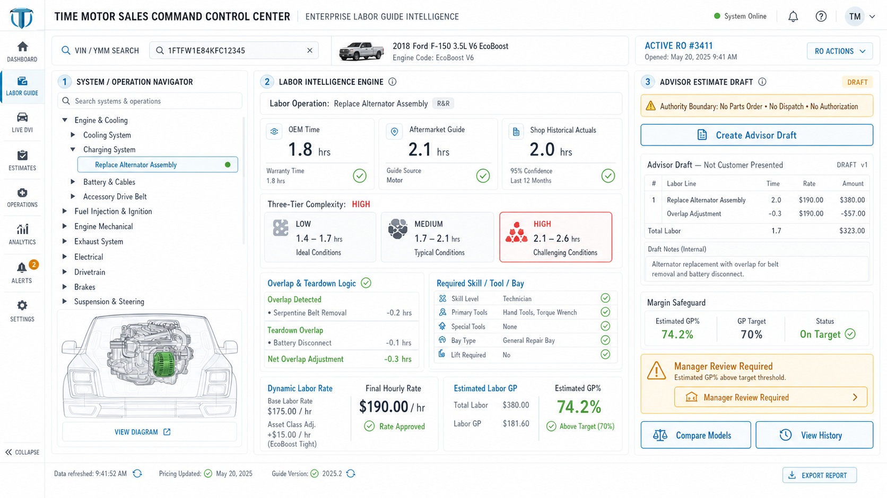
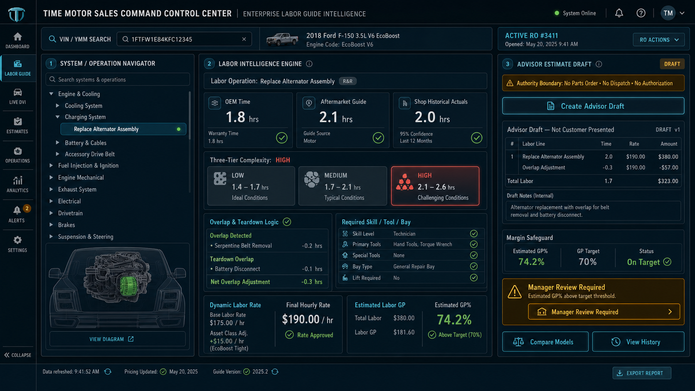

# Enterprise Labor Guide Landing Page UI Source of Truth

**Status:** Provisionally approved official mockup  
**Date adopted:** 2026-07-21  
**Branch:** `codex/diagnostics-dgn-038-039-labor-guide-ui-planning`  
**Applies to:** Release 3, `DGN-038` selectable estimate strategy direction and `DGN-039` Enterprise Labor Guide Module.

**Backend context:** [`DIAGNOSTICS_ENTERPRISE_LABOR_GUIDE_UI_BACKEND_CONTEXT.md`](DIAGNOSTICS_ENTERPRISE_LABOR_GUIDE_UI_BACKEND_CONTEXT.md)

## Adopted Mockups

### Primary Light Background Direction

### Original Dark Background Reference

## Product Decision

The light-background image is adopted as the preferred official landing-page UI direction for the **Enterprise Labor Guide Intelligence Module** inside the Diagnostics Console.

The original dark-background mockup remains retained as a secondary style reference because it established the approved information architecture, role separation, and enterprise command-center tone.

These images are a source of truth for product direction, information architecture, role separation, and enterprise visual tone. They are not yet pixel-perfect production specifications.

Backend behavior, data ownership, DVI-to-estimate conversion, labor calculations, parts query boundaries, and audit requirements are governed by the companion backend context document linked above.

## Why This Direction Is Adopted

The approved light mockup captures the Labor Guide Module as a true labor intelligence console instead of a static labor lookup table.

It correctly combines:

- VIN/YMM and active Repair Order context;
- system/component labor operation navigation;
- OEM time, aftermarket guide time, and shop historical actuals;
- three-tier complexity classification;
- overlap and teardown logic;
- required skill, tool, and bay needs;
- dynamic labor rate and labor GP visibility;
- advisor estimate draft panel;
- explicit authority boundary language;
- manager-review and model-comparison controls.

## Required Product Principles

The implemented UI must preserve these principles:

1. Labor intelligence remains explainable.
2. The advisor draft is not the official customer estimate.
3. No parts order, dispatch action, authorization, or customer promise is created from this screen alone.
4. Labor guide facts must show source, confidence, and version.
5. Dynamic labor pricing must be visible, not hidden.
6. GP safeguards must warn or require review without silently changing the customer estimate.
7. Technicians, advisors, managers, and dispatchers must see role-appropriate actions.

## Required Landing Page Zones

The final implemented screen should retain these major zones:

| Zone | Purpose |
| --- | --- |
| Header | VIN/YMM search, vehicle identity, active RO, system health, and user context. |
| Left rail | Console navigation with Labor Guide clearly selected. |
| Operation navigator | System/component hierarchy and selectable labor operation. |
| Diagram placeholder | Vehicle/system visual context without relying on unlicensed OEM diagrams. |
| Labor intelligence engine | OEM/guide/history comparison, tier, overlap, skill/tool/bay, dynamic rate, and GP. |
| Advisor draft panel | Estimate draft lines, boundary warnings, margin safeguard, manager review, compare models, and history. |

## Implementation Boundary

When implemented, this screen may create or revise a Diagnostic Estimate Draft only through the governed DGN-035–037 advisor estimate foundation.

It must not directly:

- present a customer estimate;
- request customer approval;
- create a repair job;
- order or reserve parts;
- assign or dispatch a technician;
- schedule an appointment;
- promise completion.

Those actions remain owned by their existing Dispatch Board authorities.

## Live Diagnostic-System Navigation

The System / Operation Navigator is an active, server-provided diagnostic catalog rather than a static mockup. It must:

- cover the major mechanical, electrical, network, chassis, HVAC, ADAS, hybrid/EV, diesel, NVH, body/safety, maintenance, and collision/refinish systems;
- expand each system into selectable diagnostic operations with common concerns, initial tests, skills, tools, and verification expectations;
- search across system titles, descriptions, symptoms, aliases, and operations;
- provide a governed custom-investigation fallback when no standard category matches instead of forcing an incorrect classification;
- update labor, scope, complexity, requirements, draft, comparison, and history panels when an operation is selected;
- load the active repair order from the authoritative repair-order service and link its RO number to the complete Repair Order Workbench;
- route advisor-draft creation to Advisor Review with the selected operation and repair-order context;
- remain advisory-only until the established estimate, authorization, parts, and dispatch authorities accept the handoff.

## Acceptance Notes

Before production activation, this UI direction still requires:

- advisor usability review;
- technician usability review;
- manager review of labor GP and override language;
- mobile/tablet adaptation;
- accessibility contrast and keyboard checks;
- representative browser validation;
- confirmation that no unlicensed labor-guide or OEM diagram content is embedded.
