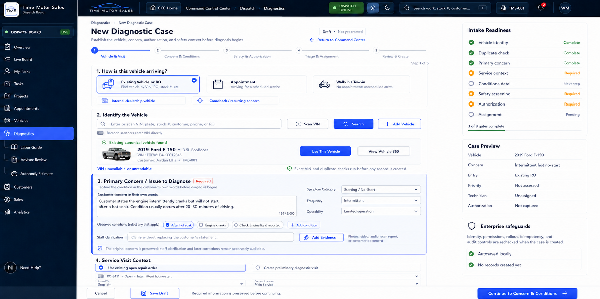

# Diagnostics Intake UI Source of Truth

**Status:** Approved and adopted  
**Approved:** 2026-07-21  
**Primary route:** `/diagnostics/intake`  
**Entry point:** Diagnostics Command Center -> **New Diagnostic Case**  
**Asset:** `docs/diagnostics/assets/diagnostics-intake-approved-mockup.png`

## Authority

This mockup is the official visual, information-architecture, and interaction source of truth for creating a diagnostic case. Implementation may refine responsive spacing and accessible control behavior, but it must preserve the approved workflow, field hierarchy, role boundaries, safety gates, and record-integrity rules.

The intake is a governed Diagnostics workflow. It must not redirect a user directly to the Repair Workbench merely to begin a new diagnostic case.

## Approved Workflow

1. **Vehicle & Visit** - identify an existing vehicle or repair order, scan a VIN, search, or add a vehicle without leaving intake.
2. **Concern & Conditions** - preserve the customer's original concern and capture structured symptom and operating-condition details.
3. **Safety & Authorization** - record immediate hazards, authorization scope, and restrictions before testing.
4. **Triage & Assignment** - establish priority, required skill, location, and technician assignment without asserting a diagnosis.
5. **Review & Create** - present the authoritative intake summary and create the governed records only after all required gates pass.

## Vehicle Identification and Creation Contract

The **Identify the Vehicle** area must expose three clear actions on the same intake surface:

- **Scan VIN**;
- **Search** existing canonical vehicle, repair order, customer, stock, plate, phone, or VIN records;
- **+ Add Vehicle**.

**+ Add Vehicle** opens an inline or contained intake step; it must not force the user into an unrelated console. Vehicle creation must support VIN decoding, manual entry when VIN is unavailable, year/make/model/trim, powertrain and engine configuration, plate and mileage, customer or owner association, dealership stock context, and vehicle-use classification as applicable.

Before creation, the server must enforce tenant and location scope, VIN validation, duplicate detection, canonical identity rules, permissions, idempotency, optimistic concurrency, and audit recording. A diagnostic-only duplicate vehicle record is prohibited.

## Primary Concern Contract

**Primary Concern / Issue to Diagnose** is a prominent, required intake record. It must include:

- the customer's concern in the customer's own words;
- a sufficiently large narrative field for new, unusual, intermittent, or multi-symptom concerns;
- symptom category, frequency, and operability;
- structured observed or reported condition tags;
- staff clarification that does not overwrite the original statement;
- supporting photo, video, audio, scan-report, or document evidence;
- correction and clarification lineage that remains separately auditable.

Structured fields support search, routing, and diagnostic reasoning. They must never replace or silently rewrite the original narrative. Intake must not assign diagnostic confidence or assert a root cause.

## Concern and Conditions Intelligence Page

The first intake page must also display a prominent, live **Diagnostic Report — Problem & Concern Summary**. The user must not need to leave intake to see it. The report summarizes the reported problem, vehicle context, classification, operating conditions, evidence status, current assessment, open requirements, and recommended next action. It must abstain from asserting a fault or root cause before technician testing.

Selecting **Continue to Concern & Conditions** opens a live intake-intelligence page even when earlier facts remain incomplete. It must not behave like a dead control or silently reject navigation.

The page reports:

- the preserved customer concern and its completion status;
- the number of structured facts captured, explicitly distinguished from diagnostic confidence;
- evidence-intake count and canonical vehicle-link status;
- open requirements and one recommended next action;
- symptom category, frequency, operability, and reported or observed reproduction conditions;
- staff clarification without replacement of the original statement;
- a downstream technician handoff preview covering concern, reproduction cues, evidence, and the reasoning boundary.

The page may report missing facts and readiness, but it must not infer a cause, assign diagnostic probability, or present an intake classification as a diagnosis. Progression to safety and authorization remains blocked until required concern-characterization fields are complete. When progression is blocked, the interface must visibly return the user to the report and explain the outstanding action.

## Service Context and Record Creation

Intake may attach to a valid existing open repair order or create a preliminary diagnostic service visit and repair order through governed services. The final create operation must preserve the canonical relationship:

`Vehicle -> Service Visit -> Repair Order -> Diagnostic Case`

The operation must be atomic or safely compensating, replay-safe, permission-controlled, and fully audited. Failure must not leave an orphan diagnostic case or duplicate vehicle.

## Readiness and Review

The persistent readiness rail must visibly distinguish complete, required, next-step, and pending gates. At minimum it covers vehicle identity, duplicate check, primary concern, service context, condition detail, safety screening, authorization, and assignment.

The case preview must summarize established facts only. Unknown priority, technician, authorization, or diagnostic conclusions must remain explicitly unassessed, unassigned, not captured, or absent.

## Interaction and Accessibility Rules

- Draft input is preserved while the user moves between steps.
- No authoritative record is created until the final governed create action succeeds.
- Required fields have text labels and validation messages, not color-only meaning.
- Keyboard, screen-reader, touch, and shop-floor tablet use are supported.
- Responsive layouts may stack controls but must retain Scan VIN, Search, and Add Vehicle as equally discoverable intake paths.
- Cancel, Save Draft, return navigation, and validation failures must never silently discard entered concern data.

## Change Control

Material changes to the five-stage flow, canonical vehicle creation, original-concern preservation, safety/authorization gates, readiness model, or record-creation boundary require an updated mockup and explicit product-owner approval. Minor responsive and accessibility corrections may proceed when they preserve this contract.
