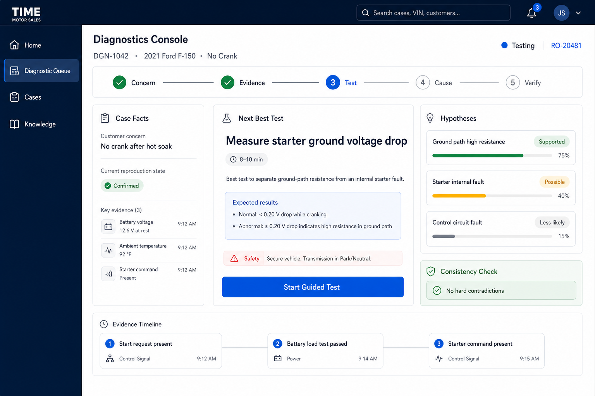

# Diagnostics Technician Workspace UI Source of Truth

**Status:** Provisionally approved and implemented in source through DGN-018; usability validation pending
**Approved:** 2026-07-20  
**Approval basis:** Product-owner visual review; technician usability validation remains required  
**Product area:** Enterprise Diagnostics Console  
**Primary route:** `/diagnostics/cases/[caseId]`  
**Primary user:** Qualified technician or diagnostic specialist

## Approved reference



The image is the initial visual and interaction direction. It is not proof that every label, confidence representation, workflow detail, or data relationship is production-ready.

## Product role

This is the technician-facing diagnostic workspace, not the repair-advisor workspace.

Technicians use it to:

- reproduce and characterize the concern;
- review structured evidence;
- compare hypotheses and contradictions;
- select and execute guided tests;
- record measurements and diagnostic evidence;
- propose or confirm a cause within authority;
- define a repair recommendation;
- complete post-repair verification.

Repair advisors receive a simplified diagnostic summary in the Repair Order Workbench. They manage diagnostic authorization, estimates, customer communication, promises, and repair authorization. They do not edit measurements, eliminate hypotheses, pass tests, or confirm technical causes.

## Approved interaction hierarchy

The initial workspace preserves:

1. a minimal Diagnostics navigation set;
2. one visible diagnostic case and concern;
3. a five-stage workflow: `Concern`, `Evidence`, `Test`, `Cause`, `Verify`;
4. one dominant next-best diagnostic action;
5. compact case facts and evidence;
6. a small set of competing hypotheses;
7. visible consistency and safety status;
8. a concise evidence timeline;
9. no repair, pricing, purchasing, QC-pass, or vehicle-release action in the technician workspace.

## Simplicity rules

- Show one primary action at a time.
- Keep navigation and links minimal.
- Use progressive disclosure for detailed labs and evidence.
- Do not place every diagnostic tool on the initial screen.
- Preserve evidence, hypothesis, conclusion, and authorization as visibly different concepts.
- Keep customer and repair-order context available without duplicating their full workspaces.
- Provide honest empty, loading, stale, restricted, blocked, unsafe, inconclusive, and unavailable states.
- Support shop-floor mobile/tablet use and desktop expert use.

## Confidence correction before implementation

The mockup shows numerical percentages beside hypotheses. Initial implementation should use qualitative, evidence-backed states such as:

- `SUPPORTED`;
- `POSSIBLE`;
- `LESS_LIKELY`;
- `CONTRADICTED`;
- `DISCRIMINATION_REQUIRED`;
- `OUT_OF_MODEL`.

Numerical probability may appear only after the applicable model has calibrated semantics, population/applicability evidence, validation thresholds, and monitoring. Visual bars may represent relative evidence strength only when clearly labeled and must not imply calibrated probability.

## Relationship to the wider console

```text
Repair Order Workbench
  -> technician opens Diagnostic Case
    -> Technician Diagnostic Workspace
      -> focused Systems/Scan/Live Data/Electrical/Waveform labs
      -> qualified cause confirmation
      -> canonical diagnosis publication
  -> advisor receives controlled diagnosis summary
  -> estimate and authorization
  -> repair execution
  -> technician/QC returns to Verify
```

The focused laboratories share the same case context. They are progressive-detail tools, not additional top-level links competing with the next diagnostic action.

## Required validation before production approval

This provisional approval must be tested with representative qualified technicians and shop leadership using the no-start scenario set.

Validation must cover:

- whether the next action is immediately understandable;
- whether evidence and hypotheses are clearly distinguished;
- whether technicians can challenge or choose another eligible test;
- whether safety and prerequisite information is visible at the right time;
- whether measurement entry is efficient with gloves/tablet and desktop;
- whether interruptions can resume without lost work;
- whether expert users can access deeper evidence without cluttering the main view;
- whether qualitative confidence is understood correctly;
- whether advisors receive sufficient summary information without entering the technician workspace;
- accessibility, performance, error, stale-version, and degraded-connectivity behavior.

## Change-control rule

The design may evolve from technician testing, safety review, accessibility findings, or implementation constraints. Material changes to the five-stage workflow, evidence/hypothesis separation, single-primary-action hierarchy, role boundary, or safety visibility require an updated mockup and explicit product approval.

## Approval interpretation

“Provisionally approved” means this is the official starting design for implementation planning. It does not mean:

- the user experience has passed technician usability testing;
- numerical hypothesis confidence is approved;
- all diagnostic laboratories have approved designs;
- the route or behavior is implemented;
- the design cannot be revised after evidence.

