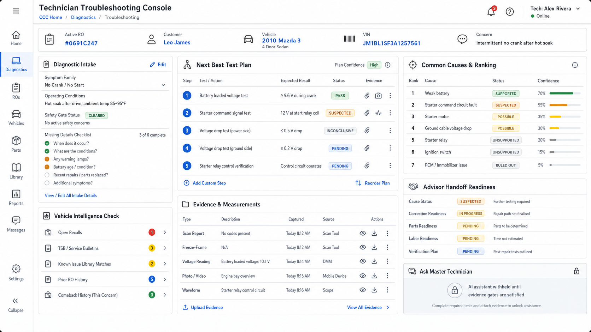

# Technician Troubleshooting Console UI Source of Truth

**Status:** Approved for implementation planning  
**Approved:** 2026-07-25  
**Approval basis:** Product-owner visual review of generated mockup  
**Target branch:** `codex/technician-troubleshooting-console`  
**Product area:** Enterprise Diagnostics Console  
**Primary user:** Technician, diagnostic specialist, or shop leader reviewing a diagnostic case

**Planning package:** [`troubleshooting-console/README.md`](troubleshooting-console/README.md)

## Approved reference

This image is the official starting direction for the technician troubleshooting console. It defines the intended workflow, panel hierarchy, role boundary, and AI-readiness posture. It is not final proof that every label, measurement type, source connector, or visual detail is production-ready.

## Product role

The Technician Troubleshooting Console is a structured troubleshooting workspace for moving from customer concern to evidence-backed diagnostic direction. It should help technicians think clearly, work consistently, and document what was checked without allowing the system to guess a cause too early.

The console is not an AI-first chat page. It is a governed troubleshooting engine first, with a future Master Technician assistant panel kept gated until the evidence, licensing, safety, and review controls are ready.

## Approved workflow areas

1. **Diagnostic Intake** — capture customer concern, symptom wording, conditions, frequency, warning lights, noise/vibration descriptions, and advisor notes.
2. **Vehicle Intelligence Check** — prompt recall, service-bulletin, campaign, known-pattern, warranty-extension, and prior-repair checks before deeper diagnosis.
3. **Next Best Test Plan** — present the next practical test with tools, safety conditions, estimated time, and expected evidence.
4. **Evidence & Measurements** — record observations, scan results, DTCs, freeze-frame details, live data, voltages, pressures, leak checks, waveforms, photos, videos, and notes.
5. **Common Causes & Ranking** — rank likely areas using common-cause libraries, known-issue libraries, repair history, symptom-system matching, and current evidence.
6. **Advisor Handoff Readiness** — distinguish “needs more testing,” “suspected cause,” “confirmed cause,” and “verified repair.”
7. **Ask Master Technician** — keep the assistant visibly available as a future capability, but gated until approved.

## Core logic direction

The console should use one troubleshooting engine with multiple domain rule packs.

Each domain rule pack should define:

- system and component taxonomy;
- symptom vocabulary and synonyms;
- common cause libraries;
- vehicle-known-issue references;
- recall, campaign, and service-bulletin check rules;
- required safety checks;
- prerequisite inspections;
- evidence requirements;
- test selection rules;
- measurement interpretation rules;
- contradiction and uncertainty handling;
- advisor handoff rules;
- post-repair verification rules.

This keeps the design expandable across mechanical, electrical, drivability, HVAC, brake, body, ADAS, network, module-programming, and intermittent-fault work without creating separate disconnected consoles.

## AI boundary

AI assistance is intentionally withheld from the primary diagnostic gate for now.

The console may be designed to become AI-ready, but the first official behavior should rely on deterministic rules, structured libraries, evidence gates, and technician authority. AI should not:

- confirm a root cause without required evidence;
- replace technician judgment;
- bypass safety gates;
- quote or reproduce proprietary service data unless properly licensed;
- turn recall, service-bulletin, or common-cause matches into automatic diagnoses.

## Knowledge-source boundary

The workflow may take inspiration from professional diagnostic systems, OEM service workflows, scan tools, Mitchell-style labor/repair organization, and dealer parts catalog workflows. However, proprietary procedures, labor times, diagrams, part numbers, service bulletins, and OEM data must only be used when the business has the legal license or integration rights.

Until licensed sources are connected, the product should use internal seed data, user-entered notes, shop-authored rules, public safety recall checks where legally available, and clearly marked placeholder knowledge.

## Implementation slices

1. Console shell and case header.
2. Diagnostic intake and symptom normalization.
3. Vehicle intelligence check panel.
4. Common-cause and known-issue library scaffolding.
5. Next-best-test plan generation.
6. Evidence and measurement capture.
7. Cause-ranking explanation panel.
8. Advisor handoff readiness state.
9. Gated Master Technician assistant placeholder.
10. Pilot validation with real technician workflows.

## Change-control rule

Material changes to the evidence-first workflow, AI gate, vehicle intelligence check, next-best-test hierarchy, or advisor handoff boundary require an updated mockup or written approval before implementation changes are treated as official.
