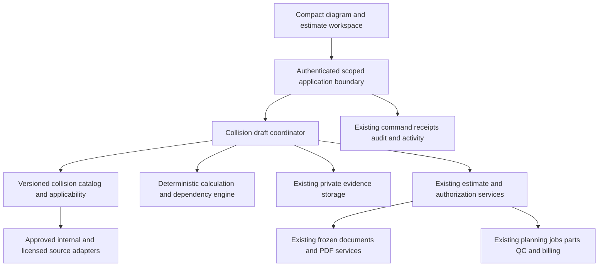

# Autobody Estimating Architecture

**Status:** Official architecture baseline for `codex/autobody-estimating`, adopted under the [approved blueprint](README.md). The generic/manual implementation is available for review. The design contracts below remain the architectural baseline; actual paths, evidence and external content limits are recorded in [Implementation status](IMPLEMENTATION_STATUS.md).

## System boundary

Keep one Next.js application and PostgreSQL/Prisma foundation. The autobody workspace owns collision draft composition and its catalog interpretation. It coordinates existing domain services for official records instead of becoming a separate vehicle registry, RO system, procurement ledger or invoice service.

## Authority and reuse

| Information or action | Owner | Autobody responsibility |
| --- | --- | --- |
| Customer, vehicle and inventory unit | Existing canonical domains | Resolve scoped identifiers and read current facts; never create copies |
| Arrival, custody, concern and RO | Service intake / Repair Order | Reuse an eligible RO or route to compact intake; visible damage need not fabricate a diagnostic case |
| Collision catalog and illustration mappings | Collision content module | Own versioned operation definitions, sources and applicability |
| Editable collision scope | Collision draft coordinator | Own working lines, selected evidence and calculation explanations |
| Presented estimate and decisions | Existing estimate / authorization services | Submit reviewed draft through their commands and retain resulting identifiers |
| Evidence bytes | Existing private evidence / Document Library storage | Link scoped assets and annotations; do not introduce public photo URLs |
| Quotes, parts, orders and reservations | Parts and procurement services | Read candidates and request existing actions; never imply a draft order was placed |
| Repair jobs, technician time and QC | Existing execution services | Handoff the exact approved revision and show actual status |
| Invoice, payments and internal costs | Existing billing / inventory cost services | Reuse their eligibility and documents; prevent duplicate costs or receipts |
| Insurer communication | Claims workflow and explicit communication authority | Prepare a package; do not send or submit automatically |

Existing `RepairEstimateVersion`, `RepairAuthorization`, `RepairJob`, `ServiceDocument`, `ServiceInvoicePackage` and `ServiceInvoice` remain the official records. Extend their supported contracts only where a collision field cannot be represented faithfully. Do not create parallel collision invoices or a second approval history.

## Proposed module structure

| Location | Responsibility |
| --- | --- |
| `src/features/autobody-estimating/` | Context strip, diagram viewer, operation selector, estimate lines, review and history |
| `src/lib/autobody-estimating/` | Shared types, pure formatting and view projections |
| `src/server/autobody-estimating/catalog/` | Sources, applicability, releases, mappings and coverage |
| `src/server/autobody-estimating/calculation/` | Labor, dependency, overlap, refinish/material and pricing rules |
| `src/server/autobody-estimating/service.ts` | Scoped orchestration and commands |
| `src/server/autobody-estimating/repository.ts` | Transactions and persistence behind the service |
| Existing `/diagnostics/autobody-estimate` route | Composition and launch into the review experience |
| Proposed `/api/autobody-estimating/*` routes | Small authenticated read/command boundaries |

Extract genuinely shared components from the mechanical guide when necessary. Do not copy its large console, front-wheel-only positions, label matching or browser storage into a second product unchanged. Mechanical behavior must remain compatible while collision migrates to stable IDs.

## Draft and revision contracts

| Proposed record | Required facts |
| --- | --- |
| CatalogRelease | Release ID, source versions, review state, effective period and coverage manifest |
| CollisionOperation | Stable operation ID, component/assembly, method, position, labor category, inclusion/dependency rules and applicability |
| DiagramAsset and DiagramBinding | Asset/version/checksum, source rights, view, orientation, callouts and component-to-operation bindings |
| CollisionDraft | Organization/location, vehicle, optional RO, payer mode, version, catalog release, rate policy, save state and author |
| CollisionDraftLine | Stable line ID, operation/source versions, side, chosen part, labor basis, quantities, price status, evidence links and overrides |
| CalculationSnapshot | Inputs and fingerprint, rule versions, every addition/deduction, unresolved values and totals by category |
| PresentedEstimateLink | Draft/version, authoritative estimate ID/version, fingerprint, document reference and actor |
| SupplementRelation | Prior authoritative estimate, added/changed/removed lines, explanations and new estimate reference |

These are logical responsibilities, not a requirement for one table per row. Reuse existing draft, evidence and command infrastructure where it supports the contract. The schema design milestone must record which responsibilities use existing records and which need additive tables or fields.

An unlinked planning draft may exist without an RO. Official generation requires validated vehicle, payer and RO context. On linking or changing vehicle, re-evaluate all applicability and source selections; never silently move an already presented estimate to another vehicle.

Browser storage may recover unsaved edits, scoped by user, organization, vehicle and draft. Durable shared drafts live on the server. A browser draft is not an official estimate and cannot overwrite a newer server version silently.

## Deterministic estimating pipeline

1. Resolve authorized vehicle/RO context and the pinned catalog release.
2. Evaluate configuration and operation applicability: supported, conditional, unknown or unsupported.
3. Normalize selection using stable component, operation, method and position IDs.
4. Identify mutually exclusive alternatives, required access work and included components.
5. Calculate candidate labor, refinish, parts, materials and sublet lines.
6. Apply reviewed overlap and pricing rules, retaining the original amounts and explanation of each adjustment.
7. Separate confirmed amounts, estimator-entered amounts and unresolved values.
8. Return the calculation fingerprint, review findings and exact service commands that are currently eligible.

Use integer cents and a defined fixed precision for labor duration and quantities; avoid binary floating-point accumulation. Define rounding at the line/component level, then sum the rounded components. For a priced line, net labor time equals base time plus approved additions minus valid included/shared-work deductions, never below zero. Rate and rule IDs must reproduce the same result later.

Do not infer a model-specific replacement time from a generic label. Repair hours may be estimator-entered with a brief basis; published replacement allowances and observed actual time remain distinct. Unknown amounts stay pending and are excluded from a clearly labeled known subtotal, not displayed as a complete total.

Body, refinish, structural, mechanical and other configured labor categories can use different rate policies. Parts price, markup, tax treatment, materials and fees use explicit shop/transaction policies. Never inherit a hard-coded tax default or apply a generic complexity multiplier as OEM labor. Refinish and material rules require an approved source or identified internal policy and must prevent charging the same material twice.

Dependency rules form a directed graph. Validate cycles and contradictory alternatives at catalog publication. Shared access can be deducted once across an estimate; deletion, reordering or supplementation must recalculate the complete relevant scope. Additions should be reviewable suggestions unless they are identified included work, in which case their cost treatment must remain visible.

## Commands and reliability

Proposed reads: authorized context, applicable catalog, diagram assets, saved draft/history and calculation preview. Proposed commands: create/save draft, attach evidence, calculate reviewed scope, present through the estimate service and start a supplement from an existing revision. Final API naming is settled with the service contract milestone.

Every write derives the actor from the session, validates organization/location access, accepts an expected version and uses a durable idempotency key. Retry the same unchanged command after a lost response. Return a clear conflict with reload/compare choices rather than overwriting newer work.

Official generation revalidates permissions, applicability, source versions, pricing policy and RO state on the server. Commit the official estimate and its collision provenance atomically through the existing repository transaction where possible. If boundaries cannot share a transaction, use a durable intent/receipt and reconcile it before another attempt; never rely on two uncoordinated browser requests.

Draft states are Draft, Needs review, Ready for presentation, Linked to estimate and Archived. They do not replace RO stages. A correction to presented work creates a new revision or supplement; existing documents and customer decisions remain frozen. Existing approval scope determines whether changed work requires a new decision.

## Action eligibility without unnecessary barriers

| Situation | Expected behavior |
| --- | --- |
| Missing optional photos or claim number | Save draft and continue manual estimating; show a contextual reminder |
| No vehicle-specific diagram available | Offer clearly labeled generic navigation or text search; show coverage limits |
| Price unknown | Retain line and pending amount; request pricing before a complete official amount is represented |
| Configuration/source applicability unresolved | Permit investigation draft; require an explicit reviewed basis or applicable source before official use of the affected line |
| Structural or calibration question | Retain proposed work and evidence; require appropriate technical determination before authorizing/executing affected work |
| Insurer has not agreed to a supplement | Keep payer decision separate from customer/internal authorization; expose the unresolved funding decision |
| Photo analysis unavailable | Keep manual and diagram paths available with no lost scope |

Do not require a photo-analysis service, numeric confidence score, diagnostic case or manager acknowledgment for every simple bumper draft. Technical and financial prerequisites apply to their relevant operation and transition.

## Security and evidence

Use existing role/capability policies, not a new hard-coded staff allowlist. Distinguish drafting, catalog publication, pricing override, estimate presentation, authorization and financial adjustment. Review access to a prototype does not grant those write capabilities.

Photo uploads use existing private storage, permitted types, size limits, scanning and authorization. Keep originals immutable with separate annotations and derived previews. Prevent SVG scripts/external references and sanitize imported vector content. Supplier or licensed assets require authenticated server-side retrieval/entitlement checks where applicable; never expose service credentials to the browser. Enforce source retention and redisplay rights without breaking retained estimate provenance.

Audit record creation, source selection, overrides, official presentation and supplements. Record actor, timestamp, subject, before/after versions and a useful explanation. Do not log customer documents, access tokens or photo bytes in operational logs.

## Persistence and compatibility

Use additive migrations when new persistence is needed. Inventory existing catalog identifiers and map them to stable collision IDs before migration. Preserve original estimate snapshots and the old source values; historical amounts must not change when catalogs or rates change.

A feature-specific review switch selects the new workspace without adopting it automatically. Each surface must visibly identify whether it writes a real draft/estimate or uses sample data. Preserve the old entry and return path until adoption. Switching back must retain all persisted work and document links.

## Operational targets

Proposed initial targets, measured against named pilot fixtures: warm catalog search/selection feedback within 300 ms; server calculation p95 within one second for 100 draft lines excluding external suppliers; lazy loading of assembly diagrams; and no page overflow at 390 px. Record actual measurements before treating these as achieved service levels.

Track save failures, version conflicts, calculation latency, unavailable content, failed handoffs and duplicate-command recovery. Operational logs and reports support staff execution; they do not add a dashboard to the default authoring screen.
