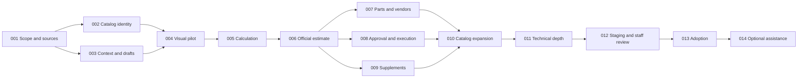

# Autobody Estimating Implementation Roadmap

**Status:** Official roadmap for `codex/autobody-estimating`; generic/manual delivery is available for owner review. [Implementation status](IMPLEMENTATION_STATUS.md) records actual evidence and remaining external content/owner decisions.
**Approved direction:** [Compact blueprint](README.md)  
**Dependencies:** [Architecture](ARCHITECTURE.md) and [catalog standard](CATALOG_AND_DIAGRAM_STANDARD.md)

Deliver vertical slices that include their needed data, application service, interface and verification. The first complete journey precedes broad content expansion. Estimating remains useful while advanced providers or AI are unavailable. No calendar dates or effort estimates are committed until source availability and pilot scope are established.

## Delivery waves

| Wave | Milestones | Reviewable outcome |
| --- | --- | --- |
| Foundation | ABE-001–003 | Canonical context, reconciled catalog identities, source/coverage decisions and durable draft contract |
| First complete journey | ABE-004–006 | Working bumper/fender diagrams, explained calculations and an official estimate/document through existing services |
| Full repair continuity | ABE-007–009 | Parts/vendor handoff, approval/execution continuity and controlled supplements |
| Comprehensive content | ABE-010–011 | All catalog families with declared coverage, detailed visual mappings and technical/refinish depth |
| Review and adoption | ABE-012–013 | Tested staff journeys, owner review and reversible adoption decision |
| Later assistance | ABE-014 | Optional supplier/interchange/photo assistance built on the proven manual workflow |

## Milestone specifications

| ID | Scope and implementation boundary | Acceptance evidence | Depends on |
| --- | --- | --- | --- |
| ABE-001 | Inventory existing body catalogs, technical sources, subscriptions and representative vehicles. Record pilot configurations, reviewers and coverage exclusions. | Source register identifies rights and real availability; owner can review the pilot scope; no invented subscription or universal-coverage claim. | Approved blueprint |
| ABE-002 | Define stable collision IDs, component/method/position taxonomy and source-version contracts. Map existing catalog representations without rewriting historical estimates. | Same ID resolves consistently through search, diagrams and saved draft; conflicting existing allowances are surfaced with sources, not silently averaged. | 001 |
| ABE-003 | Implement authorized customer/vehicle/RO context and server drafts. Design additive persistence only where existing infrastructure is insufficient. Provide save/retry/conflict behavior. | Existing records reused; returning staff resume saved work; two users cannot silently overwrite; cross-organization access denied; incomplete drafts persist. | 001 |
| ABE-004 | Build the compact Build/Review workspace and detailed bumper/fender visual pilot with text alternatives, photo/evidence links, mobile panels and an expandable diagram viewer. | Correct component/side selection through diagram and search; operation-linked detail views; full-screen expansion, zoom in/out, pan, fit/reset and return without lost edits; readable callouts and touch/keyboard controls; no horizontal phone overflow or new multi-page intake wizard. | 002, 003 |
| ABE-005 | Implement deterministic labor categories, inclusion/dependency/overlap rules, refinish/material policies and transparent unresolved amounts. | Named numeric fixtures reproduce totals; shared access counted once; incompatible methods explained; rule changes do not mutate saved official amounts. | 004 |
| ABE-006 | Present reviewed collision scope through existing estimate services and frozen documents. Support preview, generate and print/PDF with the same RO. | Exact reviewed revision generates once despite retry; totals/provenance agree between screen, service and document; no approval or invoice is implied. | 005 |
| ABE-007 | Connect real parts/quotes, fitment, procurement and outside-vendor tools with preserved return context. | Candidate versus ordered versus received is distinguishable; alternate part selection recalculates affected scope; no duplicate order or inventory cost from a retry. | 006 |
| ABE-008 | Connect estimate authorization to existing planning, approved jobs, execution, QC, handoff and billing/internal cost closeout. | One internal-recon, customer-pay and vendor journey each preserve canonical records and existing permissions; no fabricated diagnosis or technician time. | 006 |
| ABE-009 | Implement teardown supplements, changed-line comparison and exact revision decisions using authoritative estimate history. | Added/changed/deleted lines are explained; prior estimate/PDF and decisions remain unchanged; new affected scope uses existing reauthorization rules. | 006 |
| ABE-010 | Expand the complete operation-family matrix with stable components, relevant methods, diagrams, synonyms, sources and known gaps. | Every family has a coverage entry; every supported release operation has a working visual binding; generic and exact-configuration coverage are reported separately. | 007–009 |
| ABE-011 | Deepen structural/material, joining, corrosion, paint/blend, safety, related mechanical and EV references for declared configurations. | Qualified review evidence supports applicable technical methods; unknown applicability cannot masquerade as verified; refinish/material rules explain every addition/deduction. | 010 |
| ABE-012 | Validate full workflows, accessibility, performance, recovery, evidence security and staff usability against the acceptance scenarios below. Fix issues within the same simple tool. | Scenario results and coverage exclusions recorded; estimator/advisor/body/refinish feedback resolves dead ends and excessive steps; no production test records fabricated. | 011 |
| ABE-013 | Present completed implementation for owner review. If adopted, activate narrowly with rollback and monitoring; retain old entry and all saved records. | Explicit adoption decision recorded; deployment uses existing workflow and recoverable migrations; disabling the new entry does not lose documents or drafts. | 012 |
| ABE-014 | Add separately scoped supplier adapters, supported estimate interchange and supervised photo suggestions when their sources and interfaces are available. | Provider failure preserves manual operation; suggestions have source/basis and require review; no automatic insurer submission, purchasing or financial transaction. | 013 |

The first owner walkthrough occurs at ABE-006 and checks the complete narrow journey. That walkthrough does not declare catalog expansion complete. The final adoption review follows the full declared-scope acceptance evidence. These are feature delivery checkpoints, not mandatory new application-wide release gates.

## First walkthrough script

1. Find an existing vehicle and its open RO; show existing estimates before offering new work. If no RO exists, continue through compact intake and return with the selected vehicle.
2. Select front impact, open the bumper assembly and identify an affected component.
3. Choose a supported operation, its position and part option. Show what the allowance includes and which amounts remain pending.
4. Add fender work and relevant refinish. Show an explained shared-access deduction and a rejected incompatible alternative.
5. Save and reopen as another authorized staff member. Confirm scope, photos, source versions and save state survive.
6. Review and generate the official estimate; simulate a lost response and recover the same outcome without duplicates.
7. Open the saved document and print/save PDF; return directly to the same repair workflow.

Use named synthetic fixtures for automated checks. Separate staff review with real authorized cases from automated fixture evidence. Do not record a synthetic customer approval as a real operational approval.

## End to end acceptance scenarios

| Scenario | Required result |
| --- | --- |
| Returning vehicle with prior estimate | Open the actual history and resume/supplement; no duplicate customer, vehicle, RO or estimate from blind retry |
| New vehicle or missing customer information | Existing canonical creation option remains accessible at top; compact entry returns to the intended draft |
| Generic diagram only | Clear generic label and useful navigation; no implied exact part number or technical repair boundary |
| Expanded panel and operation diagrams | Open the correct detailed view from a panel or estimate line; zoom in/out, pan, fit/reset and inspect available layers/insets; close without losing edits, selection or keyboard focus |
| Wrong body style, material or sensor variant | Applicability mismatch visible; draft kept; affected operation cannot be passed off as verified |
| Incomplete photo set or offline analysis | Manual diagram/search path and save remain usable |
| Missing price or unavailable quote | Pending amount retained; known subtotal distinguished from complete quote |
| Shared access and alternative methods | No duplicate included labor; repair and replacement alternatives are mutually resolved |
| Blend and materials | Reviewed source/policy used; adjacent panel relationships explained; no duplicated material charges |
| Hidden structural or safety-related damage | Teardown findings and applicable procedures retained; new scope follows supplement and authorization rules |
| Vendor-only repair | Vendor quote, decision and return/QC workflow work without invented internal diagnosis or labor |
| Customer-pay, insurance and internal recon | Correct payer/approval treatment; insurer response does not substitute for customer/internal authority |
| Concurrent editing and lost response | Expected-version conflict is actionable; unchanged retry returns one durable outcome |
| Frozen document and catalog update | Historical estimate/PDF remains unchanged while new drafts can use a newer release |
| Jobs through closeout | Exact authorized scope reaches parts/jobs/QC/handoff; correct native billing or internal cost path applies |
| Phone and keyboard use | Complete core authoring/review flow without pointer-only targets, hidden required controls or horizontal page scrolling |
| Unauthorized access | Cross-company draft/photo/document access denied; catalog review permission does not grant pricing or financial authority |
| Rollback to old experience | Persisted records remain accessible; disabling the new entry does not delete user work |

## Traceability and progress reporting

| Approved requirement | Delivery milestones |
| --- | --- |
| Compact tool with progressive depth | 003–006, 012 |
| Canonical customer/vehicle/RO reuse | 003, 008 |
| Diagrams for every supported operation | 004, 010, 011 |
| Comprehensive catalog with honest vehicle coverage | 001, 002, 010, 011 |
| Explainable estimating rules | 005, 009, 011 |
| Documents and full repair continuity | 006–009 |
| Review before adoption | 006 walkthrough, 012, 013 |

Each completed milestone records actual changed paths, tests, representative configurations, source/review decisions and unresolved gaps. A drafted plan, static mockup, source import or passing unit suite alone does not mark a complete workflow implemented.

Measure task completion and friction: repeated identity entry, steps to add common work, blocked save attempts, missing controls, duplicate records and ability to reopen prior work. Compare observed baseline versus new workflow during staff review; do not invent a time-saving percentage. Product metrics must not turn the estimating screen into a staff-performance dashboard.

## Original implementation sequence

Start with ABE-001: inventory the actual collision allowances and existing data entitlements; select representative bumper/fender configurations; identify technical reviewers; and establish the coverage manifest. Then complete stable IDs and durable context/drafts before wiring visual additions into real estimate services. New database changes require the existing safe migration process and environment-specific authorization; this blueprint alone applies none.
