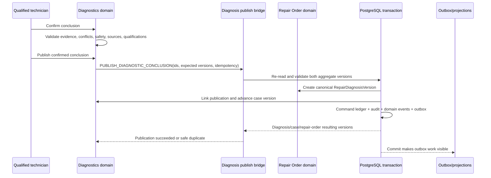

# DGN-001 — Domain Authority and Diagnosis Publishing Contract

**Milestone:** `DGN-001`  
**Version:** 1.0  
**Date:** 2026-07-20  
**Status:** Implemented contract; runtime Diagnostics behavior not started  
**Branch:** `codex/diagnostics-dgn-001-authority-contract`  
**Gate contribution:** `DG-G0`

## 1. Decision

Diagnostics is an independent bounded domain inside the Dispatch Board modular monolith.

Diagnostics owns the complete diagnostic case and the evidence-backed conclusion. The Repair Order / Shop Operations domain owns the canonical published `RepairDiagnosisVersion` that downstream estimating, authorization, repair-job, quality, financial-close, and historical workflows consume.

Diagnostics must publish through a governed bridge command. It must not write repair diagnosis, estimate, authorization, repair job, parts balance, task, schedule, QC, vehicle identity, or evidence-object records through private repository access.

## 2. Current Repository Evidence

The existing application already provides:

- canonical `Vehicle`, `ServiceVisit`, and `RepairOrder` records;
- `RepairDiagnosisVersion` with immutable version rows and repair-job references;
- `recordRepairDiagnosis` and `RECORD_DIAGNOSIS_VERSION` in Shop Planning;
- enterprise command-ledger idempotency and optimistic aggregate versioning;
- atomic audit, domain-event, and outbox creation;
- repair-order stage history;
- exact diagnosis ownership checks when creating a repair job.

Current limitations that later milestones must address:

- no `DiagnosticCase` or `DiagnosticConclusionVersion` exists yet;
- `RepairDiagnosisVersion` has no explicit diagnostic-case/conclusion/correlation linkage;
- the existing writer chains every new diagnosis to the latest diagnosis on the repair order, which cannot safely represent multiple independent concern-specific cases;
- the existing `REPAIR_ORDER_MANAGE` capability is too broad for the final diagnostic propose/confirm/publish separation;
- current JSON fields do not yet enforce the planned structured lineage contract.

DGN-001 changes no runtime behavior. It establishes the contract that DGN-006 and subsequent implementation must satisfy before Diagnostics publishing is activated.

## 3. Source-of-Truth Matrix

| Record or decision | Authoritative owner | Diagnostics authority | Prohibited behavior |
| --- | --- | --- | --- |
| Organization, location, user, session | Shared platform | Read in authorized scope | Create alternate identity or authorization system. |
| Vehicle identity and configuration | Vehicle Registry / Vehicle 360 | Read; request governed correction | Silently correct VIN/configuration inside a case. |
| Customer identity and words | Customers / Service Visit | Read; preserve exact concern snapshot | Rewrite customer words as technician findings. |
| Service visit and custody | Service Intake | Read | Create parallel visit/custody records. |
| Repair order, stage, owner, promise | Repair Order / Shop Operations | Read; request controlled diagnostic-stage effects | Patch repair-order state directly. |
| Diagnostic case and concern streams | Diagnostics | Create, own, version, route, reopen, close | Store the case only as repair-order JSON or task notes. |
| Observations and measurements | Diagnostics | Create, classify, correct by supersession | Convert inference/AI text into observed/measured fact. |
| Files, images, waveforms, scan reports | Vehicle Evidence | Link governed objects to diagnostic subjects | Create a second attachment store or bypass access/malware controls. |
| Hypotheses, conflicts, test plans/executions | Diagnostics | Create, evaluate, version, invalidate | Publish them as confirmed cause without conclusion gate. |
| Conclusion and repair recommendation | Diagnostics | Propose/confirm/version; initiate publish | Authorize scope, price, purchasing, or repair execution. |
| Published diagnosis | Repair Order / Shop Operations | Supply confirmed publication payload and receive result | Directly insert/update `RepairDiagnosisVersion`. |
| Estimate and customer/internal decision | Estimate / Authorization | Supply structured recommendation context; read outcome | Present or accept financial scope as a diagnostic action. |
| Technician, bay, tool, and time allocation | Tasks / Appointments / Dispatch | Supply requirements; read committed allocation | Assign or reserve outside scheduling authority. |
| Parts catalog, demand, reservation, purchasing, custody | Parts Operations | Request demand/readiness; read result | Change balances, purchase, substitute, or issue parts directly. |
| Authorized repair job and labor | Repair Job / Shop Execution | Provide diagnosis/recommendation linkage; read execution | Create executable work without exact authorization. |
| QC, release, comeback | Quality / Repair Order | Define concern-specific verification; consume results; reopen/link case | Pass QC or release vehicle. |
| Activity, audit, command, domain event, outbox | Shared enterprise command platform | Emit correlated diagnostic records | Maintain a private unaudited event history. |
| Diagnostic knowledge/rules/sources | Diagnostics Knowledge | Author/review/version under later authority gates | Treat unlicensed, expired, draft, or AI-generated material as active authority. |

## 4. Aggregate Boundary

### Diagnostics aggregate

The future `DiagnosticCase` aggregate owns:

- case identity, organization, location, vehicle, repair order, and concern identity;
- lifecycle, owner, risk, target, blocker, and version;
- concern/reproduction records;
- observations, measurements, evidence links, hypotheses, conflicts;
- test plans and executions;
- reasoning evaluations;
- conclusion and repair-recommendation versions;
- verification plan/execution and diagnostic outcome;
- publication state and exact published diagnosis reference.

### Repair Order aggregate

The existing `RepairOrder` aggregate owns:

- commercial/execution lifecycle and stage;
- canonical published diagnosis versions;
- estimate, authorization, repair job, QC, release, comeback, and close relationships;
- downstream readiness and historical projections.

### Cross-aggregate invariant

One repair order may contain multiple diagnostic cases. Each case may publish multiple superseding diagnosis versions over time. A publication supersedes only the prior published diagnosis for the same diagnostic case/conclusion lineage; it must not supersede the current publication of a different concern.

The repair-order-wide `version` remains the concurrency boundary for effects on the repair workflow. The diagnostic-case `version` remains the concurrency boundary for diagnostic reasoning and conclusion state.

## 5. Publishing Command Contract

### Command identity

Target command:

`PUBLISH_DIAGNOSTIC_CONCLUSION`

The command is initiated by Diagnostics after an explicit authorized publish action. A bridge service invokes the Repair Order / Shop Operations writer. During implementation, the existing `RECORD_DIAGNOSIS_VERSION` writer may be evolved or wrapped, but there must be one canonical publication path.

### Required input

```text
organizationId
locationId
repairOrderId
repairOrderExpectedVersion
diagnosticCaseId
diagnosticCaseExpectedVersion
diagnosticConcernId
conclusionVersionId
recommendationVersionId
verificationPlanVersionId
publisherUserId
confirmingTechnicianUserId
idempotencyKey
correlationId
reason
publishedAt
```

The service loads all authoritative content by identifier. It must not trust client-supplied cause, evidence, qualification, organization, vehicle, or confirmation state.

### Required preconditions

1. Actor is authenticated, active, in organization/location scope, and has the future `DIAGNOSTIC_RECOMMENDATION_PUBLISH` capability.
2. Confirming technician is active and satisfies the applicable diagnostic confirmation qualification.
3. Case, repair order, service visit, and vehicle belong to the same organization and the case references that repair order/vehicle.
4. Repair order is open and in a state that permits diagnosis publication or controlled re-diagnosis.
5. Expected repair-order and diagnostic-case versions match current versions.
6. Conclusion is the current confirmed conclusion for the concern.
7. Conclusion was confirmed through the required human command and has no unresolved hard contradiction, safety block, source-applicability block, or invalidated evidence dependency.
8. Repair recommendation and verification plan are current and derived from the exact conclusion version.
9. Every material evidence, test, rule, model, source, and knowledge version is available and authorized for the publication purpose.
10. A prior case publication, when superseded, belongs to the same diagnostic case and is the current leaf in that case's publication lineage.

Failure of any precondition produces no diagnosis row, case publication link, stage change, event, audit, or outbox side effect.

## 6. Published Diagnosis Mapping

| `RepairDiagnosisVersion` field | Authoritative mapping |
| --- | --- |
| `organizationId` | Repair order and diagnostic case organization; must match. |
| `repairOrderId` | Command subject. |
| `version` | Next repair-order diagnosis display version, unique within the repair order. |
| `concern` | Immutable concern version selected by `diagnosticConcernId`; customer wording remains distinguishable from technician interpretation. |
| `symptoms` | Structured publication projection of reproduced/not-reproduced symptoms and operating conditions. |
| `tests` | Structured projection of material test definitions/executions, results, deviations, and exact versions. |
| `evidence` | Versioned lineage envelope containing diagnostic case/conclusion/recommendation/verification identifiers plus material evidence, rule, model, source, and evaluation references. |
| `cause` | Confirmed cause text from the exact `DiagnosticConclusionVersion`; never client-authored during publish. |
| `uncertainty` | Explicit projection from the conclusion's residual uncertainty policy into `LOW`, `MEDIUM`, or `HIGH`; this represents uncertainty, not confidence. |
| `recommendation` | Current recommendation summary derived from the exact conclusion. |
| `proposedCorrection` | Proposed correction; remains unauthorized until Estimate/Authorization accepts scope. |
| `technicianUserId` | Qualified confirming technician, not necessarily the publisher. |
| `diagnosedAt` | Confirmation time from the conclusion, not request or database time. |
| `supersedesId` | Current published diagnosis for the same diagnostic case only; null for first publication. |

### Required explicit linkage

DGN-006 must choose and specify an enforceable linkage using explicit foreign keys or a dedicated publication-link model for:

- `diagnosticCaseId`;
- `diagnosticConcernId`;
- `conclusionVersionId`;
- `recommendationVersionId`;
- `verificationPlanVersionId`;
- `correlationId` and publishing command identity.

The JSON evidence envelope is required for portable historical projection but is not sufficient by itself as the relational integrity mechanism.

## 7. Atomic Commit Contract

The initial modular-monolith implementation uses one PostgreSQL transaction to:

1. re-read and lock/validate repair-order and case versions;
2. validate current conclusion, recommendation, verification plan, evidence, sources, and authority;
3. detect replay by organization/domain/command/idempotency key and request hash;
4. create one immutable `RepairDiagnosisVersion`;
5. create the explicit case-to-published-diagnosis linkage;
6. update case publication state/version;
7. advance or retain repair-order stage using approved workflow rules;
8. write repair-order state history when state changes;
9. write enterprise command ledger, diagnostic/repair domain events, audit event, and outbox messages;
10. return exact case, diagnosis, and repair-order resulting versions.

If a later architecture cannot use one database transaction, it must use a transactional outbox and idempotent consumer with an explicit `PUBLISHING` state, reconciliation, timeout, retry, and compensation policy. It may not report success before the canonical diagnosis exists and the case link is durable.

## 8. Idempotency and Concurrency

- Recommended idempotency identity: `diagnostic-publish:{caseId}:{conclusionVersionId}` plus the standard request hash.
- Same key and same request returns the original successful result.
- Same key with different request fails as idempotency-key reuse.
- Stale case or repair-order version fails with safe conflict details and no side effects.
- Simultaneous publication attempts produce at most one diagnosis for a case/conclusion version.
- Retrying after an uncertain network response must not create another diagnosis.
- Republishing unchanged content is a duplicate, not a new version.
- A changed conclusion requires a new conclusion version, reason, confirmation, and publication command.

## 9. Events and Audit

Minimum successful events:

- `DIAGNOSTIC_CONCLUSION_PUBLISHED` — Diagnostics aggregate;
- `REPAIR_DIAGNOSIS_VERSION_RECORDED` — Repair Order aggregate;
- `REPAIR_ORDER_STAGE_CHANGED` only when the stage actually changes;
- outbox event for downstream projection/reconciliation.

Event/audit metadata includes actor, confirming technician, organization/location, vehicle, repair order, case/concern/conclusion/recommendation/verification versions, published diagnosis ID/version, prior publication ID, algorithm/rule/source versions, correlation/causation IDs, reason, timestamps, request hash, and resulting aggregate versions.

No event payload may expose restricted evidence content to consumers lacking permission.

## 10. Downstream Consumption Rules

- Estimates and repair jobs reference the exact published diagnosis version used.
- A published diagnosis does not authorize price, parts purchase, technician assignment, active test, repair, QC pass, or release.
- If the conclusion is superseded after authorization, affected work is flagged for controlled impact review; it is not silently canceled or rewritten.
- A repair job may reference a diagnosis only when it belongs to the same repair order and is not invalidated for that authorized line.
- Verification failure reopens or links the diagnostic case through a future governed command and preserves the published history.

## 11. Sequence



## 12. Conflict and Failure Matrix

| Condition | Required result |
| --- | --- |
| Case/RO/vehicle/organization mismatch | Reject; security/audit signal where appropriate; no mutation. |
| Case or repair-order version stale | Conflict response with current safe version; retain user work. |
| Conclusion proposed but not confirmed | Reject. |
| Unresolved hard contradiction or invalid evidence | Reject and return reason codes. |
| Qualification/safety/source gate fails | Reject; route review/escalation. |
| Repair order closed | Reject unless a future authorized reopen command completes first. |
| Same idempotency key and request | Return original result with duplicate indicator. |
| Same key, changed request | Reject as idempotency-key reuse. |
| Another concern already has a diagnosis | Publish separately; do not supersede it. |
| Same case has older current publication | Create new version and supersede only that case publication. |
| Transaction/event/outbox write fails | Roll back everything. |
| Response lost after commit | Retry returns original committed result. |
| Published conclusion later changes | New conclusion/confirmation/publication; preserve prior record and run impact review. |

## 13. Acceptance Scenarios

1. First confirmed case publication creates one canonical diagnosis and links exact lineage.
2. Retry after response loss returns the same diagnosis.
3. Changed request under the same key is rejected.
4. Stale repair-order version creates no partial result.
5. Stale diagnostic-case version creates no partial result.
6. Unconfirmed or contradicted conclusion cannot publish.
7. Actor may propose but lacks publish capability; publish is denied.
8. Confirming technician is inactive/unqualified; publish is denied.
9. Case and repair order reference different vehicles/organizations; publish is denied.
10. Two concerns on one repair order publish independently and do not supersede each other.
11. Corrected conclusion supersedes only the prior publication for that case.
12. Estimate/job references retain the exact diagnosis used after later supersession.
13. Event/audit/outbox failure rolls back diagnosis and case state.
14. Restricted evidence is represented by safe references, not leaked payload.
15. Existing legacy Shop Planning diagnosis behavior remains unchanged until the controlled migration milestone.

## 14. Decisions Resolved by DGN-001

| Decision | Resolution |
| --- | --- |
| Is Diagnostics part of Inventory? | No. Independent bounded domain inside Dispatch Board. |
| Does Diagnostics own the repair order? | No. It owns the diagnostic case. |
| What is the downstream diagnosis source of truth? | Canonical `RepairDiagnosisVersion` owned by Repair Order / Shop Operations. |
| Can Diagnostics insert it directly? | No. Publish through the governed bridge/writer. |
| Can one RO have multiple diagnostic cases? | Yes. Publications are concern/case-specific. |
| What does supersession mean? | Supersede the prior publication for the same case, never an unrelated concern. |
| Is a published recommendation authorized work? | No. Estimate and Authorization retain authority. |
| Is JSON lineage enough? | No. Explicit relational linkage is required by DGN-006. |
| Is AI allowed to publish? | No. A qualified authorized human initiates publication. |

## 15. Deferred to Named Milestones

- Exact schema, link model, commands, capabilities, reason codes, and migration: `DGN-002` and `DGN-006`.
- Case persistence and lifecycle: `DGN-007` through `DGN-009`.
- Evidence/test/conclusion implementation: `DGN-013` through `DGN-027`.
- Runtime publishing bridge and tests: `DGN-028`.
- Estimate, dispatch, parts, and verification bridges: `DGN-030` through `DGN-033`.

## 16. DGN-001 Exit Review

| Required evidence | Result |
| --- | --- |
| Architecture decision | Accepted in this contract. |
| Source-of-truth matrix | Complete. |
| Aggregate and cross-domain boundary | Complete. |
| Diagnosis publication mapping | Complete. |
| Transaction/idempotency/concurrency contract | Complete. |
| Sequence and failure matrix | Complete. |
| Acceptance scenarios | Complete. |
| Existing repository conflict review | Complete; current whole-RO supersession limitation is explicitly deferred to DGN-006/DGN-028. |
| Runtime behavior claimed | None. |

**DGN-001 disposition:** Complete as an architecture-contract milestone. `DG-G0` remains open until `DGN-002` through `DGN-006` are completed and approved.

