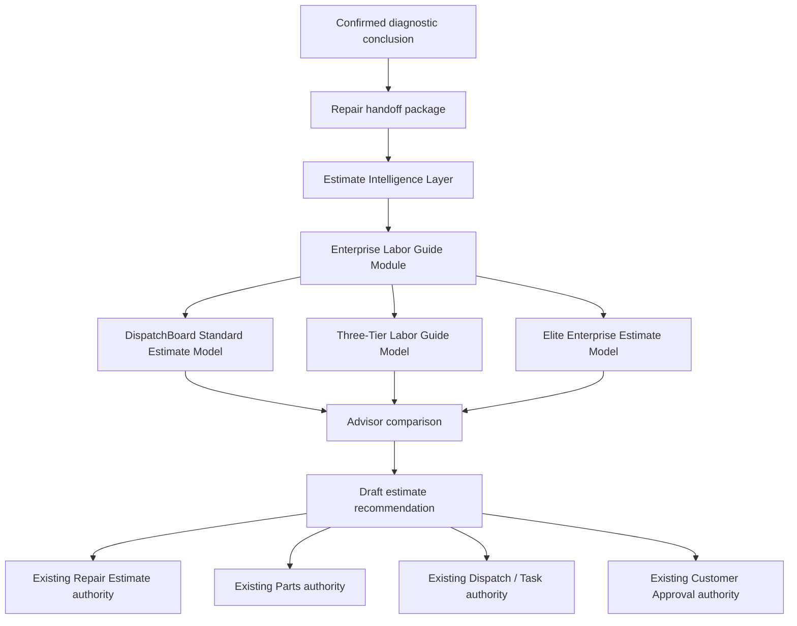
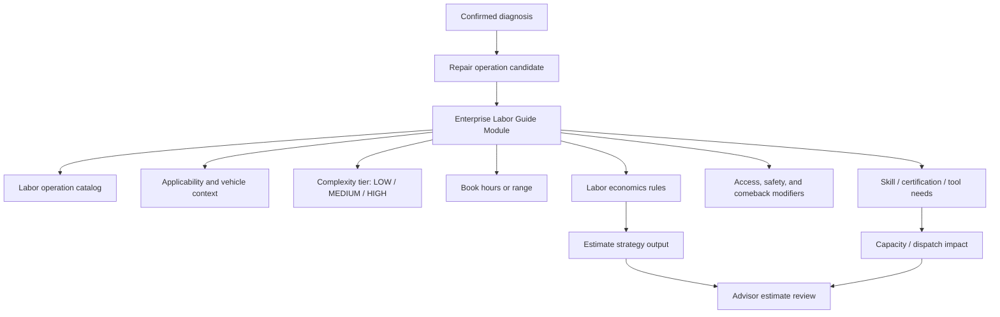

# DGN-035–044 — Estimate Intelligence and Repair Execution Planning

**Status:** Complete — planning and architecture adopted; runtime implementation deferred  
**Branch:** `codex/diagnostics-dgn-035-044-estimate-intelligence-planning`  
**Date:** 2026-07-21  
**Scope:** Release 3 planning for advisor review, estimate intelligence, selectable pricing strategies, an enterprise labor guide module, labor/parts mapping, capacity impact, repair-order job generation boundaries, and customer-ready repair execution handoffs.

## Executive Decision

Release 3 will not build a second estimating system inside Diagnostics. Diagnostics remains the authority for diagnostic evidence, confirmed cause, repair recommendation, handoff lineage, and verification proof. The existing Repair Order, estimate, authorization, parts, dispatch, task, and customer-lifecycle authorities remain the systems of record for their own records.

Release 3 will add an **Estimate Intelligence Layer** between the verified diagnostic repair package and those existing execution authorities.

The layer must produce explainable, advisor-reviewable estimate drafts and execution requirements without silently creating customer commitments, parts orders, technician assignments, or repair jobs.

Release 3 also adopts an **Enterprise Labor Guide Module** as a first-class subsystem within estimate intelligence. This module is intended to become Dispatch Board's governed labor intelligence source for diagnostic repair recommendations, not a copied labor table or a casual calculator.

## Product Objective

Turn a confirmed diagnostic conclusion into a first-class enterprise repair package that is:

- financially sound;
- labor-aware;
- labor-guide-backed;
- parts-aware;
- capacity-aware;
- customer-explainable;
- advisor-reviewable;
- auditable;
- safe from unauthorized execution;
- comparable across multiple estimate models.

The goal is not merely to produce a price. The goal is to help the shop decide: **what should be repaired, what it will likely cost, who can do it, what parts are needed, when it can fit, what risk remains, and how it should be explained to the customer.**

## Adopted Estimate Strategy Architecture

Release 3 adopts a selectable, versioned estimate strategy architecture.

Each strategy must be:

- named;
- versioned;
- permission-controlled;
- explainable line by line;
- reproducible from stored inputs;
- comparable against another strategy;
- blocked from auto-approval;
- auditable when selected, overridden, or rejected.

## Enterprise Labor Guide Module

The Enterprise Labor Guide Module is the labor-intelligence foundation for Release 3. It should eventually compete with dedicated labor-guide products by being more connected to diagnostic proof, actual shop capacity, technician skill, vehicle context, estimate economics, and verification outcome learning.

It is not merely a list of labor hours. It is a governed labor decision system.

### Labor guide responsibilities

The module should define and version:

- labor operations;
- operation aliases and advisor-friendly names;
- vehicle applicability;
- repair-family mapping;
- diagnostic-time versus repair-time separation;
- book-hour point values and ranges;
- low/medium/high labor complexity tiers;
- skill, certification, and specialty-tool requirements;
- bay, lift, alignment rack, scan-tool, programming, calibration, or road-test needs;
- access difficulty;
- safety criticality;
- comeback/warranty sensitivity;
- rust, age, mileage, environment, and prior-repair modifiers;
- labor-rate model compatibility;
- minimum labor and short-job friction factors;
- source/provenance metadata;
- confidence and reason codes;
- override and review rules.

### Labor guide architecture

### Labor operation catalog

Every governed labor operation should eventually carry:

- operation key;
- title;
- customer-safe title;
- repair family;
- included work;
- excluded work;
- required prerequisites;
- book hours or range;
- default complexity tier;
- allowed tier adjustments;
- required skill level;
- required certifications;
- required tools and bay resources;
- safety notes;
- verification expectations;
- source lineage;
- effective date;
- retired/withdrawn status.

### Three-tier labor guide model

The low/medium/high guide becomes one selectable model and one shared classification system.

The tier is not only a price category. It is a combined view of difficulty, risk, access, skill, tooling, and consequence.

| Tier | Enterprise meaning | Estimate behavior |
| --- | --- | --- |
| `LOW` | Simple access, low safety consequence, routine tooling, low uncertainty | Standard or reduced-friction labor assumptions may apply, but minimum labor still protects the shop. |
| `MEDIUM` | Normal professional repair complexity, ordinary access/tooling, normal uncertainty | Standard shop labor assumptions usually apply. |
| `HIGH` | Deep access, elevated safety risk, advanced tools, specialist skill, programming/calibration, intermittent uncertainty, or comeback sensitivity | Higher labor tier, extra review, capacity impact, and stronger customer explanation may apply. |

### Labor guide source policy

The labor guide may use internally authored operations, licensed labor data, historical shop outcomes, and manager-approved adjustments. It must not ingest or reproduce unlicensed proprietary labor-guide content.

Every labor value must be attributable to one of these source classes:

- `INTERNAL_AUTHORED`
- `LICENSED_REFERENCE`
- `SHOP_HISTORY_DERIVED`
- `MANAGER_APPROVED_OVERRIDE`
- `PILOT_EXPERIMENTAL`

### Labor guide authority boundary

The Enterprise Labor Guide Module may recommend labor operations, hours, tiers, skills, and explanations. It must not present the final customer estimate by itself. Official customer-presented estimates remain owned by the existing Repair Estimate authority.

### Labor guide implementation roadmap

The labor guide should be implemented in controlled layers, not as one large undifferentiated table.

| Step | Layer | Purpose |
| --- | --- | --- |
| 1 | Labor guide contract | Define operation shape, tier vocabulary, source policy, author/reviewer rules, and authority boundaries. |
| 2 | Operation catalog foundation | Store internally authored labor operations with included/excluded work, book hours/ranges, tiers, skills, tools, safety notes, and source lineage. |
| 3 | Vehicle and repair-family applicability | Match operations to vehicle context, diagnostic family, system, component, symptoms, and confirmed correction. |
| 4 | Three-tier calculation | Produce low/medium/high labor classification with reason codes and advisor explanation. |
| 5 | Labor economics | Apply minimum labor, labor bump, friction, access, and margin-protection policy without hiding the effective labor rate. |
| 6 | Capacity projection | Translate labor guide output into technician skill, bay/lift/tool, elapsed-time, and scheduling impact. |
| 7 | Advisor comparison | Compare Standard, Three-Tier, and Elite strategy outputs using the same labor guide evidence. |
| 8 | Learning queue | Capture actual time, comeback, warranty, and verification outcomes for reviewed future adjustment proposals only. |

### Labor guide acceptance milestones

Before the labor guide can be considered enterprise-ready, it must prove:

- a labor operation can be traced to source and version;
- the same input produces the same labor recommendation;
- low/medium/high tier selection is explained;
- manager overrides are versioned and attributable;
- short-job minimum labor is visible, capped, and reviewable;
- unlicensed labor data is rejected or marked unusable;
- diagnostic time and repair labor are not mixed silently;
- capacity impact is advisory until dispatch accepts it;
- actual-time learning cannot rewrite labor rules automatically.

## Adopted Estimate Models

### 1. DispatchBoard Standard Estimate Model

This is the conservative baseline model. It should prefer clarity, predictable pricing, and compatibility with existing Repair Order estimate fields.

Primary purpose:

- create a safe default estimate draft from confirmed diagnosis and repair handoff;
- map operations, labor, parts, fees, taxes, discounts, and risk reserves into a familiar advisor workflow;
- support human review before customer presentation.

Expected characteristics:

- base shop labor rate;
- standard parts markup policy;
- explicit fees and taxes;
- simple confidence/risk disclosure;
- no aggressive optimization unless configured.

### 2. Three-Tier Labor Guide Model

This model adopts the user’s low-tier automotive labor-guide concept, where labor categories are classified as:

- `LOW`
- `MEDIUM`
- `HIGH`

Primary purpose:

- provide a practical alternate model that is easy for advisors and managers to understand;
- map repair complexity to labor charge bands;
- support quick comparison against the DispatchBoard Standard model.

Required controls:

- the tier must be selected from governed rules, not free-form memory;
- the tier explanation must be visible to the advisor;
- the same repair may not switch tiers silently after customer presentation;
- overrides require reason and permission;
- tier changes must create a new estimate-intelligence version.

Example tier interpretation:

| Tier | Intended meaning | Typical use |
| --- | --- | --- |
| `LOW` | simple, low-risk, low-complexity work | access is easy, no special tools, low diagnostic uncertainty |
| `MEDIUM` | standard professional repair complexity | normal diagnostic repair with ordinary bay/tool requirements |
| `HIGH` | high skill, high risk, high access difficulty, or high consequence | deep access, safety-critical, intermittent risk, advanced tooling, calibration, or specialist skill |

### 3. Elite Enterprise Estimate Model

This model adopts the planning concepts from the reviewed enterprise-estimate material, rewritten as Dispatch Board’s own governed design.

Primary purpose:

- prevent margin leakage;
- protect bay capacity;
- expose labor/parts/capacity risk;
- improve advisor explanation quality;
- compare price and execution feasibility against simpler models.

Components:

- linear or curved labor bump for short, high-friction jobs;
- parts gross-profit curve support;
- technician skill and bay capacity impact;
- parts availability and ETA impact;
- estimate confidence scoring;
- advisor explanation package;
- heat-case/customer-risk hooks for future customer communication monitoring;
- predictive maintenance opportunity hooks for future CRM, not DGN-035–044 execution.

## Estimate Strategy Selector Rules

The selector must never behave like a casual price toggle. It is a governed business decision.

Allowed selector modes:

- organization default;
- location default;
- repair-category default;
- advisor/manager selected;
- comparison-only;
- pilot-only.

Required selector outputs:

- selected strategy key;
- strategy version;
- reason selected;
- actor;
- timestamp;
- input checksum;
- output checksum;
- compared strategies, if any;
- selected versus rejected model deltas.

Blocked behavior:

- no hidden repricing after customer presentation;
- no estimate mutation without a new version;
- no autonomous customer approval request;
- no parts purchase order;
- no technician assignment;
- no repair job creation;
- no customer promise creation.

## DGN-035–044 Milestone Plan

| ID | Name | Planning decision | Exit evidence for implementation |
| --- | --- | --- | --- |
| `DGN-035` | Release 3 Pilot Readiness Gate | Confirm Release 2 can safely feed estimate intelligence in shadow/pilot mode. | Gate checklist, allowed users/case types, kill switch, rollback, and no critical DG-G4 hold blocking estimate planning. |
| `DGN-036` | Advisor Review Workspace | Create the advisor-facing review concept for cause, correction, risk, proof, customer language, and estimate readiness. | Advisor can see what is proven, what is assumed, what requires approval, and what cannot be customer-presented. |
| `DGN-037` | Estimate Draft Contract | Define the canonical draft package produced from diagnostic repair handoff into existing `RepairEstimateVersion` authority. | Draft lines, totals, taxes/fees, risk reserves, expiration, source lineage, and version/replay rules are specified. |
| `DGN-038` | Selectable Estimate Strategy Engine | Define model registry, strategy selection, comparison, checksums, audit, and override rules. | Standard, three-tier, and elite strategy outputs are comparable and explainable without changing authority boundaries. |
| `DGN-039` | Enterprise Labor Guide Module | Define labor operation catalog, repair-family mapping, book-hour ranges, low/medium/high tiers, skills, certifications, tools, bay needs, safety, source lineage, and override rules. | Labor recommendations are versioned, attributable, explainable, and blocked from becoming customer estimates without Repair Estimate authority. |
| `DGN-040` | Parts Demand and GP Curve Mapping | Define parts mapping, fitment confidence, substitutes, availability, ETA, core/return handling, and markup/GP curve boundaries. | Parts recommendation can become a demand request only through existing Parts authority; pricing remains versioned. |
| `DGN-041` | Labor Economics, Bump, and Margin Protection | Define short-job labor bump, minimum labor economics, tier-rate interaction, access/friction modifiers, shop supplies, and margin-leak warnings. | Model explains labor pricing, protects small-job economics, and states when bumps are capped, disallowed, or manager-review required. |
| `DGN-042` | Capacity and Dispatch Impact Model | Define technician skill fit, bay/lift/tool constraints, flat-rate hours, calendar impact, blockers, and feasible windows. | Estimate can show execution feasibility without booking an appointment or assigning work. |
| `DGN-043` | Customer Explanation and Heat-Risk Hooks | Define customer-ready concern/cause/correction/consequence/verification language and future heat-case sentiment hooks. | Advisor receives editable customer language; heat-risk is advisory only and cannot alter price or authorization. |
| `DGN-044` | Repair Execution Handoff Gate | Define the controlled handoff from approved estimate into jobs, parts, dispatch, QC, and verification. | Approved estimate can route to owning consoles with exact lineage and no cross-domain mutation leakage. |

## Data Contract to Design During Implementation

The implementation should introduce an immutable estimate-intelligence projection or version record only if the existing estimate records cannot safely preserve strategy lineage.

Minimum conceptual fields:

- diagnostic case id;
- repair order id;
- conclusion version id and checksum;
- repair handoff version id and checksum;
- selected strategy key;
- selected strategy version;
- compared strategy outputs;
- labor guide operation candidates;
- labor guide source versions;
- labor model input/output;
- parts model input/output;
- capacity model input/output;
- confidence/risk model output;
- advisor explanation draft;
- blocked/required human approvals;
- source versions;
- input checksum;
- output checksum;
- author user;
- reviewer/approver user when required;
- supersession lineage.

## Strategy Output Contract

Every model must return the same general shape so advisors can compare them.

Required output sections:

- repair summary;
- labor lines;
- labor guide explanation;
- parts lines;
- fees and taxes;
- gross profit/margin summary where permitted;
- capacity impact;
- uncertainty and risk;
- customer explanation;
- not-included boundary;
- required approvals;
- verification expectations.

## Guardrails

The estimate-intelligence layer must not:

- diagnose;
- confirm a cause;
- invent a repair;
- bypass advisor review;
- approve customer authorization;
- create a job;
- order parts;
- schedule a technician;
- promise completion;
- hide uncertainty;
- use unlicensed proprietary labor/parts data;
- create customer-facing language that claims unsupported facts.

## Adopted Treatment of the Reviewed External Algorithm Ideas

The reviewed material is adopted as conceptual inspiration, not copied implementation.

| Concept | Release 3 decision |
| --- | --- |
| Predictive car-age CRM engine | Deferred beyond DGN-044; useful for future maintenance-opportunity intelligence. |
| Dynamic bay-capacity optimization | Adopt into DGN-042 as capacity/dispatch impact modeling. |
| Linear labor bump | Adopt into DGN-041 as governed margin-protection logic. |
| NLP technician-to-advisor mapping | Adopt as a future AI/NLP extension; DGN-043 will define non-AI customer explanation templates first. |
| Heat-case sentiment detection | Add DGN-043 hooks only; full customer-message monitoring remains future scope. |

## Acceptance Position

DGN-035–044 are now planned as Release 3’s estimate-intelligence and repair-execution bridge. Implementation may begin after this planning record is reviewed and accepted.

No runtime code, schema migration, API route, or production behavior is claimed by this planning record.
