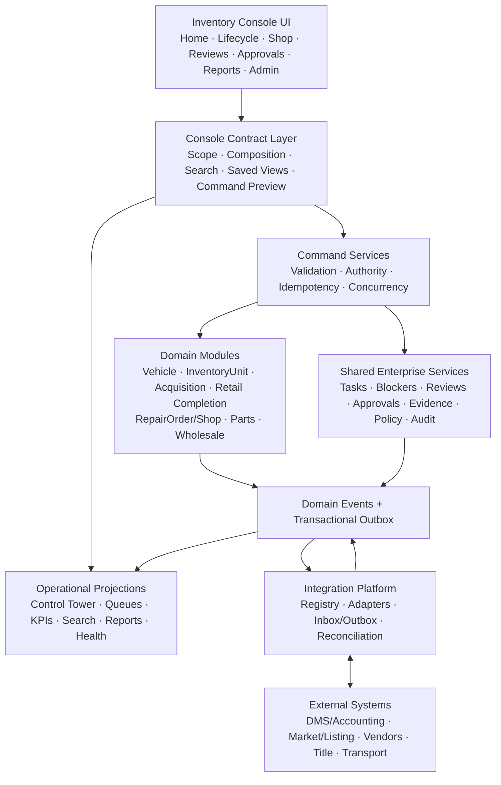

# Inventory Console Implementation Architecture

**Product:** Time Motor Sales Dispatch Board  
**Program:** Enterprise Inventory Console  
**Version:** 1.0 planning baseline  
**Date:** 2026-07-18  
**Status:** Target architecture; documentation only; implementation is not authorized  
**Roadmap:** [`INVENTORY_CONSOLE_IMPLEMENTATION_ROADMAP.md`](INVENTORY_CONSOLE_IMPLEMENTATION_ROADMAP.md)  
**Milestones:** [`INVENTORY_CONSOLE_IMPLEMENTATION_MILESTONES.md`](INVENTORY_CONSOLE_IMPLEMENTATION_MILESTONES.md)

## 1. Architectural outcome

Build one modular Inventory Console over shared enterprise foundations, with authoritative domain ownership, command-side invariants, event-backed projections, explicit external-system boundaries, and human-controlled recommendations.

The architecture must support incremental vertical slices without creating parallel vehicle identities, inventory lifecycles, RepairOrders, parts ledgers, task systems, approval systems, or audit trails.

## 2. Governing principles

- **Canonical domains:** Each business fact has one authoritative owner.
- **CQRS where useful:** Commands enforce invariants; projections serve dense operational reads.
- **Event evidence:** Accepted state changes emit attributable domain and audit evidence atomically.
- **No distributed transaction fiction:** External work uses outbox/inbox, acknowledgement, retry, and reconciliation.
- **Tenant/location isolation:** Scope is server-enforced in commands, reads, search, exports, events, and integrations.
- **Human-in-command:** Algorithms advise; commands and approvals execute.
- **Versioned policy:** Authority, thresholds, formulas, workflows, evidence, and integrations retain effective versions.
- **Progressive activation:** Deploy, migrate, read, command, integrate, and optimize are separate rollout decisions.
- **Recoverability:** Idempotency, optimistic concurrency, reversals, replay, reconciliation, backup/restore, and rollback are designed before activation.

## 3. Logical architecture

The “Console Contract Layer” is a logical boundary, not a requirement for a separate deployable service. It composes permission-equivalent reads and command previews without owning domain state.

## 4. Domain ownership

| Module | Owns | Does not own |
| --- | --- | --- |
| Vehicle Registry | Canonical physical vehicle identity, external identity map, odometer observations, relationships, duplicate review | Commercial inventory cycle, RepairOrder, parts stock |
| InventoryUnit | One dealership-controlled acquisition/disposition cycle, lifecycle state/history, owner/location, targets, operating state | Physical identity, accounting ledger, customer RepairOrder |
| Acquisition & Appraisal | Opportunity, evidence/comparables, appraisal versions, confidence, purchase limits, approvals, commitments, acquisition boundary | Inventory receipt/custody, payment processing, wholesale appraisal |
| Inventory-to-Frontline | Transport through frontline release, stage work/evidence/gates, suspension/reinstatement | Customer repair ownership, sale/delivery, wholesale settlement |
| Retail Completion | Availability, reservation, sale, delivery, unwind/reversal, operational/external reconciliation | CRM/DMS master identity, payment processing, tax/accounting ledger |
| RepairOrder / Shop | Customer Repair and Inventory Recon orders/jobs, estimates, authorization, labor, dispatch, QC, release, close/reopen | InventoryUnit ownership, parts balance, accounting ledger |
| Parts | Part/vendor/warehouse/bin, demand, reservation, immutable stock ledger, procurement, receiving, custody, transfer, recovery, counts | Repair diagnosis/approval, accounting ledger |
| Disposition & Wholesale | Candidate review, disposition appraisal, channel/price proposal, activation, offers/bids, sale/transfer, settlement/reconciliation | Acquisition appraisal, external auction/listing truth without acknowledgement |
| Work Governance | Tasks, blockers, reviews, approvals, escalations, assignment/claim, due/SLA | Underlying domain state |
| Evidence & Knowledge | Documents/media metadata, checksum, security/retention, evidence links, procedures | Domain completion by file existence alone |
| Policy & Authorization | Capabilities, delegated authority, separation of duties, thresholds, effective policy, rollout | Business record mutation |
| Integration Platform | Adapter registry, external identities, mappings, inbox/outbox, acknowledgements, retries, conflicts, reconciliation | Core domain authority |
| Reporting & Optimization | Governed metric facts, projections, scorecards, advisory recommendations/outcomes | Command execution or self-changing policy |

## 5. Aggregate and invariant model

### Vehicle and InventoryUnit

- One canonical Vehicle represents the physical asset.
- One open InventoryUnit per Vehicle/organization; a later reacquisition creates a new cycle.
- InventoryUnit starts only at authoritative financial/control acquisition evidence.
- Every accepted lifecycle version produces an immutable state event.

### RepairOrder and RepairJob

- RepairOrder retains customer-versus-inventory origin.
- Inventory Recon links to one InventoryUnit and returns an approved handoff after QC.
- RepairJob owns work readiness and links authorized parts demand without owning stock.

### Parts quantity and custody

- Immutable ledger events derive balances; negative stock and over-allocation fail.
- Reserve/release/receive/issue/install/return/transfer/count/adjust/reverse are explicit events.
- Source and destination transfer movements reconcile under concurrency.

### Wholesale and retail completion

- Offer/appraisal/proposal/approval versions are immutable after submission.
- Sale, delivery, transfer, release, unwind, and settlement reference exact authorized evidence.
- External request is not acknowledgement; expected and actual values remain separate.

## 6. Command architecture

Each consequential command follows one contract:

1. Authenticate actor/session.
2. Resolve organization, location, role/capability, delegation, field/amount restrictions, and rollout.
3. Load authoritative aggregate and expected version.
4. Validate lifecycle state, evidence, policy, separation of duties, hard gates, and external prerequisites.
5. Detect idempotent replay or conflicting request hash.
6. Preview exact effect and required approval where applicable.
7. Commit domain mutation, aggregate version, command ledger, state/ledger record, audit event, domain event, and outbox atomically.
8. Return command ID, resulting state/version, tasks/approvals/events, projection-lag expectation, and unresolved exceptions.

Commands reject stale versions safely. Cancellation and correction do not delete history; they create explicit successor or compensating evidence.

## 7. Work, review, and approval architecture

- A task represents accountable human work, not status duplication.
- Equivalent open tasks deduplicate by organization, subject, action, reason, policy/workflow version, and active state.
- Review requests gather evaluation; approval requests authorize exact consequential proposals.
- Approval retains proposal/evidence/policy versions, amount/quantity, requester, eligible approver, decision, reason, expiry, and separation-of-duties result.
- Material proposal changes invalidate stale approval.
- Notifications supplement tasks/reviews/approvals and never own state.
- Global queues and contextual panels use the same authoritative records and permission rules.

## 8. Projection architecture

### Projection families

- Console Home summary, attention, priority work, throughput, and health.
- Inventory Lifecycle summary, stages, clocks, dependencies, capital/aging, selected asset, exceptions, reviews, approvals, and recommendations.
- Shop lane, capacity, dispatch, technician/advisor, readiness, QC, and production.
- Parts demand, supply, PO/receiving, balances/ledger, custody, transfer, recovery, counts, and advice.
- Wholesale candidates, appraisals, channels, offers, completion, settlement, and exceptions.
- Vehicle 360, search, relationship graph, tasks, event/audit, documents, and integrations.
- Governed KPI facts, scorecards, reports, and exports.

### Projection envelope

Every read exposes contract/projection/catalog versions, organization/location scope, time zone, filter/as-of cutoff, calculated time, freshness, lag, quality grade, exclusions, partial reasons, reconciliation status, permissions, and drill-through.

### Consistency model

- Command acceptance is authoritative; projections may be eventually consistent.
- UI shows command-to-projection lag and does not resubmit on lag alone.
- Projections are idempotent by event identity and checkpointed.
- Replay and rebuild preserve source event order and record projection version.
- Material mismatches create exceptions; historical restatement is explicit.

## 9. Frontend architecture

### Global composition

- Shared shell owns seven approved destinations, search, location scope, notifications/help/user controls, event log, and **+ Start Workflow**.
- Domain landing pages compose governed read contracts and contextual commands.
- Deeper workspaces preserve location, filters, saved view, cutoff, selection, and return context.
- No frontend component calculates production KPIs or enforces security by visibility alone.

### State model

- URL state for shareable permitted scope, filters, stage/population, selection, and return context.
- Server query state for projections and command results.
- Local transient state only for presentation, form draft, disclosure, and optimistic pending indication.
- Saved views are server records with version and permission intersection.

### Interaction states

Every panel supports loading, empty, partial, stale, insufficient, unavailable, denied, conflict, retryable/final failure, lag, reconciliation-required, degraded/manual, and recovered states.

### Responsive/accessibility

- Desktop preserves approved density and selected-asset rail.
- Tablet uses horizontal pipelines and persistent drawers.
- Mobile prioritizes critical work/actions and vertical lifecycle progression.
- Keyboard, focus, accessible names, status semantics, contrast, zoom/reflow, reduced motion, and screen-reader refresh/command announcements are required.

## 10. Search and Vehicle 360

- Search indexes only authorized metadata and supports VIN/partial VIN, stock, vehicle attributes, external IDs, customer/deal where permitted, RepairOrder/job, part/PO, task, review, approval, exception, and document metadata.
- Results retain organization/location and field permissions.
- Vehicle 360 composes identity, InventoryUnit cycles, service, parts, customer, documents, costs, decisions, and events without moving domain ownership.
- Relationship graph edges reference authoritative IDs and effective relationships.

## 11. Integration architecture

### Registry contract

Every integration defines owner, provider/system, authority by field/workflow, direction, identifiers/mapping version, auth/secret boundary, data classification, frequency, freshness, rate/volume, idempotency, acknowledgement, retry/backoff, circuit breaker, timeout, inbox/outbox, lineage, conflict, reconciliation, support, sandbox, rollout, and deprecation.

### Adapter sequence

1. Inventory actual systems and approve source matrix.
2. Build shared adapter/contract harness.
3. Pilot one bounded round trip with sandbox fixtures.
4. Prove duplicate/retry/outage/replay/mismatch/reconciliation.
5. Enable reads before commands where possible.
6. Enable one location/workflow with manual fallback.
7. Expand only after monitored outcomes.

### Provider boundaries

- DMS/accounting: operational packages and acknowledgement; not ledger replacement.
- VIN/history/title: attributed facts with retrieval time; never silent overwrite.
- Market/listing/auction: valuation/publication/offer evidence; recommendations remain advisory.
- Parts vendors: quote/order/acknowledgement/shipment/receipt/return/credit reconciliation.
- Transport: request/confirmation/custody/status; physical receipt remains internal evidence.
- Messaging/payment: consent-safe delivery and references; no secrets or card storage.

## 12. Recommendation architecture

Algorithms run after hard eligibility and produce versioned advisory records containing inputs/sources, cutoff/freshness, method/policy version, constraints, score/range, confidence, reasons, alternatives, expiry, allowed follow-up, and outcome link.

Required engines include lifecycle delay, blocker severity, routing, next-best action, task generation, SLA/escalation, expected completion, capital exposure, acquisition/appraisal, recon priority, parts supply/allocation, wholesale disposition/channel/offer, retail completion readiness, and outcome calibration.

Weights never self-modify in production. Insufficient evidence suppresses conclusions. Kill switch and deterministic fallback are required.

## 13. Security, privacy, and governance

- Server-side tenant/location/role/capability/ownership/amount/delegation checks.
- Field policies for customer, employee, title/legal, financial, payment/reference, document/media, audit, and integration data.
- Four-eyes and anti-splitting controls for configured financial/inventory actions.
- Immutable audit with actor, subject, action, reason, before/after or proposal/result references, policy/version, correlation, and time.
- Retention, legal hold, privacy requests, quarantine, deletion evidence, and export reason/watermarking.
- Threat model covers tenant isolation, broken access, upload abuse, secrets, webhook spoofing/replay, injection, export leakage, and recommendation misuse.

## 14. Reliability and operations

- Transactional outbox and idempotent consumers.
- Bounded retries, dead letters, replay, reconciliation, projection checkpoints, and background-operations console.
- SLOs for command acknowledgement, projection lag, read latency, integration freshness, job success, and critical workflow availability.
- Structured logs/traces/metrics with privacy-safe identifiers and correlation.
- Backup, restore, RPO/RTO, disaster-recovery, migration rollback/forward, archival, and long-running replay proof.
- Runbooks, ownership, alert thresholds, escalation, manual fallback, staff communication, support training, and incident review.

## 15. Data migration strategy

1. Inventory source fields and authority; do not infer ownership or completion from ambiguous records.
2. Canonical identity reconciliation and duplicate review.
3. Dry-run mapping with errors, conflicts, exclusions, and proposed records.
4. Business review and signed reconciliation totals.
5. Idempotent import with lineage and immutable migration evidence.
6. Post-import source-versus-target and lifecycle/amount/quantity checks.
7. Feature rollout remains off until pilot authorization.

Historical representative/mockup data is never promoted to production facts.

## 16. Deployment and rollout architecture

- Backward-compatible schema first.
- Projection/read paths before consequential writes.
- Commands behind organization/location/role/action rollout policy.
- Integrations and algorithms behind independent gates and kill switches.
- Expand by slice, role, location, volume, and provider.
- Pause/rollback can disable commands/adapters while retaining audit and read evidence.
- Roll forward is required where rollback would discard authoritative history.

## 17. Architecture decision records required before code

- Console composition/BFF boundary and route/context contract.
- Inventory Lifecycle stage and Retail Completion aggregate/state boundary.
- Appraisal/purchase commitment and Wholesale appraisal separation.
- Shared task/review/approval deduplication and state contracts.
- Parts costing, ledger, reservation, and transfer concurrency confirmation.
- Projection versioning, rebuild, restatement, and reconciliation.
- Search/Vehicle 360 indexing and field-permission model.
- Integration registry, external identity, acknowledgement, and adapter harness.
- Recommendation record, explanation, outcome, calibration, and kill switch.
- Migration, archival, backup/restore, and disaster-recovery strategy.

Existing accepted ADRs remain valid and should be extended rather than duplicated.

## 18. Architecture acceptance

The architecture is ready for implementation only when:

- every UI action and value maps to an authoritative domain or projection;
- every domain has one owner and explicit cross-domain references;
- command invariants, permissions, approvals, events, reversals, and reconciliation are approved;
- external authority and acknowledgement semantics are documented;
- read envelopes, freshness, lag, error, and drill-through behavior are fixed;
- security, privacy, accessibility, performance, observability, backup/restore, pilot, and rollback targets are approved;
- no unresolved decision would materially change aggregate boundaries, navigation, source authority, or release order.

## 19. Change control

Changes to aggregate ownership, source authority, command/event contracts, authorization, projections, integration boundaries, recommendation execution limits, or rollout architecture require an ADR and coordinated roadmap/milestone update.
