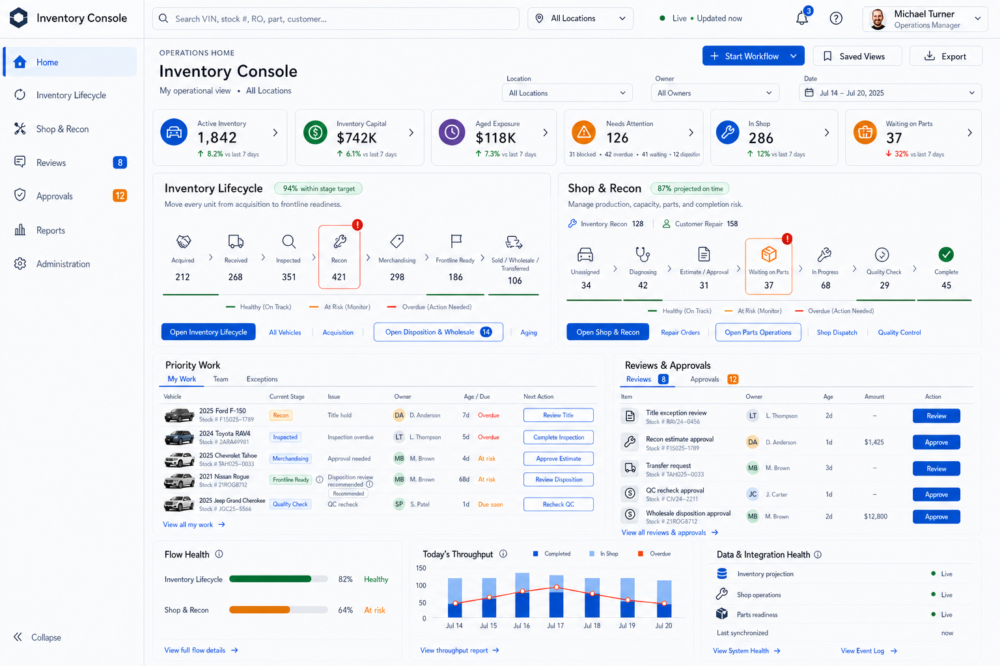
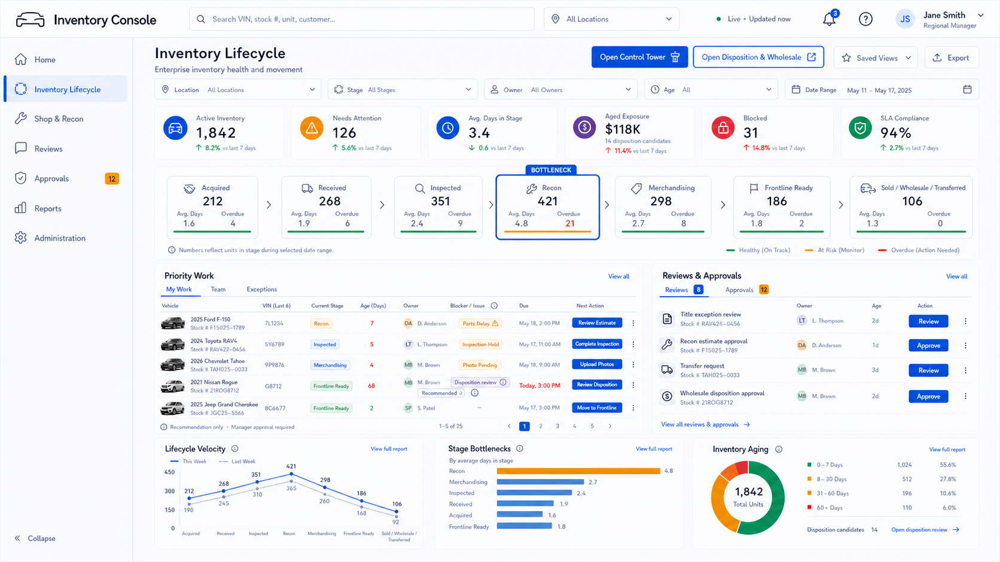
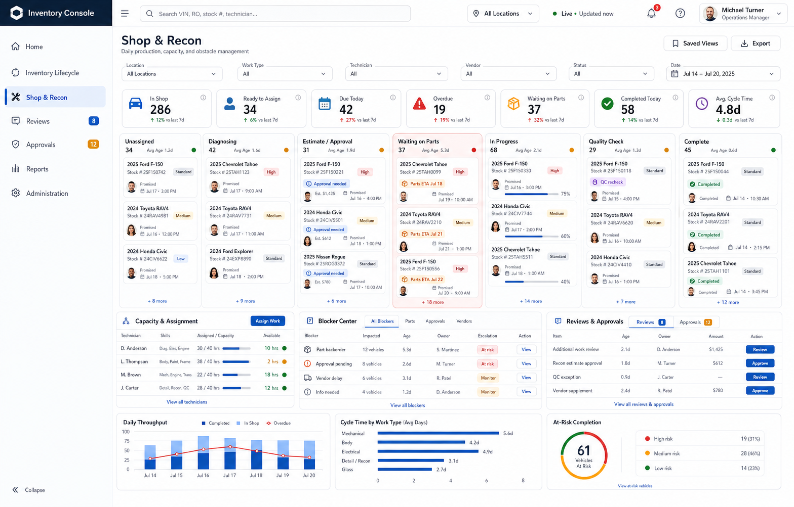
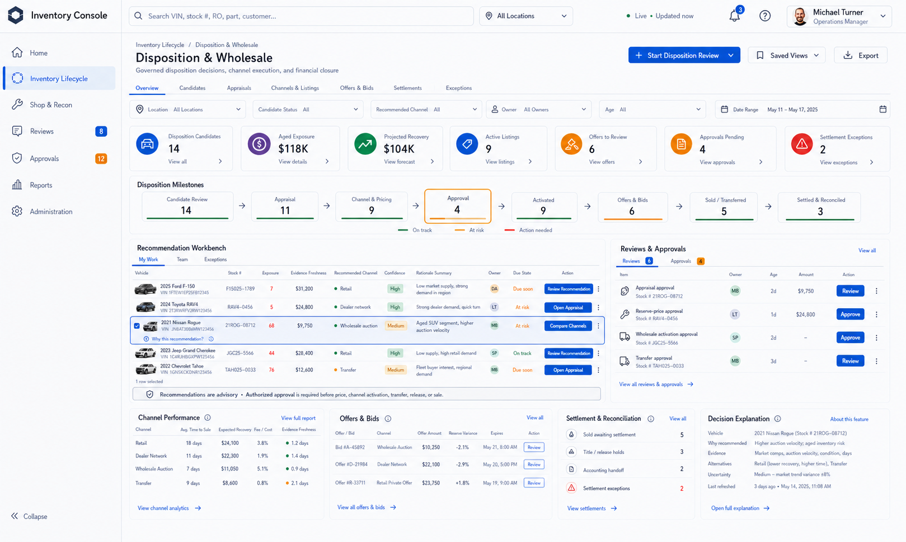
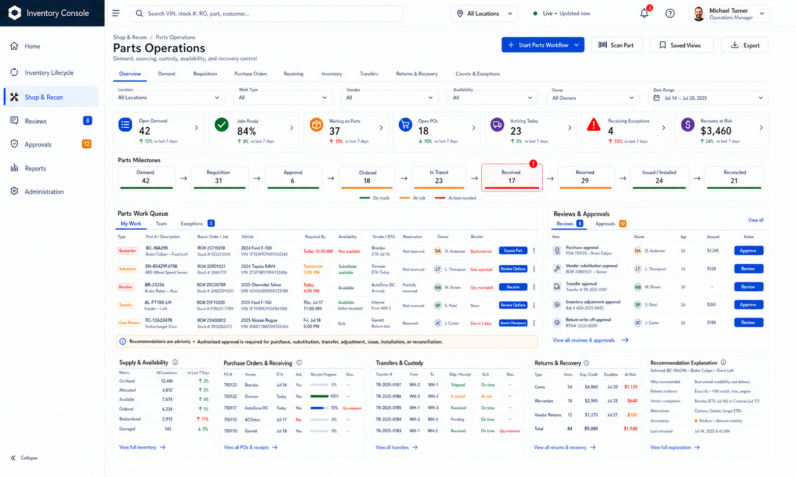

# Inventory Console Landing Pages UI Source of Truth

**Product:** Time Motor Sales Dispatch Board
**Module:** Inventory Console
**Version:** 1.4 approved baseline
**Date adopted:** 2026-07-16; refined and re-approved 2026-07-17; Control Tower navigation approved 2026-07-18
**Status:** Approved visual and interaction source of truth; implementation not yet started

---

## 1. Approval decision

The five images in this document are the binding desktop landing-page and deeper-workspace references for the Inventory Console.

- Selecting **Home** must land the staff member on the approved Inventory Console Home page.
- Selecting **Inventory Lifecycle** must land the staff member on the approved Inventory Lifecycle page.
- **Control Tower** is an explicit deeper workspace under Inventory Lifecycle, reached through the primary **Open Control Tower** command.
- Selecting **Shop & Recon** must land the staff member on the approved Shop & Recon page.
- **Reviews** and **Approvals** remain first-class console destinations and must also be visible in the relevant landing-page workflow panels.
- **Disposition & Wholesale** is an explicit deeper workspace under Inventory Lifecycle, reached through the prominent **Open Disposition & Wholesale** command.
- **Parts Operations** is an explicit deeper workspace under Shop & Recon, reached through the prominent **Open Parts Operations** command.
- Selecting **Open Disposition & Wholesale** must land the staff member on the approved Disposition & Wholesale workspace.
- Selecting **Open Control Tower** must land the staff member on the detailed Inventory Lifecycle Control Tower with the permitted landing-page context preserved.
- Selecting **Open Parts Operations** must land the staff member on the approved Parts Operations workspace.

The images define the approved information hierarchy, page composition, navigation emphasis, operational density, visual language, and relationship between summary metrics and actionable work. Values, names, counts, dates, and example vehicles shown in the mockups are illustrative and must be supplied by authoritative application data when implemented.

Wholesale algorithms and parts recommendations are decision support. They may explain and propose actions, but an authorized staff member must review and explicitly approve any consequential action.

## 2. Inventory Console Home landing page

**Required destination:** the default page reached when staff enter the Inventory Console or select **Home** within the console.

The implementation must preserve:

- the shared Inventory Console header, global search, location scope, live-data state, alerts, help, and user controls
- exactly seven primary console destinations: Home, Inventory Lifecycle, Shop & Recon, Reviews, Approvals, Reports, and Administration
- no horizontal module-tab wall
- the prominent `+ Start Workflow` command as an action rather than a navigation tab
- role-aware and state-aware workflow starts with server-side authorization and auditable outcomes
- compact operational KPIs covering active inventory, inventory capital, aged exposure, needs attention, in-shop work, and waiting-parts work
- explicit blocked, overdue, and waiting breakdown for work needing attention
- equal routing prominence for Inventory Lifecycle and Shop & Recon
- equal, prominent contextual commands for **Open Disposition & Wholesale** and **Open Parts Operations** without adding either as a primary navigation tab
- Inventory Lifecycle stage-target performance and visible bottleneck state
- visible wholesale/disposition priority work, candidate count, recommendation context, and approval state
- Shop & Recon projected-on-time performance and explicit Inventory Recon versus Customer Repair workload separation
- visible parts readiness, waiting-parts work, and parts-operations health
- contextual links to deeper capabilities instead of additional primary tabs
- Priority Work with My Work, Team, and Exceptions views
- Reviews & Approvals with direct authorized actions
- Flow Health, Today's Throughput, and Data & Integration Health
- `View Event Log` access without adding Activity as a primary navigation destination

The Home page is an attention, workflow-start, and routing surface. It must not become another detailed control tower.

## 3. Inventory Lifecycle landing page

The image above is the binding Inventory Lifecycle landing-page reference. The **Open Control Tower** refinement received explicit product approval on 2026-07-18. The prior `inventory-lifecycle-landing-page-source-of-truth.png` asset is retained only as historical change evidence and no longer governs implementation.

**Required destination:** the default page reached from the **Inventory Lifecycle** console navigation item.

The implementation must preserve:

- shared Inventory Console header, search, location scope, live-data state, alerts, help, and user controls
- selected Inventory Lifecycle navigation state
- Reviews and Approvals navigation with visible pending counts when available
- compact filters and interactive KPI strip
- a visible primary **Open Control Tower** command in the page header
- a prominent **Open Disposition & Wholesale** command in the page header
- lifecycle pipeline from acquisition through the final **Sold / Wholesale / Transferred** state
- visible bottleneck identification
- aged-exposure and disposition-candidate visibility
- priority work queue with ownership, blockers, due state, and next action
- disposition recommendations that expose their rationale and remain advisory until authorized approval
- wholesale disposition approval in the relevant Reviews & Approvals context
- Reviews & Approvals panel with direct Review and Approve actions subject to authorization
- lifecycle velocity, stage bottleneck, inventory-aging, and disposition summaries

## 4. Shop & Recon landing page

**Required destination:** the default page reached from the **Shop & Recon** console navigation item.

The implementation must preserve:

- the same shared Inventory Console shell and visual system
- selected Shop & Recon navigation state
- Reviews and Approvals navigation with visible pending counts when available
- compact filters and actionable daily-production KPIs
- a prominent **Open Parts Operations** command in the page header
- production flow from unassigned work through completion
- prominent constraint and waiting-parts visibility
- parts-readiness and waiting-on-parts readiness metrics
- readable vehicle work cards with ownership, promise state, readiness, priority, and blockers
- Capacity & Assignment, Blocker Center, Reviews & Approvals, and Parts Operations operating panels
- purchase and substitution recommendations that require authorized human approval
- parts operations metrics for requests, orders, receipts, issues, installations, transfers, reconciliation, and exceptions when supported by authoritative data
- daily throughput, work-type cycle time, and at-risk completion summaries

## 5. Disposition & Wholesale workspace

**Required destination:** the deeper workspace reached through **Open Disposition & Wholesale** from Home or Inventory Lifecycle.

The approved local navigation, eight operational milestones, recommendation workbench, role visibility, validation, approvals, records, tasks, events, implementation slices, and capability boundaries are binding as defined in [`DISPOSITION_WHOLESALE_WORKSPACE_UI_SOURCE_OF_TRUTH.md`](DISPOSITION_WHOLESALE_WORKSPACE_UI_SOURCE_OF_TRUTH.md).

Disposition & Wholesale remains subordinate to Inventory Lifecycle and must not be added as an eighth primary console navigation item.

## 6. Parts Operations workspace

**Required destination:** the deeper workspace reached through **Open Parts Operations** from Home or Shop & Recon.

The approved local navigation, nine operational milestones, parts work queue, role visibility, validation, approvals, records, tasks, events, implementation slices, immutable quantity and custody controls, and capability boundaries are binding as defined in [`PARTS_OPERATIONS_WORKSPACE_UI_SOURCE_OF_TRUTH.md`](PARTS_OPERATIONS_WORKSPACE_UI_SOURCE_OF_TRUTH.md).

Parts Operations remains subordinate to Shop & Recon and must not be added as an eighth primary console navigation item.

## 7. Navigation contract

| Staff action | Required landing destination |
| --- | --- |
| Enter the Inventory Console or select **Home** | Approved Inventory Console Home landing page in section 2 |
| Select **Inventory Lifecycle** | Approved Inventory Lifecycle landing page in section 3 |
| Select **Open Control Tower** | Detailed Inventory Lifecycle Control Tower, preserving location, filters, saved view, operating cutoff, selected stage/record, and return context |
| Select **Shop & Recon** | Approved Shop & Recon landing page in section 4 |
| Select **Open Disposition & Wholesale** | Approved Disposition & Wholesale workspace in section 5, preserving location, filter, and return context |
| Select **Open Parts Operations** | Approved Parts Operations workspace in section 6, preserving location, filter, and return context |
| Select **Reviews** | Enterprise review queue scoped by role and location |
| Select **Approvals** | Enterprise approval queue scoped by authority and location |
| Select a landing-page review or approval item | The corresponding review or approval detail, with return context preserved |
| Select **+ Start Workflow** | Role-aware workflow-start command surface; not a navigation destination |
| Select **View Event Log** | Auditable workflow and integration event history |

The application route names may follow the repository's routing conventions, but the navigation behavior above is binding. Staff must not be sent to a generic inventory list or an unrelated dashboard when selecting either approved category.

## 8. Shared interaction contract

- KPI cards filter or open the corresponding operational population; they are not static decoration.
- **Open Control Tower** opens the detailed Inventory Lifecycle workspace and preserves the current permitted operating context.
- The detailed Control Tower shows `Inventory Lifecycle > Control Tower` and a visible **Back to Inventory Lifecycle** action that restores the originating landing-page context.
- `+ Start Workflow` exposes only commands permitted for the staff member, location, selected context, and current workflow state.
- Every accepted workflow-start command creates traceable backend state and an auditable event.
- System-triggered events appear in the appropriate workflow, notification, health, or event-history surface rather than as navigation tabs.
- Pipeline stages and production columns open or filter their work queues.
- Saved views preserve the user's permitted scope and filter state.
- Search supports the identifiers available from authoritative backend sources.
- Reviews and approvals show owner, age, status, and the next authorized action.
- Approval actions enforce server-side authority, required reasons, and audit history.
- Wholesale recommendations must expose available rationale, source freshness, assumptions, confidence or uncertainty, and alternatives; price changes, channel activation, transfers, releases, or disposition decisions require an authorized human command.
- Parts recommendations must expose available rationale, source freshness, constraints, and alternatives; purchases, substitutions, transfers, adjustments, issues, installations, or reconciliation actions require an authorized human command.
- Blocked, overdue, waiting, and stale states use text or icons in addition to color.
- Data freshness, partial-data, source-unavailable, loading, empty, error, and permission-denied states must be explicit.
- Role-based layouts may prioritize different panels, but they must preserve the approved page identity and core operating model.

## 9. Relationship to the detailed control tower

This decision supersedes the older control-tower mockup only as the **default Inventory Lifecycle landing-page composition**. The detailed lifecycle swimlanes, selected-asset command rail, Shop execution rules, parts controls, governance requirements, and backend contracts in [`INVENTORY_CONSOLE_UI_SOURCE_OF_TRUTH.md`](INVENTORY_CONSOLE_UI_SOURCE_OF_TRUTH.md) remain valid for deeper workspaces where they do not conflict with this approved landing-page decision.

## 10. Change control

Any material change to the Home routing model, workflow-start command, primary navigation, any approved landing page or deeper workspace, **Open Disposition & Wholesale**, **Open Parts Operations**, local workspace tabs or milestones, priority-work placement, Reviews & Approvals visibility, event-log access, approval guardrails, or core operating panels requires explicit product approval and a versioned update to the applicable source-of-truth document and approved image.
