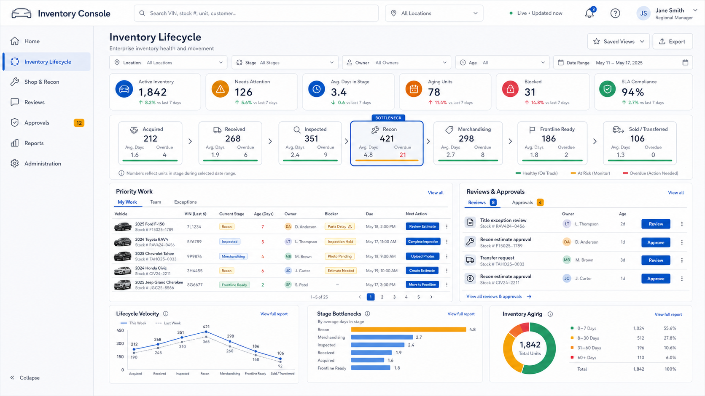

# Inventory Console Landing Pages UI Source of Truth

**Product:** Time Motor Sales Dispatch Board
**Module:** Inventory Console
**Version:** 1.0 approved baseline
**Date adopted:** 2026-07-16
**Status:** Approved visual and interaction source of truth; implementation not yet started

---

## 1. Approval decision

The two images in this document are the binding desktop landing-page references for the Inventory Console.

- Selecting **Inventory Lifecycle** must land the staff member on the approved Inventory Lifecycle page.
- Selecting **Shop & Recon** must land the staff member on the approved Shop & Recon page.
- **Reviews** and **Approvals** remain first-class console destinations and must also be visible in the relevant landing-page workflow panels.

The images define the approved information hierarchy, page composition, navigation emphasis, operational density, visual language, and relationship between summary metrics and actionable work. Values, names, counts, dates, and example vehicles shown in the mockups are illustrative and must be supplied by authoritative application data when implemented.

## 2. Inventory Lifecycle landing page

**Required destination:** the default page reached from the **Inventory Lifecycle** console navigation item.

The implementation must preserve:

- shared Inventory Console header, search, location scope, live-data state, alerts, help, and user controls
- selected Inventory Lifecycle navigation state
- Reviews and Approvals navigation with visible pending counts when available
- compact filters and interactive KPI strip
- lifecycle pipeline from acquisition through sale or transfer
- visible bottleneck identification
- priority work queue with ownership, blockers, due state, and next action
- Reviews & Approvals panel with direct Review and Approve actions subject to authorization
- lifecycle velocity, stage bottleneck, and inventory-aging summaries

## 3. Shop & Recon landing page

**Required destination:** the default page reached from the **Shop & Recon** console navigation item.

The implementation must preserve:

- the same shared Inventory Console shell and visual system
- selected Shop & Recon navigation state
- Reviews and Approvals navigation with visible pending counts when available
- compact filters and actionable daily-production KPIs
- production flow from unassigned work through completion
- prominent constraint and waiting-parts visibility
- readable vehicle work cards with ownership, promise state, readiness, priority, and blockers
- Capacity & Assignment, Blocker Center, and Reviews & Approvals operating panels
- daily throughput, work-type cycle time, and at-risk completion summaries

## 4. Navigation contract

| Staff action | Required landing destination |
| --- | --- |
| Select **Inventory Lifecycle** | Approved Inventory Lifecycle landing page in section 2 |
| Select **Shop & Recon** | Approved Shop & Recon landing page in section 3 |
| Select **Reviews** | Enterprise review queue scoped by role and location |
| Select **Approvals** | Enterprise approval queue scoped by authority and location |
| Select a landing-page review or approval item | The corresponding review or approval detail, with return context preserved |

The application route names may follow the repository's routing conventions, but the navigation behavior above is binding. Staff must not be sent to a generic inventory list or an unrelated dashboard when selecting either approved category.

## 5. Shared interaction contract

- KPI cards filter or open the corresponding operational population; they are not static decoration.
- Pipeline stages and production columns open or filter their work queues.
- Saved views preserve the user's permitted scope and filter state.
- Search supports the identifiers available from authoritative backend sources.
- Reviews and approvals show owner, age, status, and the next authorized action.
- Approval actions enforce server-side authority, required reasons, and audit history.
- Blocked, overdue, waiting, and stale states use text or icons in addition to color.
- Data freshness, partial-data, source-unavailable, loading, empty, error, and permission-denied states must be explicit.
- Role-based layouts may prioritize different panels, but they must preserve the approved page identity and core operating model.

## 6. Relationship to the detailed control tower

This decision supersedes the older control-tower mockup only as the **default Inventory Lifecycle landing-page composition**. The detailed lifecycle swimlanes, selected-asset command rail, Shop execution rules, parts controls, governance requirements, and backend contracts in [`INVENTORY_CONSOLE_UI_SOURCE_OF_TRUTH.md`](INVENTORY_CONSOLE_UI_SOURCE_OF_TRUTH.md) remain valid for deeper workspaces where they do not conflict with this approved landing-page decision.

## 7. Change control

Any material change to either landing page's navigation, primary pipeline or production flow, priority-work placement, Reviews & Approvals visibility, or core operating panels requires explicit product approval and a versioned update to this document and its approved image.
