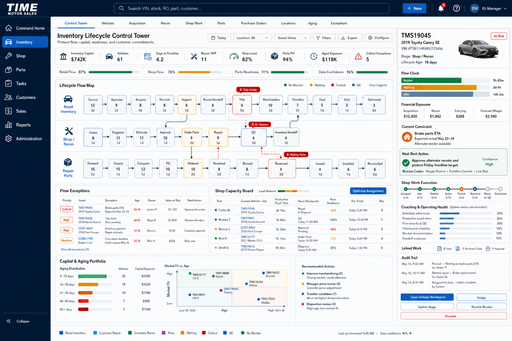

# Inventory Console UI Source of Truth

**Product:** Time Motor Sales Dispatch Board  
**Module:** Inventory Operations Console  
**Approved concept:** Inventory Lifecycle Control Tower  
**Version:** 1.0 planning baseline  
**Date adopted:** 2026-07-13  
**Status:** Approved visual source of truth; initial control-tower UI implemented at `/vehicles`  
**Algorithm specification:** [`INVENTORY_OPTIMIZATION_ALGORITHMS.md`](INVENTORY_OPTIMIZATION_ALGORITHMS.md)
**Enterprise program:** [`INVENTORY_ENTERPRISE_ROADMAP.md`](INVENTORY_ENTERPRISE_ROADMAP.md) · [`INVENTORY_ENTERPRISE_ARCHITECTURE.md`](INVENTORY_ENTERPRISE_ARCHITECTURE.md) · [`INVENTORY_ENTERPRISE_IMPLEMENTATION_MILESTONES.md`](INVENTORY_ENTERPRISE_IMPLEMENTATION_MILESTONES.md)

---

## 1. Approved mockup



The image above is the default visual and interaction source of truth for the Inventory Console. Future implementation should preserve its operating model, information hierarchy, density, and panel relationships unless a later explicitly approved mockup supersedes it.

The first implementation is mounted on the application Inventory route at `/vehicles`. It includes the approved module navigation, KPI and health strips, three lifecycle swimlanes, operational work panels, and independently scrolling selected-asset command rail. The current operational records are representative UI data until the corresponding authoritative inventory read models and command APIs are connected.

This is not a direction to copy another enterprise product. It is the approved original Time Motor Sales presentation for the inventory algorithms, lifecycle controls, Shop execution, parts readiness, capital exposure, and manager command workflows.

## 2. Product intent

The console is an enterprise operating control tower, not a static vehicle list or generic analytics dashboard. It must let authorized users:

- understand current vehicle, Shop, and parts flow
- identify bottlenecks and critical exceptions
- distinguish customer repair from dealership inventory recon
- protect capital, frontline targets, and customer commitments
- assign and rebalance work
- inspect recommendation explanations
- open the detailed vehicle or Shop workbench
- act on blockers, approvals, stage changes, and escalations
- review aging, market fit, and disposition pressure
- trace every material decision through the audit history

## 3. Binding layout

### 3.1 Global shell

- Use the shared Time Motor Sales top header and collapsible dark navy global sidebar.
- Preserve universal search, `+ New`, notifications, help, and user controls.
- Keep Inventory selected in the global navigation.
- The global sidebar may collapse to icons to increase workspace width.

### 3.2 Inventory module navigation

Use a horizontal module bar under the global header:

- Control Tower
- Vehicles
- Acquisition
- Recon
- Shop Work
- Parts
- Purchase Orders
- Locations
- Aging
- Exceptions

`Control Tower` is the default landing view. These tabs are module workspaces, not decorative filters.

### 3.3 Header and controls

Display:

- title: `Inventory Lifecycle Control Tower`
- subtitle: `Protect flow, capital, readiness, and customer commitments.`
- operating date
- location scope
- Saved Views
- Filters
- Export
- Configure

### 3.4 Operating KPIs

Use one compact KPI strip rather than oversized cards:

- Inventory Capital
- Vehicles
- Days to Frontline
- Recon WIP
- Shop Load
- Parts Fill
- Aged Exposure
- Critical Exceptions

Below it, show compact flow-health indicators:

- Retail Flow
- Shop Flow
- Parts Readiness
- Data Confidence

Every KPI must come from an authoritative read model. Preview or unavailable data must be labeled clearly.

### 3.5 Lifecycle Flow Map

The lifecycle map is the primary upper workspace and must contain three related swimlanes:

```text
Retail Inventory
  Source -> Appraise -> Acquire -> Receive -> Inspect -> Recon Handoff
  -> Title -> Merchandise -> Frontline -> Deal -> Sold -> Delivered

Shop / Recon
  Intake -> Diagnose -> Estimate -> Approve -> Order Parts
  -> Repair -> QC -> Inventory Handoff

Repair Parts
  Demand -> Source -> Compare -> PO -> Ordered -> Received
  -> Binned -> Reserved -> Issued -> Installed -> Reconciled
```

Cross-lane handoffs are mandatory:

- Retail inspection may create a linked inventory-recon Shop workflow.
- Parts reservations feed Shop repair execution.
- Shop QC returns successful inventory recon to Retail title or merchandising.
- Customer-owned repair work never enters the Retail Inventory lifecycle.

Each lifecycle node shows count, average stage age, and health. Bottlenecks such as title holds, QC returns, and waiting parts must be visible without opening another page.

### 3.6 Operational lower workspace

The area beneath the lifecycle map contains:

1. **Flow Exceptions:** prioritized exceptions with asset, age, owner, value at risk, and next action.
2. **Shop Capacity Board:** technician, vehicle/job, productive touch time, checkpoint, parts readiness, expected finish, bay, and load-balancing recommendation.
3. **Capital & Aging Portfolio:** age distribution, vehicle count, capital exposure, market-fit-versus-age visualization, and recommended actions.

The Shop Capacity Board must distinguish optimization recommendations from manager-approved assignments.

### 3.7 Right command rail

The selected-asset rail extends from beneath the module navigation to the bottom of the viewport and scrolls independently.

It includes:

- vehicle identity and photo
- lifecycle and Shop stage
- total lifecycle age
- active, waiting, and idle time
- acquisition, recon, carrying, and forecast-margin values
- current constraint
- next-best action, confidence, and reason codes
- Shop execution state
- coaching and operating health
- linked tasks, purchase orders, and approvals
- audit trail
- `Open Vehicle Workbench`, `Assign`, `Update Stage`, `Resolve Blocker`, and `Escalate`

The command rail must never overlay or obscure the primary workspace.

## 4. Inventory and Shop separation

The UI must communicate these distinct workflows:

| Workflow | Purpose | Completion destination |
| --- | --- | --- |
| Retail Inventory | Buy, prepare, merchandise, sell, and deliver dealership stock | Customer delivery or approved disposition |
| Shop Customer Repair | Diagnose and repair a customer-owned vehicle | Customer delivery |
| Shop Inventory Recon | Diagnose and repair dealership-owned retail stock | Retail title or merchandising workflow |
| Repair Parts | Source, reserve, issue, return, and reconcile parts | Shop execution and financial reconciliation |

Use stable labels and colors so the user never confuses customer property with dealership inventory.

## 5. Shop execution and accountability

The selected work item uses this execution state model:

```text
Assigned -> Acknowledged -> Started -> Active
-> Paused with Reason -> Resumed -> Ready for QC
-> Returned for Correction or Completed
```

Execution health uses:

```text
Execution Health =
  25% Schedule adherence
+ 20% Productive touch-time utilization
+ 20% First-time-fix and QC quality
+ 15% Checkpoint reliability
+ 10% Blocker documentation quality
+ 10% Handoff and completion evidence
```

Label the panel `Coaching & Operating Health`. Approved waiting and system-caused delays are excluded. The UI must not label an employee lazy, present an opaque discipline score, or treat a blocker report as misconduct.

## 6. Interaction rules

- Clicking a lifecycle node filters the lower workspace without navigating away.
- Clicking an exception or work item updates the right command rail.
- `Open Vehicle Workbench` opens the full record and execution workspace.
- Saved views and filters must remain aligned within the viewport.
- Recommendations must expose reason codes and confidence.
- Optimization never silently reassigns work, commits a purchase, changes a price, or disposes inventory.
- Manager overrides require a reason and create an audit event.
- Critical safety, title, compliance, and customer-delivery conditions visibly outrank numeric scores.
- Counts, queue membership, and lifecycle stages must update from authoritative state.

## 7. Density and readability

- Keep the complete control tower visible in one desktop viewport at the approved reference size.
- Use compact controls and rows without reducing text below comfortable reading size.
- Prefer bold labels, concise single-line values, and clear status colors.
- Avoid excessive card padding, large empty areas, decorative graphics, and unnecessary repeated actions.
- Keep the lifecycle map, exceptions, capacity board, aging portfolio, and command rail simultaneously visible.
- At narrower desktop widths, preserve the command rail and allow the central workspace to scroll horizontally before collapsing essential information.

## 8. Visual language

- Main canvas: light neutral background
- Global shell: deep navy
- Primary action: restrained cobalt blue
- Healthy/complete: green
- Waiting: amber
- Critical/blocking: red
- Customer repair: cyan
- Inventory recon: blue or green as defined in the legend
- QC: distinct blue
- Borders: crisp, subtle, consistent
- Elevation: minimal and functional
- Corners: modest enterprise radius

Avoid glassmorphism, decorative gradients, purple bias, oversized cards, dark main-canvas defaults, and tiny text.

## 9. Responsive behavior

### Desktop

- Full approved control-tower composition.
- Independent command-rail scrolling.
- Collapsible global navigation.

### Tablet

- Preserve module tabs with horizontal scrolling.
- Lifecycle map may scroll horizontally.
- Right command rail becomes a persistent drawer opened by the selected asset.
- Flow Exceptions and Shop Capacity stack without losing their controls.

### Mobile

- Show priority actions and selected-asset commands first.
- Present lifecycle as a vertical stepper.
- Keep assignment, blocker, stage, QC, and evidence commands accessible.
- Do not attempt to reproduce the complete desktop matrix at unreadable scale.

## 10. Implementation acceptance criteria

The UI implementation is not source-of-truth compliant until:

- all three lifecycle swimlanes are visible and connected
- Retail Inventory, Customer Repair, Inventory Recon, and Parts are unmistakably distinct
- lifecycle nodes show count, age, and health
- exception ranking explains value at risk and next action
- the Shop Capacity Board shows workload, readiness, checkpoint, expected finish, and bay
- system delays are excluded from execution health
- the right command rail scrolls independently and does not cover the workspace
- the lifecycle map and operational panels fit the approved desktop viewport
- recommendation actions remain manager-controlled
- safety and compliance hard rules cannot be hidden by scoring
- loading, empty, error, stale-data, permission-denied, and partial-data states are designed
- keyboard navigation, focus visibility, labels, contrast, and reduced-motion behavior are verified
- browser tests prove the primary tabs, filters, selection, workbench route, and command actions

## 11. Change control

Changes that materially alter the lifecycle swimlanes, Inventory-versus-Shop boundary, command-rail relationship, one-page density, or primary operating panels require explicit product approval and an updated source-of-truth image or document version.
