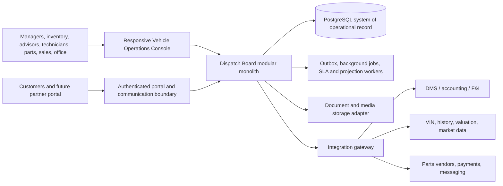
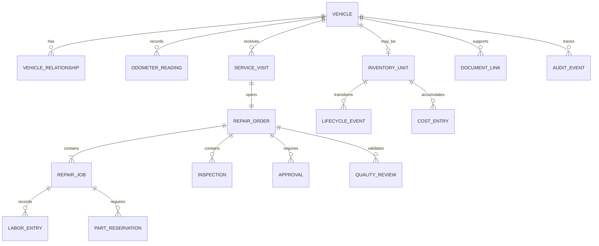

# Vehicle Operations Enterprise Architecture

**Product:** Time Motor Sales Dispatch Board  
**Module:** Vehicle Operations Console  
**Version:** 1.0 target architecture  
**Date:** 2026-07-13  
**Status:** Approved planning target; the current inventory algorithm foundation and visual prototype do not yet provide this complete architecture

## 1. Mission

Build one trustworthy operating system for every vehicle-related workflow at Time Motor Sales: acquisition, dealership inventory, transportation, inspection, reconditioning, title, merchandising, pricing review, sales handoff, customer repair, appointments, repair orders, technician dispatch, parts, purchase orders, quality control, delivery, warranty, documents, communications, and operational analytics.

The goal is enterprise operating discipline, not imitation of a vendor screen. The console adopts proven patterns from national platforms while retaining a simpler dealership-specific workflow, explainable decisions, manager authority, and an incremental path from the existing application.

## 2. Enterprise benchmark

The target combines these public product patterns:

| Enterprise pattern | Public benchmark | Dispatch Board adoption |
| --- | --- | --- |
| Task-driven work orders with skills, parts, checklists, and role-controlled access | [ServiceNow work orders and tasks](https://www.servicenow.com/docs/r/field-service-management/work-order-management/setting-up-work-orders-and-tasks.html) | Repair orders own structured jobs, requirements, evidence, labor, parts, and approvals. |
| Qualified dispatch queues and dispatcher workspaces | [ServiceNow manual dispatch](https://www.servicenow.com/docs/r/field-service-management/field-service-scheduling/c_DispatchWorkOrderTasks.html) | Only ready, qualified work enters shop dispatch; managers retain drag/drop and override controls. |
| Unified vehicle record with milestones, warranties, parts, appointments, claims, and stakeholder relationships | [Salesforce Automotive Cloud vehicle console](https://help.salesforce.com/s/articleView?id=sf.auto_experience_cloud_user.htm&language=en_US) | One vehicle command page becomes the navigation root for its complete operational history. |
| Guided vehicle-service scheduling using territory, work type, technician, vehicle, and available slot | [Salesforce Automotive Scheduler](https://help.salesforce.com/s/articleView?id=ind.auto_appontments_user_parent.htm&language=en_US&type=5) | Appointments use the existing scheduling foundation and create qualified service intake. |
| Work orders separated from resource requirements and bookings | [Dynamics 365 Universal Resource Scheduling](https://learn.microsoft.com/en-gb/dynamics365/field-service/universal-resource-scheduling-for-field-service) | Work defines what is needed; requirements define eligibility; bookings define who and when. |
| Parts warehouses, adjustments, transfers, purchasing, returns, and inventory journals | [Dynamics 365 inventory, purchasing, and returns](https://learn.microsoft.com/en-us/dynamics365/field-service/inventory-purchasing-returns-overview) | Every quantity change posts to an immutable parts ledger with a source document. |
| Role-specific experiences on one data core | [Tekion Automotive Retail Cloud](https://tekion.com/products) | Managers, advisors, technicians, parts staff, inventory staff, sales, and executives share canonical records but receive different workspaces. |
| Connected scheduling, inspection, technician, parts, customer communication, and invoicing workflows | [CDK Fixed Operations Suite](https://www.cdkglobal.com/cdk-fixed-operations-suite) | End-to-end service flow is visible without duplicate re-entry; accounting remains an integration boundary. |
| Reliability, security, operational excellence, performance, and experience as equal architecture pillars | [Microsoft Power Platform Well-Architected](https://learn.microsoft.com/en-us/power-platform/well-architected/) | Every release has security, recovery, observability, performance, and usability gates. |

These references are capability benchmarks, not evidence of feature parity or permission to copy proprietary implementations.

## 3. Architecture principles

1. **One canonical vehicle identity.** A VIN may have many roles over time, but it must not become disconnected duplicate vehicle records.
2. **Separate ownership from workflow.** Customer-owned repair vehicles never become retail inventory. Dealership-owned recon vehicles remain inventory linked to shop work.
3. **State changes are commands.** High-impact fields change through validated commands, not unrestricted form edits.
4. **Events preserve history.** Lifecycle transitions, quantity movements, approvals, financial decisions, and overrides are append-only evidence.
5. **Work is explicit.** Every exception has an owner, next action, due time, and escalation path.
6. **Eligibility precedes optimization.** Safety, authorization, skill, bay, title, parts, and customer constraints filter choices before scoring.
7. **Human authority is visible.** Recommendations never silently purchase, price, dispose, pay, discipline, or communicate externally.
8. **One deployable application first.** Keep a modular monolith and shared PostgreSQL transaction boundary until measured load or team ownership requires extraction.
9. **Integrate through contracts.** DMS, accounting, payments, market data, VIN, history, messaging, and vendor systems connect through adapters, not leaked vendor schemas.
10. **Operate degraded, never deceptively.** External failures show freshness and retry state; cached or estimated data is labeled.

## 4. System context and boundaries



### Owned by this module

- canonical vehicle operational record and vehicle relationships
- dealership inventory lifecycle and capital/recon exposure
- shop intake, repair orders, jobs, inspections, estimates, approvals, labor, QC, and delivery readiness
- repair-parts stock, demand, sourcing, purchasing, receiving, reservation, issue, return, core, warranty, and count controls
- vehicle documents, photos, evidence metadata, milestones, blockers, ownership, and audit history
- dispatch, task generation, recommendations, exceptions, KPIs, and operational projections

### Integrated, not recreated initially

- general ledger, accounts payable/receivable, payroll, tax, and financial statements
- lender submission and contracts-in-transit
- payment processing and card data
- authoritative title agency, OEM, recall, warranty, valuation, and vehicle-history data
- public website merchandising syndication and third-party marketplaces
- enterprise communications delivery

## 5. Bounded domains

| Domain | Core aggregates | Responsibilities |
| --- | --- | --- |
| Vehicle Registry | Vehicle, VehicleIdentity, OdometerReading, VehicleRelationship | VIN/stock identity, ownership classification, customer/dealership association, immutable identity history. |
| Retail Inventory | InventoryUnit, Acquisition, Appraisal, ReconPlan, MerchandisingPackage, PricingDecision, Disposition | Acquisition through delivery/disposition, stage clocks, costs, readiness, market review. |
| Shop Operations | ServiceVisit, RepairOrder, RepairJob, Inspection, Estimate, Approval, LaborEntry, QualityReview | Customer repair and inventory recon, work authorization, dispatch, evidence, QC, service history. |
| Resource Scheduling | Requirement, Booking, Skill, Certification, Bay, Tool, Availability | Eligibility, capacity, appointment-to-work conversion, technician/bay/tool scheduling. |
| Parts and Procurement | PartMaster, StockItem, StockLedgerEntry, Demand, Reservation, PurchaseOrder, Receipt, Return | Perpetual inventory, traceability, purchasing, allocation, transfers, cores, warranty recovery. |
| Customer and Engagement | Customer, VehicleRelationship, Appointment, Interaction, Promise, Consent | Vehicle-linked service context, approvals, communication preference, promise and SLA history. |
| Work Management | Task, Checklist, Assignment, Blocker, Escalation, Comment | Reuses the existing Tasks Console for operational execution rather than creating another task system. |
| Documents and Evidence | Document, MediaAsset, EvidenceLink, SignatureReference | Metadata, retention, access, checksum, relationship to commands and lifecycle gates. |
| Decision and Policy | PolicyVersion, DecisionRecord, Override, Outcome | Versioned deterministic rules, explanations, confidence, safe rollout, calibration. |
| Integration and Data Quality | ExternalSystem, ExternalIdentity, SyncCursor, Inbox, Outbox, Conflict | Idempotent exchange, lineage, freshness, reconciliation, dead-letter handling. |
| Audit and Reporting | AuditEvent, MetricFact, DailySnapshot, ProjectionCheckpoint | Tamper-evident history, operational read models, KPI definitions, reproducible reporting. |

Domains exchange identifiers and events. They do not directly rewrite another domain's private state.

## 6. Canonical vehicle model



### Identity rules

- Store VIN normalized to 17 characters when applicable; retain raw input and validation source.
- Enforce organization-scoped VIN uniqueness while supporting non-VIN assets through a documented exception path.
- Stock number is location/organization scoped and versioned; it is not vehicle identity.
- A customer vehicle may later become a trade-in through an explicit ownership transition, not record replacement.
- Odometer values are append-only observations with reading time, source, unit, actor, and correction link.
- External identifiers are stored in an identity map with source system and sync authority.

## 7. Command, event, and projection architecture

Every material mutation follows:

```text
Request -> authenticate -> authorize -> validate command -> load aggregate
-> enforce state and policy -> write aggregate + domain event + audit + outbox atomically
-> update/rebuild projection -> notify/retry asynchronously -> observe outcome
```

Required command properties:

- command ID and idempotency key
- organization, location, actor, delegated authority, and correlation ID
- expected aggregate version for optimistic concurrency
- normalized input and policy version
- result, rejection reason, and affected records

Events are append-only facts. Corrections create superseding events. Operational tables may expose current state, but authoritative history must remain reconstructable.

Read models are purpose-built for:

- inventory control tower
- vehicle 360 command page
- shop dispatch and technician lane
- parts counter and receiving
- manager exceptions and approvals
- customer/advisor service timeline
- executive operating scorecard

## 8. Workflow state machines

The existing vehicle, shop, and parts state machines remain the base. Enterprise expansion adds explicit substate and cancellation/reversal commands rather than a single overloaded status.

### Retail inventory

```text
Opportunity -> Appraisal -> Approved Limit -> Acquired -> Transit -> Received
-> Inspection -> Recon (linked shop RO) -> Title/Documents -> Merchandise
-> Frontline -> Reserved/Deal Pending -> Sold -> Delivered
                                  \-> Disposition Review -> Disposed
```

### Shop

```text
Appointment/Walk-in -> Intake -> DVI/Diagnosis -> Estimate -> Authorization
-> Parts/Resource Ready -> Dispatch -> Repair -> QC -> Advisor Review
-> Customer/Inventory Handoff -> Closed
```

### Parts

```text
Demand -> Source/Compare -> Approval -> PO -> Ordered -> Partial/Full Receipt
-> Inspect -> Bin -> Reserve -> Issue -> Install -> Return/Core/Warranty -> Reconcile
```

Each transition defines required evidence, actor capability, clock behavior, side effects, reversal path, and emitted event.

## 9. Security and governance

### Authorization

- Organization and location tenancy on every business record.
- Capability-based server policies layered over roles; UI visibility is never enforcement.
- Attribute checks for ownership, location, dollar limit, work type, certification, and separation of duties.
- Step-up confirmation for purchase, price, disposition, refund, warranty, and sensitive-document commands.
- Service accounts have scoped credentials, rotation, expiry, and no interactive login.

### Data protection

- TLS in transit; platform/database encryption at rest.
- Secrets outside source control; no credentials in logs or decision explanations.
- PII minimization, field classification, export controls, retention schedules, and legal-hold support.
- Malware scanning and content-type validation for uploaded documents/media.
- Payment card and lender-sensitive data remain outside this module unless a separately approved compliance architecture exists.

### Audit

- Record who, what, when, where, prior value, new value, reason, authority, correlation, and source.
- Audit viewing and export are separately permissioned.
- Sensitive audit events are immutable to normal application roles.
- Reports retain definition version, time zone, filter, and snapshot timestamp.

## 10. Integration architecture

Use an anti-corruption adapter per external system:

```text
External payload <-> adapter mapping <-> canonical command/event
```

Minimum controls:

- idempotent inbox and transactional outbox
- signed webhooks or authenticated polling
- source-of-truth matrix by field and workflow
- schema/version compatibility checks
- retry with exponential backoff and bounded attempts
- dead-letter queue with operator replay
- sync cursor, freshness timestamp, lineage, and reconciliation counts
- duplicate detection and conflict queue; never last-write-wins for high-impact facts
- circuit breaker and degraded-state UI

Initial adapters should be selected only after an integration inventory identifies the actual DMS, accounting, valuation, parts, website, messaging, and payment systems used by the dealership.

## 11. Reliability and operations

Initial production objectives, to be approved before launch:

| Measure | Initial target |
| --- | --- |
| Console availability during business hours | 99.9% monthly |
| Read API p95 | under 500 ms for normal filtered views |
| Command API p95 excluding external calls | under 800 ms |
| Accepted-command durability | no acknowledged command loss |
| Projection freshness | under 60 seconds normally; visibly stale otherwise |
| Background-job recovery | retry-safe with operator replay |
| Recovery point objective | 15 minutes or better |
| Recovery time objective | 4 hours or better |
| Security/audit event retention | policy-defined and tested |

Required operational capabilities:

- structured logs, metrics, traces, correlation IDs, and health indicators
- synthetic checks for login, vehicle lookup, command execution, and critical jobs
- backup restore drills, failure injection for adapters, and documented incident runbooks
- feature flags, migration compatibility, canary/pilot releases, rollback, and kill switches
- capacity and slow-query monitoring with organization/location dimensions

Microsoft recommends measuring and publishing workload health from metrics, resource logs, and traces; this console follows that observable health-model pattern ([monitoring guidance](https://learn.microsoft.com/en-us/power-platform/well-architected/reliability/monitoring-alerting-strategy)).

## 12. Performance and scale strategy

- Cursor-based pagination and server filtering for all large collections.
- Composite indexes begin with organization/location and common lifecycle predicates.
- Summary projections serve dashboards; dashboards do not aggregate raw ledgers on every request.
- Media uses object storage and signed access, not database blobs.
- Long imports, exports, forecasts, document processing, and integration sync run asynchronously.
- Archive policies separate hot operational data from retained audit/report history.
- Load testing models multiple locations, peak morning dispatch, bulk receiving, and concurrent technician updates.

Extraction into services is allowed only when a bounded domain has independent scaling, security, availability, or team-release needs that exceed the modular monolith. Likely later candidates are media processing, integration workers, notifications, and analytics—not core transactional commands.

## 13. Experience architecture

Role-specific workspaces share the same canonical data:

- **Manager control tower:** flow, capital, exceptions, approvals, capacity, risk, and next action.
- **Inventory workspace:** acquisition, transit, intake, title, recon, merchandising, aging, pricing/disposition review.
- **Advisor workspace:** appointment, check-in, DVI, estimate, approvals, customer promises, status, invoice handoff.
- **Technician workspace:** current/next job, instructions, history, clocking, parts, evidence, blockers, QC handoff.
- **Parts workspace:** demand, sourcing, PO, receiving, bins, reservation, issue, returns, counts, exceptions.
- **Vehicle 360:** identity, ownership, lifecycle, repair/service history, documents, costs, parts, appointments, communications, decisions, audit.
- **Executive scorecard:** trusted KPI definitions, trend, drill-down, data freshness, and operating variance.

Every screen requires loading, empty, stale, partial, unauthorized, conflict, failure, and recovery states. Dense desktop workflows and low-friction mobile execution are both first-class.

## 14. Analytics and responsible automation

Analytics progresses through controlled levels:

1. descriptive facts and reconciled KPIs
2. deterministic alerts and rules
3. explainable recommendations
4. forecasts with uncertainty and backtesting
5. constrained optimization with preview and manager approval
6. limited automation for reversible, low-risk actions

AI may summarize evidence, draft notes, suggest classifications, or explain variance. AI may not be the sole basis for safety release, financial commitment, employee discipline, legal/compliance conclusions, customer pricing, or vehicle disposition. Every AI feature needs provenance, confidence, evaluation, fallback, monitoring, and a kill switch.

## 15. Testing architecture

- Domain unit tests for every transition, calculation, and hard rule.
- Property and invariant tests for ledgers, quantities, clocks, totals, and idempotency.
- Repository tests for tenancy, concurrency, uniqueness, and transaction boundaries.
- Contract tests for every adapter and webhook version.
- Integration tests spanning command, event, projection, task, audit, and outbox.
- Browser tests for the dealership's critical daily journeys.
- Accessibility tests against WCAG 2.2 AA targets.
- Performance, backup/restore, security, and disaster-recovery exercises before enterprise rollout.

## 16. Architecture decision record queue

The following decisions require explicit ADRs before their implementation milestone:

1. Canonical Vehicle versus the existing appointment Vehicle model migration.
2. InventoryUnit and customer-vehicle ownership transition rules.
3. RepairOrder/RepairJob aggregate and accounting/DMS boundary.
4. Parts perpetual-ledger costing method and financial authority.
5. Media/document storage provider and retention.
6. Notification and customer-consent provider boundary.
7. Tenant/location isolation and enterprise permission model.
8. Outbox/job runner and deployment topology.
9. Reporting store and snapshot retention.
10. First external integration and source-of-truth matrix.

## 17. Architecture completion gate

The enterprise target is achieved only when the platform can prove:

- one reconciled vehicle identity and complete timeline
- no unauthorized cross-location or cross-organization access
- no negative or unexplained parts quantity without a visible exception
- no repair execution without applicable authorization and readiness evidence
- no vehicle frontline/delivery release with failed critical gates
- every financial or lifecycle decision is attributable and reversible through controlled commands
- every integration can fail without corrupting the canonical record
- every major dashboard number drills to source records and a versioned definition
- restore, replay, rollback, and incident procedures work in practice

