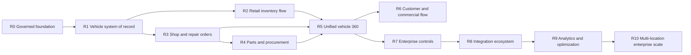

# Vehicle Operations Enterprise Roadmap

**Version:** 1.0  
**Date:** 2026-07-13  
**Status:** Planned program; status markers apply only to this Vehicle Operations program  
**Architecture:** [`INVENTORY_ENTERPRISE_ARCHITECTURE.md`](INVENTORY_ENTERPRISE_ARCHITECTURE.md)  
**Implementation backlog:** [`INVENTORY_ENTERPRISE_IMPLEMENTATION_MILESTONES.md`](INVENTORY_ENTERPRISE_IMPLEMENTATION_MILESTONES.md)
**Governance baseline:** [`governance/README.md`](governance/README.md)

## 1. Outcome

Evolve the current Inventory Operations prototype and deterministic algorithm foundation into an enterprise-grade Vehicle Operations Console that coordinates retail inventory, repair shop, parts, customers, appointments, documents, decisions, and vehicle history on one governed operating record.

This roadmap aims for capability and operating-quality parity with leading enterprise patterns. It does not claim parity today, and it does not attempt to recreate a full DMS, accounting suite, payroll system, or lender platform inside the first release.

## 2. Current baseline

### Implemented foundation

- existing Dispatch Board authentication, roles, tasks, activity, manager review, appointments, customer foundation, and organization/location groundwork
- static `/vehicles` control-tower prototype and approved UI source of truth
- deterministic vehicle, shop, parts, lifecycle, KPI, decision, acceptance, and safety helpers with automated tests
- documented retail inventory, shop, and parts workflow boundaries
- completed M0 glossary/RACI, KPI catalog, threat/data-classification model, and reliability/retention/incident policy baseline

### Not yet implemented as durable Inventory Console behavior

- inventory-specific persistence and migrations
- vehicle lifecycle command services and APIs
- repair orders, repair jobs, labor, DVI, estimates, approvals, or QC persistence
- parts catalog, perpetual stock ledger, purchasing, receiving, binning, reservations, issue, returns, or counts
- live inventory read models behind the prototype
- enterprise vehicle 360, audit, integration gateway, reporting projections, or production operating controls

## 3. Program rules

- Deliver small vertical slices: schema, policy, service, API, UI, audit, observability, and tests together.
- Preserve current daily task and appointment workflows throughout migration.
- No prototype value may appear as live production data.
- No high-impact automation ships without preview, reason, authority, audit, outcome, and kill switch.
- Each phase must pass operational acceptance before the next phase depends on it.
- Integrations follow a documented source-of-truth matrix; do not begin with vendor-specific database fields.

## 4. Release train



R2 and R3 may run in controlled parallel only after R1 identity contracts are stable. R4 begins after the RepairJob and demand contracts are stable.

## 5. Phase roadmap

### R0 — Governed foundation

**Purpose:** Establish the architecture, terminology, authority, quality measures, and safe delivery system.

Deliver:

- canonical glossary and ownership matrix
- architecture decision records for Vehicle, InventoryUnit, RepairOrder, Parts Ledger, audit, jobs, and media
- organization/location capability policies
- command envelope, optimistic concurrency, idempotency, audit, inbox/outbox, and feature-flag foundations
- data classification, retention, security threat model, SLOs, observability, backup/restore, and pilot controls

Exit gate:

- one approved definition exists for every critical status, amount, clock, and KPI
- a test command proves atomic domain event, audit record, and outbox write
- restore and rollback procedures are documented and exercised in a non-production environment

### R1 — Canonical vehicle system of record

**Purpose:** Create a trustworthy vehicle identity and relationship foundation shared by every later workflow.

Deliver:

- canonical Vehicle identity, VIN normalization, stock identities, external identities, and duplicate review
- ownership/usage relationships for customer-owned, dealership-owned, trade-in, sold, and historical vehicles
- append-only odometer readings and corrections
- vehicle location and custody history
- document/media metadata and evidence links
- vehicle search, list, create, duplicate resolution, and 360 identity header
- import preview, validation, reconciliation, and rollback

Exit gate:

- a vehicle cannot silently duplicate by VIN within an organization
- customer repair and dealership inventory routing is deterministic and tested
- every identity correction remains attributable

### R2 — Retail inventory lifecycle control

**Purpose:** Replace spreadsheet/prototype inventory tracking with a live, command-driven lifecycle.

Deliver:

- InventoryUnit, acquisition/appraisal, purchase limits, transportation, receipt, inspection, recon linkage, title, merchandising, frontline, reservation, sale, delivery, and disposition states
- stage events, accountable owner, target, SLA, pause reason, blocker, and next action
- acquisition, recon, title, carrying, merchandising, and projected margin exposure
- frontline-readiness and evidence gates
- configurable 72-hour/30-day/45-day policy reviews
- live control tower, lifecycle lanes, exceptions, aging portfolio, and vehicle command rail

Exit gate:

- every active inventory unit has a current stage, location, owner, age, next action, and explainable readiness state
- price and disposition remain approval commands
- managers can reconcile control-tower totals to vehicle records

### R3 — Shop and repair-order operating system

**Purpose:** Manage customer repair and inventory recon through one controlled shop engine.

Deliver:

- appointment/walk-in intake and RepairOrder creation
- Digital Vehicle Inspection, concern, cause, correction, estimate, authorization, job, labor, notes, evidence, and QC models
- work-type templates, skill/certification, bay/tool/resource requirements, and eligibility
- fast-track, standard, and diagnostic/heavy routing
- dispatcher board with current/next queue, readiness, predicted finish range, conflict, drag/drop, and manager override
- technician mobile workspace with clocking, instructions, service history, parts, blockers, evidence, and handoff
- advisor workspace with status, promises, approval requests, change orders, and delivery readiness
- first-pass yield, comeback linkage, productivity, efficiency, proficiency, and quality-adjusted metrics

Exit gate:

- no repair begins without applicable diagnosis/estimate, authorization, eligibility, and parts/resource readiness
- no release bypasses applicable QC evidence
- inventory recon returns to retail flow and customer repair returns to customer delivery without cross-contamination

### R4 — Parts, purchasing, and material control

**Purpose:** Give every part quantity, reservation, cost, movement, and recovery a source document and audit trail.

Deliver:

- part master, supersession/interchange, vendor, warehouse, bin, stock item, unit/cost basis
- immutable stock ledger and current balance projections
- demand from RepairJob, reservation, issue, install, unused return, substitution, transfer, adjustment, and count
- requisition, vendor comparison, approval, PO, partial receipt, discrepancy, backorder, cancellation, and vendor return
- core and warranty recovery with deadlines and credit reconciliation
- ABC-XYZ, reorder, safety-stock, vendor, ETA-risk, allocation, count-risk, and obsolescence recommendations
- barcode/QR-ready receiving and issue workflows

Exit gate:

- no quantity changes without a ledger entry, source, actor, location, and reason
- negative available quantity is blocked or creates a controlled exception
- physical count, ledger, reservations, open orders, and recoverable credits reconcile

### R5 — Unified Vehicle 360 and command center

**Purpose:** Present the complete operational truth without forcing users to search across modules.

Deliver:

- identity, relationships, milestones, lifecycle, service history, inspection, repair, parts, costs, documents, warranties, appointments, communications, decisions, and audit tabs
- role-aware actions and field visibility
- event timeline with filters and drill-through
- linked record graph and duplicate/conflict warnings
- universal vehicle/stock/VIN/customer/RO/part search
- saved views, exports with permission controls, and consistent deep links

Exit gate:

- authorized users can answer what happened, what is happening, what is blocked, who owns it, what it costs, and what happens next from one vehicle page

### R6 — Customer, approval, warranty, and commercial handoffs

**Purpose:** Connect internal work to a transparent customer experience and controlled financial handoffs.

Deliver:

- service appointment conversion, check-in, promise windows, transportation needs, consent, and communication preferences
- estimate/change-order approval with immutable presented/accepted versions
- customer status timeline and approved outbound messaging templates
- warranty eligibility, claim evidence, claim status, supplier recovery, and credit linkage
- service menu, labor/parts/tax estimate boundaries, invoice-ready handoff, and payment-provider boundary
- sales, delivery, F&I, accounting, and title handoff contracts without rebuilding their systems

Exit gate:

- customer-visible amounts and approvals are versioned and attributable
- communications respect consent, templates, delivery evidence, and failure handling
- commercial handoffs reconcile without duplicate entry

### R7 — Enterprise platform controls

**Purpose:** Make the console governable, secure, reliable, configurable, and operable beyond one expert user.

Deliver:

- capability and attribute-based permissions, dollar limits, separation of duties, delegated authority, and step-up confirmation
- field-level data classification, retention, legal hold, audit export, and sensitive document controls
- organization/location configuration, policy versioning, effective dates, approval, simulation, rollout, and rollback
- localization-ready time, currency, unit, and tax boundaries
- health dashboards, job replay, dead-letter operations, backup restore, incident runbooks, and SLO reporting
- accessibility, performance, concurrency, security, and disaster-recovery validation

Exit gate:

- permission matrix, restore drill, integration failure drill, audit export, and production rollback all pass witnessed acceptance

### R8 — Integration ecosystem

**Purpose:** Connect authoritative external systems while preserving a clean canonical model.

Deliver:

- integration registry and field/workflow source-of-truth matrix
- reusable authenticated adapter framework, mapping versions, inbox/outbox, reconciliation, replay, and conflict operations
- prioritized adapters for the dealership's actual DMS/accounting, VIN/history, market valuation, website/listing, parts vendor, messaging, and payment systems
- import/export jobs, webhook monitoring, freshness, lineage, and degraded-state experiences
- partner API scopes, rate limits, idempotency, audit, sandbox, and contract tests

Exit gate:

- each integration can be disabled or fail without corrupting core workflows
- reconciliation proves counts and financial/quantity totals across boundaries

### R9 — Trusted analytics and constrained optimization

**Purpose:** Move from operational visibility to measurable improvement without opaque autonomous management.

Deliver:

- governed KPI catalog and daily snapshots
- inventory turn, gross/day, stage delay, recon variance, shop throughput, first-pass yield, utilization, parts fill, stock accuracy, purchase performance, recovery, promise, and customer experience reporting
- drill-through from KPI to source record and formula version
- cohort and bottleneck analysis, forecast ranges, backtesting, data-drift monitoring, and scenario simulation
- manager-preview scheduling, purchasing, pricing-review, transfer, and disposition recommendations
- responsible AI summaries with evaluation, citations to internal evidence, monitoring, fallback, and kill switch

Exit gate:

- every published KPI reconciles to governed facts
- every predictive/optimization feature beats a documented baseline in shadow mode before controlled rollout
- no protected or high-impact action becomes autonomous

### R10 — Multi-location enterprise scale

**Purpose:** Support multiple rooftops, centralized services, partners, and higher volume without sacrificing local control.

Deliver:

- cross-location inventory search, transfer, custody, cost, and approval workflows
- centralized dispatch/parts pools with local eligibility and promise constraints
- organization hierarchy, shared services, location policy inheritance, and exception overrides
- customer/partner portals with least privilege
- enterprise reporting consolidation and location comparability
- scale testing, archival, partition strategy, higher availability, and advanced recovery topology

Exit gate:

- tenancy isolation, cross-location accounting/quantity reconciliation, and central-versus-local authority pass production-scale tests

## 6. Capability parity scorecard

This scorecard defines “equal to or better” as measurable operating capability, not feature count.

| Capability | Enterprise target |
| --- | --- |
| Unified record | One vehicle page connects identity, ownership, inventory, service, parts, appointments, documents, warranty, communication, decisions, and audit. |
| Workflow control | Every lifecycle uses validated states, evidence gates, reversals, clocks, owners, tasks, and escalations. |
| Dispatch | Work, requirements, and bookings are separate; eligibility includes skill, certification, bay, tool, availability, parts, priority, and promise. |
| Inventory integrity | Vehicle and parts balances reconcile to immutable events/ledgers and visible exceptions. |
| Customer transparency | Versioned estimates, approvals, promises, status, and communication history are attributable. |
| Enterprise security | Least privilege, location/organization isolation, dollar limits, separation of duties, audit, retention, and export controls. |
| Integration | Versioned adapters, source authority, idempotency, lineage, reconciliation, replay, conflict management, and degraded states. |
| Analytics | Governed definitions, snapshots, drill-through, freshness, confidence, and reproducibility. |
| Reliability | SLOs, observability, retries, restore drills, incident response, safe deployments, and rollback. |
| Experience | Role-specific, responsive, accessible, dense where appropriate, and low-friction for execution. |
| Automation | Explainable, versioned, measured, reversible, manager-controlled, and safely disabled. |

## 7. Prioritization model

Roadmap items are ordered by:

```text
Priority = safety/compliance necessity
         + data-integrity dependency
         + customer/revenue release
         + daily operating frequency
         + exception reduction
         - migration risk
         - integration uncertainty
```

Safety and integrity dependencies are gates, not weights. A visually attractive feature cannot outrank canonical identity, authorization, ledger, or audit foundations.

## 8. Program-level success measures

- 100% of active inventory and open repair orders have an owner, stage, next action, and target
- 100% of critical transitions retain actor, command, event, evidence, and audit correlation
- no unauthorized repair, purchase, price, disposition, or QC release in acceptance testing
- parts inventory accuracy and reservation reconciliation meet an approved target
- reduced time to frontline, diagnostic approval, parts readiness, repair completion, and delivery
- improved first-pass yield and reduced unexplained idle/rack time
- KPI totals reconcile to source records within an approved tolerance
- critical workflows remain usable during an external integration outage
- staff adoption and task-update time meet pilot targets without adding duplicate entry

## 9. Stop conditions

Pause expansion and fix the foundation when:

- duplicate or conflicting vehicle identities exceed the approved tolerance
- ledger or financial reconciliation fails
- cross-tenant/location access is possible
- critical commands lack audit or can execute twice
- background failures are invisible or unreplayable
- dashboard metrics cannot drill to source truth
- staff must maintain the same operational fact in multiple consoles
- recommendations show unsafe bias, unexplained drift, or material override/error rates

