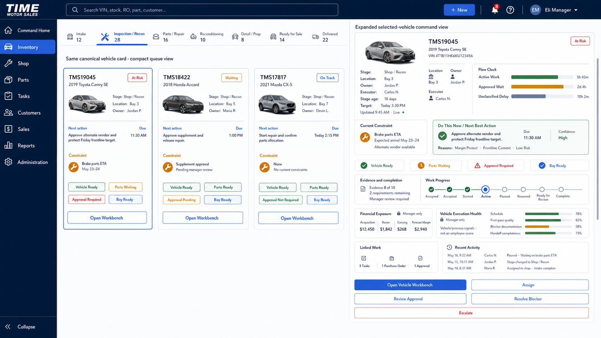

# Inventory Execution Vehicle Card UI Source of Truth

**Product:** Time Motor Sales Dispatch Board  
**Program:** Inventory Console Optimization  
**Component family:** Vehicle Lifecycle Card  
**Version:** `1.0.0`  
**Status:** Approved official desktop visual and interaction source of truth  
**Date adopted:** July 19, 2026  
**Adoption authority:** Explicit project-owner approval  
**Implementation claim:** None. This document approves the vehicle-card design and interaction contract; it does not claim implementation or production activation.
**Official Workbench source:** [`INVENTORY_EXECUTION_VEHICLE_WORKBENCH_UI_SOURCE_OF_TRUTH.md`](INVENTORY_EXECUTION_VEHICLE_WORKBENCH_UI_SOURCE_OF_TRUTH.md)

---

## 1. Approved mockup



The image above is the official desktop source of truth for the Inventory Execution Vehicle Lifecycle Card family.

It governs:

- the compact Vehicle Lifecycle Card used in queues and lifecycle populations;
- the expanded Selected Vehicle Command Card used when a vehicle is selected;
- the shared identity, accountability, readiness, constraint, next-action, evidence, linked-work, activity, and governed-action hierarchy;
- the visual relationship demonstrating that compact and expanded variants are projections of the same canonical vehicle.

Values, names, amounts, dates, counts, vehicle images, and example work shown in the mockup are illustrative. Implementations must use authoritative permitted data and show honest unavailable, stale, partial, or conflicting states.

## 2. Approval decision

The Vehicle Lifecycle Card is adopted as the official persistent operating representation of a vehicle as it moves through the Inventory lifecycle.

The card is not a duplicate vehicle record, a task, a generic form, or a manually draggable lifecycle state. It is a permission-aware projection of the canonical Vehicle/InventoryUnit and its current operating context.

The same canonical vehicle card appears in different permitted populations after authoritative lifecycle commands, gates, and handoffs change its projected state.

## 3. Official terminology

| Official term | Meaning |
| --- | --- |
| Vehicle Lifecycle Card | Shared component family and canonical compact operating projection |
| Compact Vehicle Lifecycle Card | Queue, lifecycle, My Work, Shop/Recon, exception, and search presentation |
| Expanded Selected Vehicle Command Card | Detailed manager/selected-asset presentation shown on the right side of the approved mockup |
| Vehicle 360 | Canonical permission-aware vehicle record, evidence, relationship, and history projection |
| Vehicle Execution Workbench | Focused execution context opened from the card within the canonical vehicle context |

Avoid calling the expanded card a separate vehicle record or a standalone form.

## 4. Component relationship

```text
Canonical Vehicle / InventoryUnit and related domain facts
  -> Vehicle Lifecycle Card projection
      -> Compact queue variant
      -> Expanded selected-vehicle command variant
      -> Vehicle Workbench header/context
```

All variants share canonical identity and current source facts. They do not maintain independent status, owner, readiness, evidence, or lifecycle values.

## 5. Compact Vehicle Lifecycle Card contract

### 5.1 Required identity

- vehicle image or approved placeholder;
- stock/inventory number;
- year, make, model, and trim where authoritative;
- VIN suffix or approved permitted identifier;
- ownership context where relevant.

### 5.2 Required operating context

- current lifecycle stage;
- operating state or health label;
- current physical location;
- accountable owner;
- current executor where applicable;
- current next action;
- due or target time;
- primary controlling constraint;
- stage-relevant readiness indicators;
- `Open Workbench` action.

### 5.3 Readiness indicators

The approved example uses:

- `Vehicle Ready`;
- `Parts Waiting` or `Parts Ready`;
- `Approval Required`, `Approval Pending`, or `Approval Not Required`;
- `Bay Ready`.

Actual readiness indicators are role- and stage-aware. Applicable states must use text and may include:

- Ready;
- Not Ready;
- Blocked;
- Waiting;
- Unknown;
- Stale;
- Not Applicable.

A mandatory failed readiness dimension cannot be hidden by an aggregate score or color.

### 5.4 Compact-card density

The compact card must remain scannable. Full evidence, financial history, audit history, complete task lists, and every possible command belong in the expanded card or workbench.

## 6. Expanded Selected Vehicle Command Card contract

The expanded card follows the approved information sequence.

### 6.1 Identity and health

- stock/inventory number;
- year, make, model, and trim;
- VIN or permitted identifier;
- vehicle image;
- text status such as `At Risk`;
- lifecycle stage;
- stage age;
- current physical location;
- accountable owner;
- current executor;
- target;
- local freshness state.

### 6.2 Flow Clock

The official labels are:

- `Active Work`;
- `Approved Wait`;
- `Unclassified Delay`.

These measure vehicle/workflow flow. They must not be presented as hidden employee inactivity or disciplinary evidence.

### 6.3 Current Constraint

The card presents the highest controlling constraint with:

- constraint name;
- concise operational explanation;
- expected resolution/arrival where supported;
- available recovery or alternative where supported;
- text and icon in addition to color.

### 6.4 Do This Now / Next Best Action

The most prominent recommendation or current action includes:

- exact action;
- due time;
- confidence/data sufficiency;
- concise reasons or stable reason codes;
- required authority where applicable;
- consequence or protected outcome where supported.

Recommendations remain advisory unless the actor has authority and issues the applicable command.

### 6.5 Readiness

The expanded card shows only the controlling or role-relevant readiness dimensions. Full readiness details and resolution ownership belong in the workbench.

### 6.6 Evidence and completion

The card summarizes:

- evidence satisfied versus required;
- remaining requirements;
- manager/independent review requirement;
- completion or handoff readiness.

Evidence content remains governed and permission filtered.

### 6.7 Work Progress

The approved visual uses a text-supported progression:

```text
Assigned -> Accepted -> Started -> Active -> Paused
  -> Resumed -> Ready for Review -> Complete
```

Only valid reached/current states are emphasized. Task progress does not independently complete a governed vehicle-domain gate.

### 6.8 Financial Exposure

The approved manager example includes:

- acquisition;
- recon;
- carrying;
- forecast margin.

Financial information is permission aware, source labeled, and unavailable to roles without the applicable access. Estimated and forecast values must be identified as such.

### 6.9 Vehicle Execution Health

The official term is `Vehicle Execution Health`, not employee coaching score.

The approved manager example may include:

- schedule;
- first-pass quality;
- blocker documentation;
- handoff completeness.

The panel must state that these are vehicle/process signals and not an employee score. It may not drive automatic employee discipline or public ranking.

### 6.10 Linked Work

The card summarizes authorized linked work such as:

- tasks;
- purchase orders;
- approvals.

Selecting linked work opens the authoritative record or workbench. The card does not duplicate those records.

### 6.11 Recent Activity

The card displays a short attributable activity summary with actor, time, and material outcome. Full history remains in Vehicle 360 or authorized audit context.

### 6.12 Governed actions

The approved manager action hierarchy is:

1. `Open Vehicle Workbench` — primary;
2. `Assign`;
3. `Review Approval`;
4. `Resolve Blocker`;
5. `Escalate` — critical outline.

Actions are role-, state-, location-, evidence-, authority-, and policy-aware. The server revalidates every command.

The approved card deliberately does not contain a generic `Update Stage` action.

## 7. Staff and manager variants

The card family uses one underlying projection with role-aware emphasis.

### 7.1 Staff emphasis

- current action;
- location;
- owner/executor;
- due time;
- readiness;
- blocker/waiting state;
- evidence remaining;
- Start/Resume, Block/Wait, Submit, Request Help, or Handoff actions where eligible.

### 7.2 Manager emphasis

- ownership and assignment;
- stage age and target;
- primary constraint;
- next-best action and explanation;
- approvals/reviews;
- financial exposure where authorized;
- Vehicle Execution Health;
- linked work and recent activity;
- assignment, resolution, approval, escalation, and Workbench commands.

Role variants prioritize information; they do not create separate cards or conflicting facts.

## 8. Lifecycle movement rule

The card changes lifecycle populations only after authoritative state changes.

```text
Current work performed
  -> evidence and required fields validated
  -> review/approval completed where required
  -> handoff accepted where required
  -> authorized domain command accepted
  -> domain event and audit recorded
  -> card projection refreshes in the correct lifecycle population
  -> new owner and next action appear
```

Dragging the card, changing task status, or editing a display field does not independently change vehicle lifecycle stage.

If a command is accepted before the card projection refreshes, show a visible accepted/pending state and prevent duplicate submission.

## 9. One current action and parallel work

For staff attention and constrained resources, normally show one Current Work assignment and at most one verified-ready staged Next Work assignment.

A vehicle may have multiple linked active tasks only when:

- the workflow permits safe parallel work;
- tasks do not compete for the same vehicle access, bay, evidence, document, or authoritative transition;
- dependencies and owners are explicit;
- the card identifies the controlling action and summarizes other linked work;
- completing one task cannot incorrectly close or advance another.

## 10. Source authority

The card is a projection over authorized sources including, where applicable:

- Vehicle and InventoryUnit;
- lifecycle state and events;
- vehicle location/custody;
- Tasks and completion readiness;
- repair orders/jobs;
- Parts demand, procurement, receipt, reservation, issue, return, and reconciliation;
- evidence;
- reviews and approvals;
- costs and forecasts;
- enterprise command, event, audit, and integration state.

The card must never present illustrative mockup values as live operational facts.

## 11. State and failure presentation

The card family must represent:

- loading;
- live/fresh;
- stale;
- partial data;
- missing required information;
- conflicting sources;
- unauthorized/restricted fields;
- command pending projection;
- provider unavailable;
- recoverable error;
- empty/no eligible action.

Facts, observations, calculations, estimates, predictions, and recommendations remain distinguishable.

## 12. Visual contract

The approved vehicle-card visual language uses:

- deep navy application chrome;
- white/light-neutral card surfaces;
- cobalt primary actions and selected state;
- green for ready/success;
- amber for waiting/constraint;
- red for critical/escalation;
- crisp subtle borders;
- modest enterprise corner radius;
- minimal functional elevation;
- compact but readable spacing;
- modern legible sans-serif typography;
- icons plus text for operational state.

Avoid:

- glassmorphism;
- decorative gradients;
- oversized empty cards;
- tiny text;
- color-only meaning;
- purple visual bias;
- excessive actions;
- generic stage editing;
- employee score presentation.

## 13. Responsive interpretation

### 13.1 Desktop

The approved image is binding for the relationship between compact queue cards and the expanded selected-vehicle command card.

### 13.2 Tablet

- compact cards retain identity, state, owner, action, due, constraint, and readiness;
- expanded card may open as a persistent drawer;
- Current Action and constraints appear before financial or activity detail.

### 13.3 Mobile

- one-column compact card;
- identity, location, stage/state, current action, due time, blocker, readiness, and primary action first;
- expanded content uses progressive disclosure;
- financial, execution-health, linked-work, and activity sections follow execution needs;
- tap targets, focus, labels, and assistive-technology behavior must be validated.

A future mobile mockup may refine layout but cannot remove the approved information and control priorities.

## 14. Relationship to the Vehicle Execution Workbench

`Open Vehicle Workbench` opens the canonical vehicle context focused on the selected current work or command.

The card provides summary and routing. The workbench provides:

- complete readiness and dependencies;
- contextual form;
- evidence capture and review;
- complete definition of done;
- related work and handoff;
- Vehicle 360 record context and history;
- command confirmation, receipt, failure, and recovery.

The card must not become a miniature workbench.

## 15. Conformance with Inventory EOS forms architecture

The approved card passes the proposed architecture criteria when interpreted through this document:

- canonical identity and source authority;
- one card family with compact and expanded variants;
- owner, executor, location, target, constraint, readiness, evidence, next action, and freshness;
- contextual commands rather than generic forms;
- evidence and completion visibility;
- role-aware financial and process health;
- no generic stage change;
- no employee score;
- no client-only lifecycle movement;
- direct Workbench routing;
- text-supported operational states.

The broader forms and Vehicle Workbench architecture remains governed separately until its own adoption decision.

## 16. Supersession and coexistence

This source of truth refines the selected-asset command rail defined in [`INVENTORY_CONSOLE_UI_SOURCE_OF_TRUTH.md`](INVENTORY_CONSOLE_UI_SOURCE_OF_TRUTH.md).

It supersedes the older selected-asset rail only for:

- official Vehicle Lifecycle Card family naming;
- compact-card relationship;
- required owner, executor, location, target, readiness, evidence, and freshness context;
- `Vehicle Execution Health` terminology and employee-score prohibition;
- removal of generic `Update Stage` from the approved card action set;
- the approved action hierarchy in section 6.12.

The overall Control Tower composition, lifecycle swimlanes, operational panels, selected-asset rail placement, and other unaffected requirements remain governed by the existing Control Tower source of truth.

## 17. Change control

Explicit product approval and a versioned source update are required for material changes to:

- compact-versus-expanded relationship;
- required identity, ownership, location, target, constraint, next-action, readiness, or evidence hierarchy;
- card source authority;
- lifecycle movement rule;
- primary action hierarchy;
- role-aware financial or execution-health visibility;
- employee-score prohibition;
- card-to-Workbench relationship;
- desktop visual composition;
- status terminology or color system;
- responsive information priority.

## 18. Approval record

**Decision:** Approved  
**Date:** July 19, 2026  
**Approved asset:** `assets/inventory-execution-vehicle-card-family-source-of-truth-v1.png`  
**Approved scope:** Compact Vehicle Lifecycle Card and Expanded Selected Vehicle Command Card desktop family  
**Code authorization:** None  
**Next planning step:** Complete detailed field, role-visibility, command, mobile, and Workbench-form contracts before implementation.

## 19. Related documents

- [`INVENTORY_EXECUTION_OPERATING_SYSTEM_OFFICIAL_ADOPTION.md`](INVENTORY_EXECUTION_OPERATING_SYSTEM_OFFICIAL_ADOPTION.md)
- [`INVENTORY_EXECUTION_OPERATING_SYSTEM.md`](INVENTORY_EXECUTION_OPERATING_SYSTEM.md)
- [`INVENTORY_EXECUTION_OPERATING_SYSTEM_MVP_ADOPTION.md`](INVENTORY_EXECUTION_OPERATING_SYSTEM_MVP_ADOPTION.md)
- [`INVENTORY_EXECUTION_OPERATING_SYSTEM_IMPLEMENTATION_ROADMAP.md`](INVENTORY_EXECUTION_OPERATING_SYSTEM_IMPLEMENTATION_ROADMAP.md)
- [`INVENTORY_EXECUTION_FORMS_AND_VEHICLE_WORKBENCH_ARCHITECTURE.md`](INVENTORY_EXECUTION_FORMS_AND_VEHICLE_WORKBENCH_ARCHITECTURE.md)
- [`VEHICLE_EVIDENCE_AND_360_IMPLEMENTATION.md`](VEHICLE_EVIDENCE_AND_360_IMPLEMENTATION.md)
- [`INVENTORY_CONSOLE_UI_SOURCE_OF_TRUTH.md`](INVENTORY_CONSOLE_UI_SOURCE_OF_TRUTH.md)
- [`frontline-workflow/STAFF_EXPERIENCE.md`](frontline-workflow/STAFF_EXPERIENCE.md)
