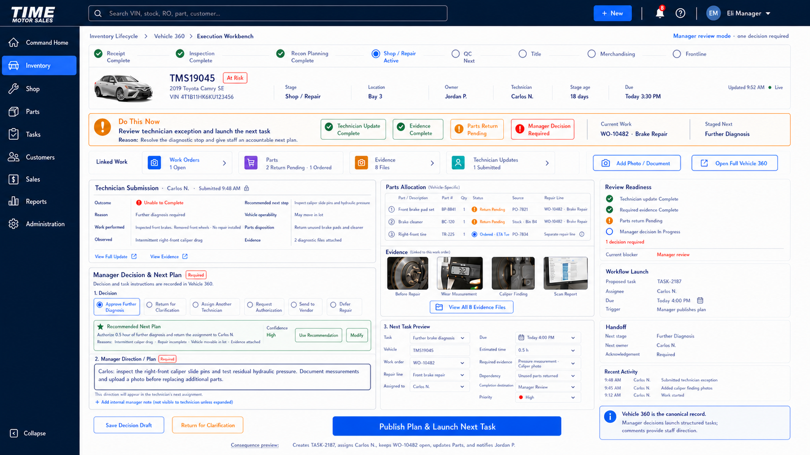

# Inventory Execution Vehicle Workbench UI Source of Truth

**Product:** Time Motor Sales Dispatch Board  
**Program:** Inventory Console Optimization  
**Component:** Vehicle Execution Workbench  
**Version:** `1.0.0`  
**Status:** Approved official desktop visual, interaction, and execution source of truth  
**Date adopted:** July 19, 2026  
**Adoption authority:** Explicit project-owner approval  
**Governing strategy:** [`INVENTORY_EXECUTION_OPERATING_SYSTEM.md`](INVENTORY_EXECUTION_OPERATING_SYSTEM.md)  
**Official vehicle cards:** [`INVENTORY_EXECUTION_VEHICLE_CARD_UI_SOURCE_OF_TRUTH.md`](INVENTORY_EXECUTION_VEHICLE_CARD_UI_SOURCE_OF_TRUTH.md)  
**Architecture context:** [`INVENTORY_EXECUTION_FORMS_AND_VEHICLE_WORKBENCH_ARCHITECTURE.md`](INVENTORY_EXECUTION_FORMS_AND_VEHICLE_WORKBENCH_ARCHITECTURE.md)  
**Implementation claim:** None. This document approves the Workbench product contract; it does not claim application implementation, integration, migration, pilot, or production activation.

---

## 1. Approved mockup

The image above is the official desktop source of truth for the Vehicle Execution Workbench. It depicts the manager-review state after a technician submits an incomplete-work exception. Its composition, hierarchy, terminology, authority boundaries, linked-work model, manager direction, and structured task-launch behavior are binding.

Names, dates, identifiers, times, counts, vehicle images, parts, work, and evidence in the mockup are illustrative. Implementations must use authoritative permitted data and honestly disclose unavailable, stale, partial, predicted, pending, or conflicting states.

## 2. Approval decision

The Vehicle Execution Workbench is adopted as the official focused execution mode within Vehicle 360. It is where authorized staff perform vehicle-centered work, document outcomes, resolve exceptions, review evidence, issue governed decisions, and launch the next accountable task.

The Workbench is not:

- a second vehicle record;
- a second task engine;
- an unrestricted record editor;
- a catalog of generic forms;
- a dashboard or tab wall;
- a place where free-text comments silently replace structured workflow decisions.

Vehicle 360 remains the canonical permission-aware vehicle context. Work orders, parts records, purchase orders, evidence, tasks, approvals, and technician updates remain authoritative linked domain records.

## 3. Core experience contract

Every Workbench state must preserve:

1. one selected vehicle and canonical identity;
2. one current action and accountable actor;
3. one concise staged-next action when verified;
4. the active work order or domain record;
5. readiness, dependencies, blockers, due time, and evidence requirements;
6. contextual tools required to execute the current action;
7. a precise outcome command with a visible consequence preview;
8. a complete event, evidence, decision, and handoff trail.

Secondary records remain accessible through Linked Work and Vehicle 360 without competing with the current action.

## 4. Persistent layout

The desktop Workbench uses:

- the approved TIME MOTOR SALES application shell and global navigation;
- breadcrumb path `Inventory Lifecycle > Vehicle 360 > Execution Workbench`;
- a slim lifecycle stepper;
- a persistent vehicle header containing vehicle identity, stage, location, owner, executor or technician, stage age, due time, freshness, and risk state;
- a prominent `Do This Now` band;
- a compact Linked Work strip;
- a dominant contextual execution surface;
- a narrower operational context rail;
- one dominant context-sensitive command.

The Workbench must not introduce another global navigation destination merely to expose its forms or linked records.

## 5. Linked Work contract

The persistent Linked Work strip provides counts and status for:

- Work Orders;
- Parts;
- Evidence;
- Technician Updates;
- other authorized approvals, tasks, or records when relevant.

Linked Work opens the authoritative record or a contextual panel. It does not copy or independently mutate the record.

## 6. Work-order and Parts relationship

The Workbench must connect the vehicle to one or more work orders and their repair lines. Parts remain centrally governed by Parts Operations while the Workbench shows a vehicle-specific ledger through traceable demand, reservation, allocation, issue, installation, return, and reconciliation records.

Each displayed parts requirement or allocation must resolve to:

- vehicle;
- work order;
- repair line;
- part and quantity;
- requester;
- stock, purchase-order, or vendor source;
- current allocation and disposition state;
- installed, unused, returned, cancelled, or core status as applicable.

`Requested`, `reserved`, `ordered`, `received`, `issued`, `installed`, `return pending`, and `reconciled` are distinct states. A purchase-order status must never be presented as proof that a part was installed on a vehicle.

Technicians may request parts within their authority. Ordering, approval, receiving, issuing, adjustment, and reconciliation remain permission-controlled Parts operations.

## 7. Evidence and attachments

Photos, measurements, scan reports, documents, invoices, work orders, and other evidence are captured once and linked to the vehicle, task, work order, repair line, decision, and lifecycle stage as applicable.

Evidence must show category, author or source, timestamp, requirement state, and governing record. Required evidence is validated before the corresponding consequential command. Optional evidence never becomes hidden mandatory work.

## 8. Required technician Quick Closeout

Technicians must document assigned work before completion, exception routing, or QC handoff. The normal path is designed for approximately 15–30 seconds and primarily uses deliberate one-tap choices.

The minimum required confirmation covers:

- outcome;
- work performed;
- parts used or disposition;
- additional finding state;
- required verification;
- QC or next-step readiness.

The system automatically supplies vehicle, work order, repair line, technician, bay, assigned parts, timestamps, and other known context. It may generate a standardized completion narrative from confirmed choices.

Safety, completion, finding, and QC answers are not silently preselected. The technician must make the required confirmation.

## 9. Conditional incomplete-work documentation

When work is `Partially Completed`, `Unable to Complete`, `No Repair Required`, or otherwise cannot follow the normal completion path, the Workbench requires enough information to create a safe and accountable disposition.

Conditional requirements include, as applicable:

- reason code;
- brief explanation;
- work or tests performed;
- observation or diagnosis;
- recommended next step;
- additional diagnostic time;
- vehicle operability;
- parts disposition;
- required evidence;
- authorization, vendor, equipment, capacity, or safety dependency.

`Further Diagnosis Required` keeps the work order open and routes a diagnostic follow-up rather than sending the vehicle to QC. The Workbench displays the exact missing requirements and disables submission until they are satisfied.

## 10. Optional technician information

The Workbench provides a collapsed control labeled `Add More Information or Updates — Optional` for detailed notes, measurements, recommendations, photos, documents, or voice-to-text input.

This supplementary area does not delay a valid routine closeout. It does not replace a required finding, safety, parts-discrepancy, incomplete-work, or authorization workflow.

## 11. Manager Decision and Next Plan

When a technician exception requires management review, the manager receives a focused `Manager Decision & Next Plan` surface containing:

- the technician's authoritative submitted update;
- evidence and vehicle-specific parts context;
- an explainable recommended next plan, where available;
- a required structured manager decision;
- required staff-facing `Manager Direction / Plan`;
- an optional internal manager note;
- a structured Next Task Preview;
- the effect of publishing the plan.

The manager direction explains what staff should do. Structured task fields drive workflow automation. Free text alone must not assign, schedule, authorize, purchase, or change authoritative state.

## 12. Next-task launcher

Before publishing, the task preview shows and permits authorized adjustment of:

- task type and instruction;
- vehicle, work order, and repair line;
- assignee;
- due time;
- estimated time;
- priority;
- required evidence;
- dependencies;
- completion destination;
- acknowledgement requirement.

`Publish Plan & Launch Next Task` records the manager decision and direction, creates or updates the authoritative task, assigns the next owner, preserves the work-order state, applies permitted Parts effects, notifies affected owners, and emits an auditable receipt.

The technician must be able to see the manager's direction in the launched assignment and acknowledge responsibility when required.

## 13. Context-sensitive commands

The dominant command changes with the verified outcome. Approved examples include:

| Condition | Command |
| --- | --- |
| Completed repair | `Complete Work & Send to QC` |
| Partially completed | `Submit Update & Route Remaining Work` |
| Unable to complete | `Submit Exception & Request Next Action` |
| Further diagnosis required | `Submit Update & Request Further Diagnosis` |
| Additional authorization required | `Submit Finding for Authorization` |
| Manager review complete | `Publish Plan & Launch Next Task` |

Generic `Update Status` or `Update Stage` commands are not acceptable substitutes.

Every consequential command must show its expected effects before execution and return a clear accepted, completed, pending, rejected, conflict, or recovery state afterward.

## 14. Accountability and audit

The Workbench records, within authorized visibility:

- owner, executor, reviewer, and next owner;
- assignment, acknowledgement, start, pause, submission, review, and completion timestamps;
- work performed and exception details;
- parts request, allocation, issue, installation, return, and reconciliation events;
- evidence and document relationships;
- manager decision, staff-facing direction, internal note classification, and recommendation override;
- launched task and handoff receipt;
- command, policy, template, and data versions where material.

The Workbench must not expose opaque employee scores, public rankings, automatic discipline, or surveillance-oriented measures.

## 15. Visual and simplicity requirements

Implementations must preserve the approved visual family:

- deep navy shell;
- white and light-neutral operating surfaces;
- cobalt primary actions;
- green, amber, and red operational states;
- compact, readable typography;
- restrained borders, radius, and elevation;
- calm density and strong information hierarchy.

Avoid purple emphasis, decorative gradients, glassmorphism, oversized cards, competing primary buttons, unnecessary charts, and additional tab layers.

Routine staff interaction time and documentation burden must be measured as product-quality signals, not employee-performance scores.

## 16. Permission, safety, and failure behavior

The client never grants authority. Server-side command eligibility, permissions, separation of duties, current record version, evidence rules, and lifecycle gates remain authoritative.

Drafts are nonauthoritative. Consequential commands require online revalidation. Duplicate submission must be idempotent. Concurrent changes, partial failures, pending downstream effects, unavailable integrations, and stale projections must remain visible with an understandable recovery route.

## 17. Responsive requirement

The approved image governs desktop composition. Tablet and mobile adaptations must preserve, in order:

1. vehicle identity and current action;
2. required Quick Closeout or manager decision;
3. missing requirements, blockers, and evidence;
4. the context-sensitive command and consequence;
5. linked records and full Vehicle 360 context.

Responsive layouts may reflow panels but may not remove authority, evidence, accountability, or exception requirements.

## 18. Adoption and change control

This approval authorizes the Workbench to be treated as the official product and UX source of truth for future no-code specifications, implementation planning, conformance review, and governed delivery.

It does not authorize application code, migrations, integrations, production activation, financial limits, employee policy, or enterprise rollout.

Material changes to the hierarchy, terminology, linked-record ownership, technician documentation requirement, manager decision model, task-launch behavior, evidence requirement, Parts accountability, authority boundary, or approved visual direction require explicit approval and a versioned update to this document and its image.
