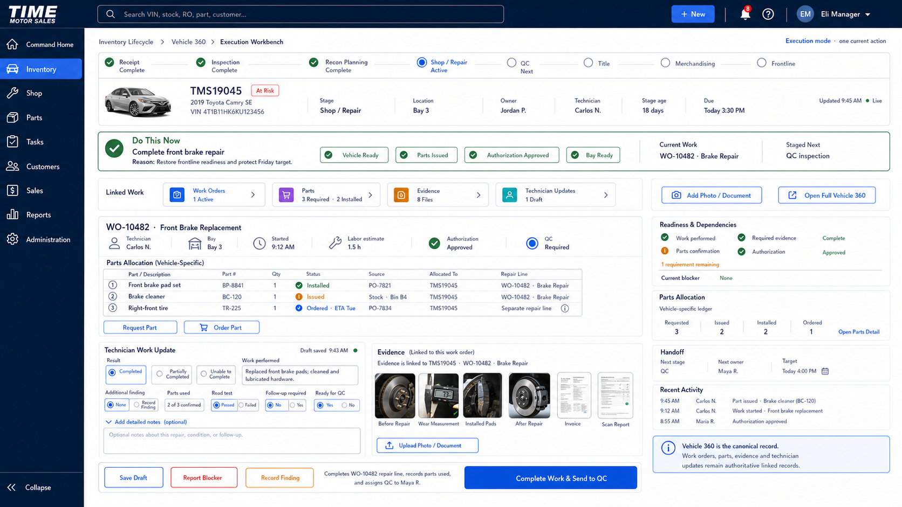

# Technician Repair Workbench UI Source of Truth

**Product:** Time Motor Sales Dispatch Board
**Program:** Technician Experience Optimization
**Component:** Technician Repair Workbench
**Version:** `1.0.0`
**Status:** Approved official product, visual, interaction, and routing source of truth
**Date adopted:** July 25, 2026
**Adoption authority:** Explicit project-owner approval
**Routing contract:** [`TECHNICIAN_WORKSPACE_PAGE_RECORD_ROUTING_MATRIX.md`](TECHNICIAN_WORKSPACE_PAGE_RECORD_ROUTING_MATRIX.md)
**Repair-order source:** [`VEHICLE_SERVICE_INTAKE_AND_REPAIR_ORDER_UI_SOURCE_OF_TRUTH.md`](VEHICLE_SERVICE_INTAKE_AND_REPAIR_ORDER_UI_SOURCE_OF_TRUTH.md)
**Vehicle execution context:** [`INVENTORY_EXECUTION_VEHICLE_WORKBENCH_UI_SOURCE_OF_TRUTH.md`](INVENTORY_EXECUTION_VEHICLE_WORKBENCH_UI_SOURCE_OF_TRUTH.md)
**Implementation claim:** None. This approval governs future implementation and conformance review; it does not claim that the dedicated technician route, all controls, integrations, or production rollout are complete.

---

## 1. Approved mockup

This image is the official desktop source of truth for the Technician Repair Workbench. Names, identifiers, dates, vehicle facts, work-order facts, parts, evidence, and status values are illustrative. A working implementation must use authoritative, permission-filtered records and honestly represent unavailable, stale, pending, conflicted, or incomplete states.

## 2. Product decision

The Technician Repair Workbench is the technician's single job-execution surface for one assigned or validly claimed `RepairJob`.

It is where a technician:

- sees the customer's original concern and authorized repair scope;
- opens the linked repair order without creating another copy;
- acknowledges or starts the assigned repair job;
- follows required work, inspection, diagnosis, and verification steps;
- opens contextual diagnostic tools when additional reasoning or testing is required;
- requests, records, and reconciles job-specific parts usage through governed Parts records;
- documents work performed, measurements, findings, evidence, and repair outcome;
- explains incomplete work or the need for further diagnosis;
- submits completed work to quality control or routes an exception to the correct reviewer.

This Workbench is not a queue, a second repair order, a generic task-detail page, a replacement Vehicle 360, a parts ledger, or a diagnostic-case system.

## 3. Relationship to the three technician screens

The technician experience has three surfaces with separate responsibilities:

1. **My Work** is the role landing page and assigned-work queue.
2. **Available Work** is the eligible, claimable-work queue used when the technician has no current assignment or is ready for more work.
3. **Technician Repair Workbench** is the focused execution page for one repair job.

Only the third surface is a repair workbench. My Work and Available Work route to the authoritative execution surface; they do not collect a second copy of repair notes, evidence, parts, concern, diagnosis, or completion.

Diagnostics & Tools is contextual capability inside the Technician Repair Workbench and may also be opened as a specialist console. It is not a fourth general technician workbench.

## 4. Canonical record contract

The Workbench is assembled from linked canonical records rather than a new all-purpose record.

| Information or action | Canonical owner |
| --- | --- |
| Customer identity and contact | `Customer` |
| Vehicle identity and history | `Vehicle` and Vehicle 360 |
| Arrival, keys, custody, transportation | `ServiceVisit` and governed intake records |
| Customer's original words | `RepairOrder.customerConcern` or the approved equivalent |
| Overall service engagement, authorization, and stage | `RepairOrder` |
| One authorized unit of technician repair work | `RepairJob` |
| Technician assignment | current `RepairJobDispatch` |
| Start, pause, and labor events | `RepairJobLaborClock` and `RepairJobLaborEvent` |
| General accountability wrapper, when required | linked `Task` |
| Diagnostic reasoning and test lifecycle | linked diagnostic case |
| Photos, documents, measurements, and scans | governed vehicle evidence linked to the applicable records |
| Parts demand, reservation, issue, installation, return, and reconciliation | authoritative Parts records |
| Quality decision | authoritative quality inspection |
| Release decision | repair-order release authorization |

The Workbench may project these records together. It may mutate them only through their authorized commands, policies, validation, idempotency, version, audit, and event rules.

## 5. Required information hierarchy

The approved desktop composition preserves:

1. vehicle identity, current stage, location, current owner, and repair risk;
2. one dominant `Do This Now` instruction;
3. the active work-order and repair-job relationship;
4. compact Linked Work access for work orders, parts, evidence, and technician updates;
5. current repair scope and parts allocation;
6. a large technician update area;
7. structured outcome and exception fields;
8. evidence upload and linked-document access;
9. quality-control readiness and one context-sensitive completion command.

The page must remain compact and highly readable. Secondary information may collapse or move to a contextual drawer, but the current job, authority, safety, missing requirements, and submission consequence may not be hidden.

## 6. Work-order attachment rule

The repair order is attached by durable record relationship, not by requiring the technician to upload the dealership's own work order.

The Workbench receives the `RepairJob` selected from My Work, Available Work, Shop Dispatch, or an authorized deep link. That job resolves its parent `RepairOrder`, vehicle, customer concern, authorization state, repair line, evidence, parts demand, and current dispatch.

An externally supplied document may be uploaded as evidence when policy permits. It never replaces the canonical `RepairOrder`.

## 7. Technician documentation contract

Routine completion must be fast and structured. The technician confirms:

- outcome;
- work performed;
- parts used or their disposition;
- additional finding state;
- required verification or road test;
- readiness for quality control.

The Workbench must provide enough free-text space for meaningful repair documentation, including work performed, measurements, observations, and recommendations. Voice-to-text and document or photo upload may assist entry, but required safety and outcome choices must remain deliberate.

## 8. Incomplete work and further diagnosis

When the repair is incomplete, partially completed, unable to be completed, unsafe, or requires further diagnosis, the Workbench must collect the decision packet management needs:

- structured reason;
- work and tests already performed;
- current observation or finding;
- remaining concern or unresolved condition;
- recommended next step;
- estimated additional diagnostic or repair time when known;
- operability and safety state;
- parts, authorization, equipment, vendor, bay, skill, or capacity dependency;
- required supporting evidence;
- proposed next owner or review route.

The system keeps the repair order and repair job open in the appropriate governed state. It does not label incomplete work as completed merely to move it out of the technician's queue.

`Further Diagnosis Required` opens or links a diagnostic case and passes the verified context already captured. Diagnostics owns its evidence-and-reasoning lifecycle and returns governed findings or a repair handoff; it does not create a parallel repair order.

## 9. Context-sensitive outcome commands

| Verified condition | Dominant command |
| --- | --- |
| Repair completed and requirements satisfied | `Complete Work & Send to QC` |
| Repair partially completed | `Submit Update & Route Remaining Work` |
| Unable to complete | `Submit Exception & Request Next Action` |
| Further diagnosis required | `Submit Update & Request Further Diagnosis` |
| Additional authorization required | `Submit Finding for Authorization` |
| Safety hold required | `Place Safety Hold & Notify Advisor` |

Each command must preview its effects, revalidate authority and record version on the server, be idempotent, write durable activity and audit evidence, and show a clear accepted, pending, rejected, conflicted, or recovery result.

## 10. Entry and exit contract

Approved entry routes:

- My Work assignment;
- Available Work after a successful eligibility check and atomic claim;
- Shop Dispatch assignment;
- Repair Order Workbench linked repair job;
- authorized notification or deep link.

Approved exits:

- back to My Work;
- next assigned job;
- Quality Control after accepted completion;
- advisor, manager, Parts, or Diagnostics review after an accepted exception;
- linked Repair Order or Vehicle 360 for permitted broader context.

The technician must never have to choose among multiple competing detail forms for the same repair job.

## 11. Permission and safety

- The client never grants technician authority.
- A technician can open only jobs allowed by assignment, claim eligibility, role, location, and record policy.
- Available Work ranking is explainable and operational; it is not an employee score or public ranking.
- Authorization, safety, evidence, parts, diagnostic, quality, and release gates are server enforced.
- Consequential actions require fresh state and online validation.
- Duplicate submission, concurrent updates, partial downstream failure, and stale projections must have explicit recovery behavior.

## 12. Visual conformance

Implementations must preserve the approved visual family:

- deep navy application shell;
- white and light-neutral work surfaces;
- cobalt primary action;
- restrained green, amber, and red operating states;
- compact but comfortable typography;
- strong visual hierarchy and limited navigation;
- one dominant action;
- generous repair-documentation space without oversized empty cards.

Avoid decorative gradients, glass effects, tiny fonts, multiple competing primary actions, redundant sidebars, duplicate tab systems, and unrelated enterprise controls in the technician's execution path.

## 13. Adoption and change control

This document and its approved image are the official source of truth for technician repair execution. Future implementation plans, mockups, route changes, and conformance reviews must align with it.

Material changes to the page's purpose, canonical record ownership, required technician evidence, incomplete-work packet, diagnostic handoff, quality-control gate, or routing boundary require explicit approval and a versioned update.
