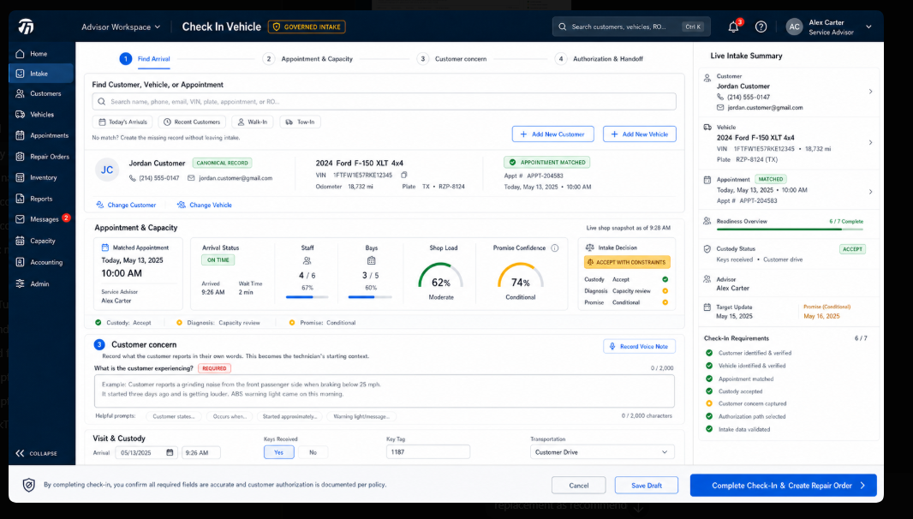
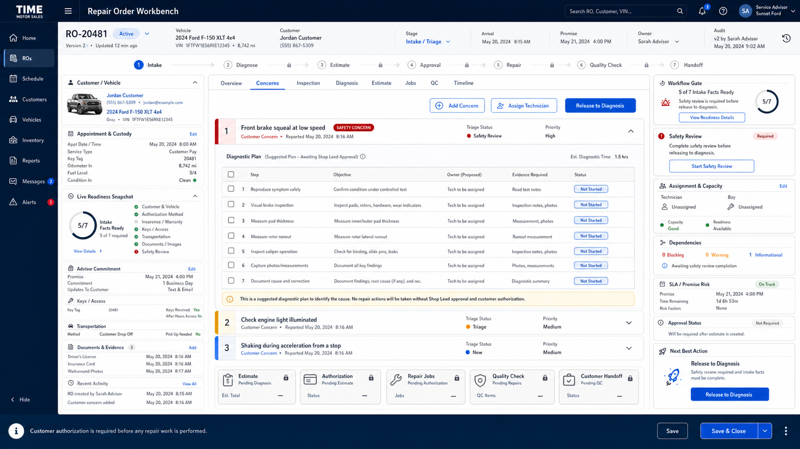

# Vehicle Service Intake and Repair Order UI Source of Truth

**Status:** Approved for implementation  
**Approved:** 2026-07-20  
**Product area:** Inventory Console / Shop & Recon  
**Routes:** `/vehicles/repair-orders?intakeSource=WALK_IN`, `/vehicles/repair-orders?repairOrderId=:id`

## Approved references

### Vehicle service intake

### Repair-order workbench

These images are the visual and interaction target. Implementations may adapt individual values to live data and responsive constraints, but must preserve the information hierarchy, compact density, governed actions, and shared design language.

## Intake contract

The intake workspace exists to identify the arrival, preserve the customer's words, establish custody, evaluate live service readiness, and create one governed repair order. It does not prescribe a repair.

1. **Find Arrival** searches customers, vehicles, appointments, VIN, plate, phone, email, and repair-order references. When no canonical match exists, the advisor can add a customer or vehicle without abandoning intake.
2. **Appointment & Capacity** distinguishes custody acceptance, diagnosis outlook, and promise confidence using current appointment, reservation, staff, bay, workload, and overdue-work facts.
3. **Customer concern** preserves a maximum 2,000-character customer statement. The approved example appears only as disappearing placeholder text inside the empty textarea.
4. **Custody & Handoff** captures arrival, keys, transportation, advisor, location, target update, promise, consent, and internal notes.
5. Completion creates the repair order, links the appointment when present, attaches the current readiness snapshot, and places the order into Shop & Recon.

## Repair-order workbench contract

The repair-order workbench is the execution home after check-in. It preserves the intake record and progressively governs diagnosis, estimate, authorization, repair jobs, quality control, and customer handoff.

- The customer's original concern remains distinct from technician findings, cause, recommendation, and correction.
- Concern work is represented as accountable workstreams with a suggested diagnostic plan, evidence requirements, owners, dependencies, and status.
- Suggested plans require human review; the system must not represent an inferred cause as confirmed diagnosis.
- Downstream stages remain gated by their authoritative records: diagnosis, estimate version, customer authorization, repair jobs, QC results, and release authorization.
- Version, audit, readiness, custody, promise, and activity context remain visible without leaving the workbench.

## Interaction requirements

- Preserve compact desktop density and avoid horizontal overflow.
- Keep primary actions visible without hiding required context.
- Provide honest loading, empty, unavailable, conflict, and permission states.
- Search and record creation must not discard entered intake information.
- Duplicate customer, vehicle, appointment, or repair-order conditions must be surfaced before creating another canonical record.
- Server-side policy, validation, idempotency, exact-version commands, and audit history remain authoritative.

## Implementation boundary

The approved UI must reuse the canonical `Customer`, `Vehicle`, `Appointment`, `ServiceVisit`, `RepairOrder`, readiness, inspection, diagnosis, estimate, authorization, job, quality, release, activity, and audit foundations. It must not create parallel customer, vehicle, appointment, repair, or task systems.
