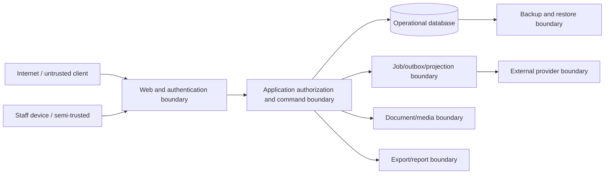

# Vehicle Operations Threat Model and Data Classification

**Milestone:** `VEH-006`  
**Version:** 1.0  
**Assessment date:** 2026-07-13  
**Status:** Approved planning baseline; listed mitigations are requirements unless explicitly marked as current evidence  
**Risk owner:** General Manager  
**Security steward:** Security and Operations Owner  
**Vocabulary:** [`VEHICLE_OPERATIONS_GLOSSARY_RACI.md`](VEHICLE_OPERATIONS_GLOSSARY_RACI.md)

## 1. Method and references

This model uses the OWASP four-question approach: what are we working on, what can go wrong, what will we do, and did we do enough. OWASP describes threat modeling as a structured, repeatable process that should begin early and be revisited throughout delivery ([OWASP Threat Modeling Cheat Sheet](https://cheatsheetseries.owasp.org/cheatsheets/Threat_Modeling_Cheat_Sheet.html)).

Control outcomes align at a planning level with the NIST Cybersecurity Framework 2.0 functions: Govern, Identify, Protect, Detect, Respond, and Recover ([NIST CSF 2.0](https://www.nist.gov/cyberframework)). This document does not claim certification or regulatory compliance.

## 2. Scope

### In scope

- Dispatch Board web application and Vehicle Operations module
- browser sessions, APIs, server services, PostgreSQL data, jobs, projections, audit, and exports
- vehicle, inventory, shop, parts, customer-linked, document, financial-exposure, decision, and operational data
- planned document/media storage and external adapters
- staff, managers, administrators, service accounts, customers/partners when portals exist
- development, test, staging, production, backup, restore, import, export, and incident workflows

### Out of scope but treated as external trust boundaries

- DMS, accounting, lender/F&I, payment processor, government/title, OEM, valuation/history, parts-vendor, messaging, and identity-provider systems
- user-owned endpoints and networks beyond application/session controls
- physical dealership, key, vehicle, bay, warehouse, and paper-document security

Out-of-scope systems still require integration contracts, authentication, least privilege, failure behavior, and incident contacts.

## 3. Security objectives

1. Only authorized users and services can view or change records within their organization/location and capability.
2. Vehicle identity, lifecycle, repair authorization, parts quantity, costs, approvals, and audit history preserve integrity.
3. Accepted commands, evidence, and operational history remain available and recoverable within approved objectives.
4. Sensitive customer, credential, document, financial, and security data is minimized and protected.
5. Security-relevant activity is attributable, detectable, reviewable, and retained.
6. An external outage or malicious payload cannot silently corrupt canonical state.
7. Recommendations and AI cannot bypass safety, financial, privacy, or approval controls.

## 4. Assets and impact

| Asset | Confidentiality impact | Integrity impact | Availability impact | Owner |
| --- | --- | --- | --- | --- |
| Canonical vehicle identity and ownership relationships | Medium | Critical | High | VPO |
| Inventory lifecycle, title/readiness, custody, and disposition | Medium | Critical | High | IM |
| Repair orders, diagnosis, estimates, authorizations, labor, QC | High | Critical | High | SM |
| Parts ledger, purchase orders, receipts, reservations, credits | High | Critical | High | PM/OM |
| Customer identity, contact, consent, communication, documents | Critical | High | High | GM/SA |
| Credentials, tokens, secrets, session material | Critical | Critical | Critical | SO |
| Audit, command, event, outbox, integration, and incident logs | High | Critical | Critical | SO |
| Financial exposure, costs, pricing/disposition decisions | High | Critical | High | GM/OM |
| Documents, photos, video, signatures, title/warranty evidence | Critical | Critical | High | OM |
| Algorithms, policy versions, decision records, KPI snapshots | Medium | High | Medium | VPO/DATA |
| Backups and exports | Critical | Critical | Critical | SO |

## 5. Actors and trust levels

| Actor | Legitimate capability | Primary abuse/error concern |
| --- | --- | --- |
| Unauthenticated internet user | Login and future public entrypoints only | Enumeration, credential attack, exploit, denial of service |
| Staff user | Assigned operational work within allowed scope | Horizontal access, unsafe update, data export, compromised session |
| Manager/department owner | Broader commands and approvals | Excess authority, self-approval, high-impact error, account takeover |
| Application administrator | Configuration and technical operations | Confusing technical access with business authority, secret exposure |
| Service/integration account | Narrow machine contract | Token theft, replay, excessive scope, malicious/invalid payload |
| Customer/partner portal user | Own approved records/actions only | Insecure direct object reference, relationship misbinding, document leakage |
| Developer/operator | Deployment, support, diagnostics | Production data access, unsafe migration, log/backup leakage |
| External provider | Contracted data/action exchange | Stale/incorrect data, compromised webhook, dependency outage |
| Malicious insider | Legitimate foothold used improperly | Fraud, concealment, export, audit tampering, collusion |

## 6. Trust boundaries and data flows

Every arrow requires authentication where applicable, input validation, authorization, classification-aware logging, integrity/replay controls, failure behavior, and observability.

## 7. Risk rating

- **Likelihood:** 1 Rare, 2 Unlikely, 3 Possible, 4 Likely, 5 Expected
- **Impact:** 1 Negligible, 2 Minor, 3 Material, 4 Severe, 5 Critical
- **Score:** likelihood × impact
- **Priority:** 20–25 Critical, 12–19 High, 6–11 Medium, 1–5 Low

Safety, cross-tenant disclosure, credential compromise, payment/card exposure, audit destruction, and unrecoverable data loss remain critical policy concerns even if initial likelihood is lower.

## 8. Priority threat register

| ID | STRIDE / scenario | L×I | Required mitigation | Verification evidence | Owner |
| --- | --- | --- | --- | --- | --- |
| `TM-01` | Spoofing: credential stuffing or session theft takes over staff/manager account | 4×5 Critical | Strong password hashing, rate limit, secure session cookie, rotation/invalidation, MFA/SSO plan, suspicious-login logging | Auth abuse tests; session invalidation test; alert evidence | SO |
| `TM-02` | Elevation: staff calls manager vehicle/financial command directly | 4×5 Critical | Server capability policy on every mutation; dollar/location/ownership attributes; deny by default | Permission matrix tests per route/service | SO/VPO |
| `TM-03` | Information disclosure: cross-organization/location ID enumeration | 3×5 High | Tenant/location predicate in repository boundary; opaque IDs insufficient alone; response normalization | Cross-tenant integration tests and query review | SO |
| `TM-04` | Tampering: direct status/amount/quantity edit bypasses command rules | 4×5 Critical | Command-only material mutations; state machine; schema constraints; immutable ledger/events; restricted admin tools | Invariant tests; database-role review; audit correlation | VPO |
| `TM-05` | Repudiation: purchase, approval, price, disposition, or adjustment lacks attribution | 3×5 High | Actor/delegation, reason, prior/new state, command ID, event, audit, policy version, timestamp | End-to-end audit test and export sample | GM/OM |
| `TM-06` | Tampering/replay: duplicate webhook or retry creates double purchase/receipt/command | 4×5 Critical | Idempotency key, signed webhook, inbox uniqueness, expected version, replay window | Duplicate/reordered delivery contract tests | SO |
| `TM-07` | Integrity: stale external valuation/title/history silently overwrites canonical fact | 4×4 High | Field authority matrix, freshness, mapping version, conflict queue, no silent last-write-wins | Conflict/freshness adapter tests | VPO/DATA |
| `TM-08` | Disclosure: logs or errors expose customer data, VIN documents, tokens, or connection strings | 3×5 High | Structured allowlisted logs, redaction, sanitized errors, secret scanning, restricted observability access | Log fixture scan; error response tests | SO |
| `TM-09` | Malicious upload: document/media carries malware or active content | 3×5 High | Size/type allowlist, quarantine, malware scan, randomized object key, safe content disposition, signed access | Upload abuse tests; scan failure test | SO/OM |
| `TM-10` | Object access: guessed document/export URL bypasses record permissions | 3×5 High | No public bucket, short-lived signed access after record authorization, download audit, revocation | Unauthorized/cross-tenant download tests | SO |
| `TM-11` | Fraud: same actor creates and approves purchase, adjustment, refund, or disposition | 3×5 High | Configurable separation of duties, dollar limits, step-up confirmation, exception reporting | Self-approval rejection tests | GM/OM |
| `TM-12` | Integrity: parts balance becomes negative or unexplained through concurrency | 4×4 High | Immutable ledger, atomic reservation, row/aggregate version, nonnegative invariant, reconciliation | Concurrent reservation property/integration tests | PM |
| `TM-13` | Safety: repair starts/releases without authorization, skill, parts, or QC gate | 3×5 High | Hard readiness and QC gates; evidence; server state machine; override restrictions | Safety transition test suite | SM |
| `TM-14` | Denial: expensive search/export/import or bot traffic exhausts app/database | 4×4 High | Rate/size/time bounds, cursor pagination, async jobs, quotas, cancellation, indexes, monitoring | Load/abuse tests; slow-query alerts | SO |
| `TM-15` | Availability: job/outbox/projection failure leaves accepted command invisible | 3×5 High | Atomic outbox, retry, checkpoint, dead letter, lag alarm, operator replay, read-after-command receipt | Failure-injection and replay tests | SO |
| `TM-16` | Destruction: ransomware/operator error corrupts production and reachable backups | 3×5 High | Least privilege, isolated/immutable backup copies, encryption, restore drills, break-glass controls | Documented restore and integrity reconciliation | SO |
| `TM-17` | Supply chain: compromised dependency/build/deployment introduces malicious code | 3×5 High | Lockfiles, review, dependency/secret scanning, protected CI, artifact provenance plan, small releases | Pipeline evidence and dependency review | SO |
| `TM-18` | Privacy: exports/imports/backups retained or shared beyond business need | 3×5 High | Classification, minimum fields, permission/reason, encrypted transfer, expiry, retention/disposal, audit | Export policy tests and retention review | GM/SO |
| `TM-19` | Misconfiguration: feature/policy change broadly enables unsafe automation | 3×5 High | Versioned config, preview, four-eyes approval, effective date, pilot scope, rollback/kill switch | Policy lifecycle tests | VPO |
| `TM-20` | AI/decision abuse: prompt/content injection or opaque output drives material action | 3×4 High | Treat content as untrusted, constrained inputs/outputs, provenance, no direct tool authority, human approval, monitoring, kill switch | Adversarial evaluation and action-boundary tests | VPO/SO |
| `TM-21` | Privacy/integrity: customer portal binds user to wrong vehicle/customer | 3×5 High | Verified relationship, least privilege, reauthentication for sensitive action, no editable ownership link | Relationship-binding and IDOR tests | SO/SA |
| `TM-22` | Audit tampering: privileged actor alters or deletes audit/incident evidence | 2×5 High | Append-only application path, separate permission, external/immutable retention target, audit-access logging | Tamper attempt and privileged-access review | SO |

## 9. Data classification

### Classification levels

| Level | Name | Definition | Minimum handling |
| --- | --- | --- | --- |
| `C0` | Public | Approved for intentional public release. | Integrity control; no secrets; approved publication process. |
| `C1` | Internal | Routine dealership operational information not intended for public release. | Authenticated access, least privilege, encrypted transport, approved retention. |
| `C2` | Confidential | Business/customer information whose disclosure or change could cause material harm. | Role/location restriction, encryption at rest/in transit, controlled export, access/audit logging where material. |
| `C3` | Restricted | Credentials or highly sensitive customer, financial, identity, document, security, or legal data. | Explicit need-to-know, field/document controls, no routine logs, masked lower environments, strong export/retention controls, incident priority. |

Classification follows the highest-sensitivity field in a record/export unless field-level controls safely produce a lower-class view.

### Data inventory

| Data category | Class | Examples | Permitted purpose | Prohibited handling |
| --- | --- | --- | --- | --- |
| Public merchandising | C0 after approval | Public price, approved photos, year/make/model, listing description | Approved vehicle marketing | Publishing VIN documents, keys, internal notes, customer association |
| Vehicle operations | C1/C2 | VIN, stock, location, custody, stage, blockers, internal condition | Authorized dealership operations | Public bulk export or unapproved third-party use |
| Customer contact/relationship | C2 | Name, phone, email, address, vehicle relationship, preferences | Service/sales operation and approved communication | Marketing without consent/authority; test fixtures copied from production |
| Customer identity/document | C3 | Driver license, signature reference, title/registration documents | Approved identity/title/delivery workflow | Logs, email attachments without approved control, public object URLs |
| Repair/inspection evidence | C2; C3 when linked to sensitive customer/document | Concerns, diagnosis, media, estimates, approvals | Vehicle service and warranty | Uncontrolled sharing or employee-performance reuse |
| Financial operational | C2/C3 | Purchase limit, cost, gross, refunds, warranty credit, account references | Authorized decisions and reconciliation | Storing card data, bank credentials, lender secrets in general fields |
| Parts/procurement | C1/C2 | Part master, cost, vendor quote, PO, stock, credits | Parts operations and reconciliation | Public cost/vendor export |
| Credentials/security | C3 | Password hash, session, API key, webhook secret, incident detail, vulnerability | Authentication, security operations | Application logs, source code, client response, screenshots |
| Audit/command/event | C2/C3 | Actor, before/after, reason, IP/device metadata, correlation | Integrity, investigation, compliance, support | General editing/deletion; broad staff export |
| Algorithms/KPIs | C1/C2 | Weights, decisions, performance, forecasts, error rates | Operations, calibration, management | Autonomous discipline; public disclosure without approval |
| Backups/exports | Inherit maximum | Database backup, CSV/PDF, incident package | Recovery or approved business purpose | Unencrypted unmanaged copies or indefinite retention |

### Environment rules

- Production C2/C3 data is not copied into development/test by default.
- Any approved lower-environment copy requires minimization, masking/tokenization, owner approval, expiry, and destruction evidence.
- Seed/test data is synthetic and must not resemble real credentials or sensitive documents.
- Screenshots and support bundles inherit the classification of visible content.

## 10. Baseline security requirements by layer

| Layer | Required controls before production use |
| --- | --- |
| Identity/session | Password hashing, secure cookies, expiry/invalidation, rate limits, account-state enforcement, MFA/SSO roadmap, no sensitive session storage in client-readable form |
| Authorization | Deny-by-default server capabilities, tenant/location/record attributes, separation of duties, service-account scopes, periodic review |
| Validation/commands | Schema validation, state machines, expected versions, idempotency, size/range bounds, normalized error responses |
| Database | Least-privileged runtime/migration roles, constraints, transactional integrity, encrypted managed storage, no routine direct edits |
| Files/media | Quarantine, type/size validation, malware scan, private storage, signed access, retention, download audit |
| Integrations | Authenticated/signed traffic, secret rotation, source matrix, inbox/outbox, replay protection, rate limits, conflict/reconciliation |
| Logging/monitoring | Allowlisted structured events, redaction, correlation, security alerts, restricted access, clock synchronization |
| Delivery | Peer review, protected branches/CI, dependency and secret scanning, migration checks, feature flags, rollback |
| Recovery | Isolated backups, encryption, restore tests, RPO/RTO evidence, break-glass and incident process |

## 11. Current evidence versus future control

Current repository evidence includes application authentication, server-side policies for existing domains, structured validation patterns, activity/command ledgers in selected domains, tests, and protected workflow patterns. It does **not** prove the full Vehicle Operations controls above.

Each future implementation card must reference applicable `TM-*` risks and attach test/runbook evidence. A requirement is not marked implemented merely because it appears in this document.

## 12. Threat review triggers

Review and version this model when:

- a new trust boundary, portal, external provider, file type, AI feature, payment/financial data flow, or mobile/offline capability is proposed
- tenant/location or role/authority rules change
- a material incident, near miss, penetration test, dependency advisory, or audit finding occurs
- architecture extracts a service or changes hosting/database/storage/job topology
- at least annually even without a trigger

## 13. Acceptance evidence

`VEH-006` is satisfied because this document defines:

- scope, assets, actors, trust boundaries, security objectives, and risk method
- prioritized threat scenarios with mitigations, owners, and verification evidence
- classification and handling for vehicle, customer, financial, document, credential, audit, integration, backup, and export data
- security requirements, environment rules, review triggers, and an explicit no-compliance/no-implementation overclaim boundary

