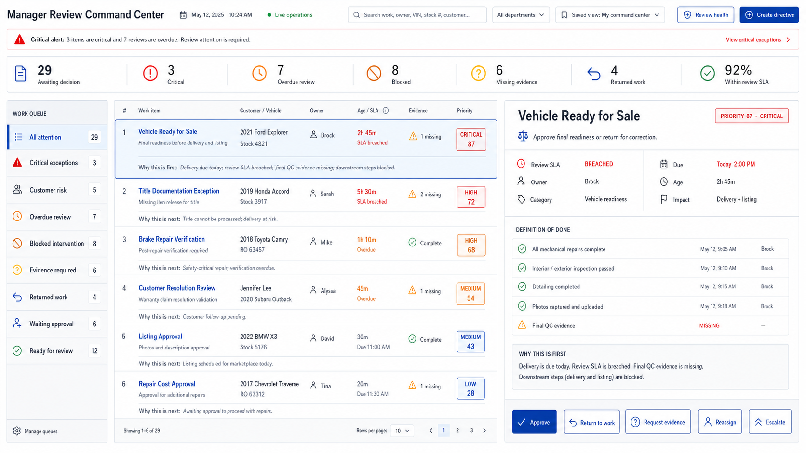

# Manager Review Command Center UI/UX Source of Truth

**Document:** Canonical visual and interaction reference  
**Version:** v1.0 approved planning baseline  
**Approved:** 2026-07-12  
**Status:** Approved for implementation planning  
**Target route:** `/manager-review`

## 1. Canonical Reference

The approved desktop composition is:

This image is the canonical visual acceptance reference for the Manager Review Command Center. Implementations should adopt its information hierarchy, operational density, relative panel proportions, restrained enterprise styling, ranked worklist, persistent decision workbench, and visible decision controls before introducing alternative layouts.

The source image is a planning mockup, not evidence of implemented behavior.

## 2. Authority And Interpretation

The image is authoritative for:

- desktop information hierarchy
- summarize, prioritize, select, understand, and act workflow
- compact command header and filter placement
- critical-alert placement
- action-summary placement and density
- three-pane queue, worklist, and workbench composition
- selected-row relationship to the workbench
- definition-of-done and evidence visibility
- explainable-priority placement
- persistent formal decision actions
- restrained enterprise visual language

The image is illustrative, not authoritative, for:

- dates and times
- people, customer, vehicle, repair-order, stock, and file examples
- counts, percentages, SLA durations, and priority scores
- exact wording of sample ranking explanations
- department names not otherwise established in product policy
- business rules, transition authority, evidence requirements, and algorithm weights

All illustrative values must be supplied by live, authorized read models. Business behavior remains governed by:

- [`MANAGER_REVIEW_ARCHITECTURE.md`](MANAGER_REVIEW_ARCHITECTURE.md)
- [`MANAGER_ATTENTION_ENGINE.md`](MANAGER_ATTENTION_ENGINE.md)
- server-side policies and validation

If the image conflicts with an approved domain invariant, permission rule, accessibility requirement, or deterministic algorithm contract, the invariant or contract wins. The visual design should then be updated deliberately rather than allowing silent drift.

## 3. Experience Objective

The Command Center must help a manager complete one continuous operating loop:

> Detect the exception, understand its priority, inspect the proof, make a formal decision, and advance to the next most important item.

The interface is not a general task browser, a chart dashboard, or an employee performance-review form. Its purpose is to turn operational signals into safe management decisions and accountable next actions.

## 4. Required Desktop Structure

### 4.1 Command header

The top area contains:

- `Manager Review Command Center` title
- business date
- live/freshness indicator
- global operational search
- department or workflow filter
- saved view selector
- Review Health entry point
- Create Directive action

The header remains compact. It must not become a marketing-style hero or consume space needed by the worklist.

### 4.2 Critical exception alert

A narrow alert appears below the header only when genuine critical exceptions exist.

It must:

- state the number of critical items
- summarize their operational meaning
- open the Critical Exceptions queue
- use red only for active critical conditions
- disappear or become a neutral all-clear state when no critical condition exists

Routine work must never be promoted into this alert merely to attract attention.

### 4.3 Action summary

The approved top-level measures are:

- Awaiting decision
- Critical
- Overdue review
- Blocked
- Missing evidence
- Returned work
- Within review SLA

Each measure is an interactive filter into its underlying work. Counts must reconcile with the authoritative queue read model. Summary metrics are not decorative cards.

### 4.4 Queue rail

The left rail provides stable management-intent queues:

- All Attention
- Critical Exceptions
- Customer Risk
- Overdue Review
- Blocked Intervention
- Evidence Required
- Returned Work
- Waiting Approval
- Ready for Review

Each eligible item has exactly one primary queue at an evaluation instant. Secondary signals may appear in the row and workbench without inflating primary headline counts.

The selected queue uses a clear, restrained selected state. Queue color does not replace text labels or counts.

### 4.5 Ranked worklist

The center pane is the manager's primary triage surface. It shows a dense, scan-friendly ordered list.

Each row should expose, as available:

- sequence or rank
- operational title
- requested decision or concise work description
- customer, vehicle, stock, repair-order, case, or other reference
- accountable owner
- review age and review SLA state
- evidence completeness
- priority band and score when applicable
- concise, explainable ranking reason

The selected row must be visually connected to the right-side workbench. Rows must remain readable at normal browser zoom and must not become miniature dashboard cards.

Default ordering follows the approved Manager Attention Engine. Stable tie-breakers prevent items from jumping unpredictably during refresh.

### 4.6 Persistent decision workbench

The right pane remains open for the selected item and contains:

- selected item and reference
- exact decision required
- priority band, score, and explanation version when applicable
- review SLA state distinct from task due state
- owner
- due time
- review category
- customer, delivery, safety, title, financial, or downstream impact
- definition of done
- evidence completeness and deficiencies
- explanation of why the item is ranked at its current position
- formal decision controls

Additional workbench tabs or sections should expose:

- Overview
- Evidence and attachments
- Checklist
- Activity timeline
- Dependencies and related work
- Previous review cycles

The default overview must contain enough information for the majority of decisions without forcing the manager to open a separate task page.

## 5. Formal Decision Controls

The following actions remain persistently visible for the selected item when authorized and applicable:

- Approve
- Return to Work
- Request Evidence
- Reassign
- Escalate

Visibility and availability are server-authoritative. An action can be hidden or disabled only for a clear policy, state, or permission reason.

### Approve

- Normal approval is available when all mandatory policy and evidence gates are satisfied.
- If a permitted manager override exists, use an explicit `Approve with override` path requiring authority and reason.
- Do not present ordinary Approve as safely available while mandatory final-QC or other required evidence is missing.

### Return to Work

Requires:

- reason code
- corrective instructions
- corrective checklist items where applicable
- revised due time
- confirmed owner

### Request Evidence

Requires:

- precise evidence requirement
- responsible responder
- response deadline
- visible timer behavior under the applicable SLA policy

### Reassign

Requires:

- new accountable owner
- reassignment reason
- preserved original ownership history
- visibility into due-time feasibility and relevant workload context where available

### Escalate

Requires:

- category and severity
- escalation reason
- escalation owner or destination
- immediate next action
- due time

Escalation establishes accountability; it is not merely a red label.

## 6. Interaction Contract

- Selecting a queue filters the worklist without leaving the Command Center.
- Selecting a worklist row updates the persistent workbench without route loss.
- Search and filters operate on authoritative results and preserve useful state.
- Clicking a summary measure opens the corresponding operational work.
- A successful decision refreshes summary, queue, worklist, and workbench state together.
- After a successful decision, selection advances predictably to the next highest-ranked eligible item.
- If no next item exists, the interface shows a useful queue-clear state.
- Background refresh must not discard manager input or unexpectedly change the selected item.
- A stale or conflicting command shows the authoritative new state and allows safe reconsideration.
- Loading, empty, error, stale-data, permission, and concurrency states are explicit.
- High-impact actions use confirmation proportional to their consequence; routine valid approvals remain fast.

## 7. Visual Language

The approved visual character is:

- calm
- dense
- authoritative
- operational
- restrained
- highly legible

Required styling direction:

- light neutral working canvas
- dark, high-contrast operational text
- white or subtly differentiated work surfaces
- muted navy or indigo primary interaction accent
- amber for warnings and approaching deadlines
- red reserved for critical conditions and breaches
- green reserved for verified completion or healthy status
- subtle borders and minimal shadows
- compact line icons used with visible labels
- density achieved through alignment and spacing, not unreadably small typography

Avoid:

- decorative gradients
- glassmorphism
- oversized rounded cards
- excessive pills and badges
- rainbow queue colors
- chart-heavy presentation above live work
- hidden primary decisions inside overflow menus
- playful illustration or consumer-app styling
- employee leaderboards or covert performance scoring

## 8. Responsive Direction

The canonical image governs desktop composition. Responsive behavior must preserve the same decision order rather than shrink all three panes until they become unusable.

The live Needs Assignment workflow remains available as a final operational queue even though it is not visible in the canonical image. This reconciles the established application workflow and the formal Manager Attention Engine queue contract without weakening the approved composition.

### Tablet

- Queue rail may collapse into a queue selector or compact rail.
- Worklist remains the primary pane.
- Workbench may open as a persistent adjacent pane where space allows or a controlled detail layer.
- Decision actions remain visible and labeled.

### Mobile

- Present one primary stage at a time: queue, worklist, then workbench.
- Preserve a clear way back without losing filters or selection.
- Surface decision, risk, SLA, missing evidence, and required actions before secondary history.
- Avoid horizontal scrolling for core content.
- High-impact actions must remain deliberate and accessible.

Responsive acceptance requires browser proof; a desktop screenshot alone is insufficient.

## 9. Accessibility Contract

- All controls use meaningful visible labels or accessible names.
- Queue, row, tab, disabled, warning, and critical states do not rely on color alone.
- Keyboard navigation follows a predictable queue-to-worklist-to-workbench sequence.
- Focus remains visible.
- Tables or list semantics preserve meaningful relationships between labels and values.
- Status updates and decision outcomes are announced appropriately.
- Text remains readable at normal zoom and during browser zoom.
- Sticky actions do not obscure evidence or timeline content.
- Confirmation and validation messages identify the exact corrective action required.

## 10. Live Command And Review Health

The canonical image represents the default `Live Command` mode.

Live Command prioritizes:

- current exceptions
- review and intervention queues
- decision context
- formal actions

`Review Health` is a related but separate analytical mode for:

- review inflow and throughput
- review age percentiles
- SLA trends
- first-pass approval
- return reasons
- evidence deficiencies
- recurring blockers
- downstream delays
- recommendation overrides

Historical analytics must not displace live operational work from the default Command Center.

## 11. Implementation Acceptance Gate

A Manager Review Command Center UI slice is not complete until applicable evidence proves:

- the approved header, summary, queue, worklist, and workbench hierarchy
- reconciled live counts
- deterministic ranked ordering and visible explanation
- selected-row and workbench continuity
- definition-of-done and evidence-state visibility
- formal action availability based on server policy
- safe missing-evidence approval behavior
- predictable next-item advancement
- loading, empty, error, stale, permission, and concurrency states
- responsive desktop, tablet, and mobile behavior
- keyboard and accessibility behavior
- browser-level workflow evidence

Any significant departure from this source of truth requires an explicit design decision and documentation update before implementation drift is accepted.
