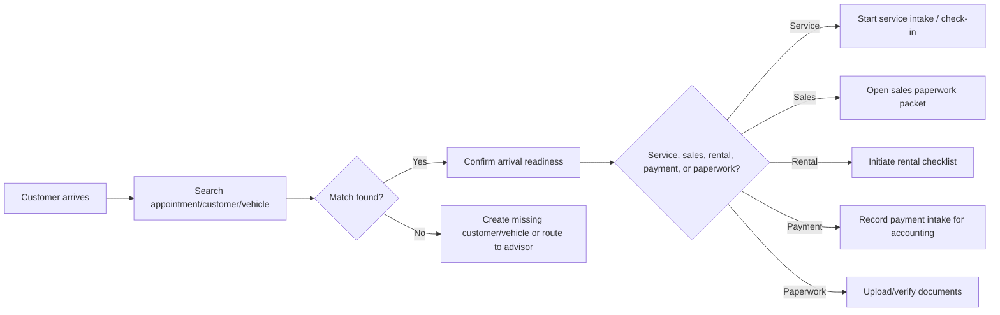

# Operations Coordinator Workflows

## Workflow 1: Customer arrives for appointment

## Workflow 2: New appointment setup

1. Search customer.
2. Search vehicle.
3. If missing, create lightweight customer/vehicle record.
4. Select appointment type.
5. Check availability/resource warnings.
6. Create draft or scheduled appointment.
7. Confirm customer communication.
8. Route to advisor/sales/manager if conflict or special approval exists.

## Workflow 3: Service intake support

1. Search customer/vehicle.
2. Confirm appointment or walk-in.
3. Capture concern in customer's words.
4. Verify keys, transport, promise target, contact method.
5. Route to advisor or create intake draft.
6. If vehicle can be accepted, proceed to check-in workflow.
7. If not, route to advisor/manager with reason.

## Workflow 4: Parts delivery at front desk

1. Search PO, vendor, part, RO, vehicle, or delivery label.
2. If matched:
   - Confirm quantity.
   - Confirm condition.
   - Select location/bin.
   - Mark received in canonical receiving workflow.
3. If unmatched:
   - Create unverified receiving review.
   - Put in quarantine/parts counter.
   - Route to parts.

## Workflow 5: Sales paperwork packet

1. Search customer/vehicle/deal.
2. Start or open sales packet.
3. Verify required docs:
   - ID
   - proof of insurance
   - signed buyer docs
   - trade docs if applicable
   - title/registration docs if applicable
4. Upload/scan docs.
5. Flag missing signatures.
6. Route approval/finance/legal issues to manager/sales/accounting.

## Workflow 6: Financing packet

1. Search customer/deal.
2. Open finance checklist.
3. Verify required inputs:
   - customer identity
   - income/employment docs if applicable
   - lender docs
   - insurance
   - down payment/payment intake reference
4. Upload docs.
5. Route terms/approval to manager/finance authority.

## Workflow 7: Proof of insurance

1. Search customer/deal/rental/vehicle.
2. Upload proof of insurance document.
3. Capture carrier/policy/basic effective date if supported.
4. Mark "received" only, not "legally approved" unless a future authority flow exists.
5. Route missing/expired/unclear proof to manager/sales.

## Workflow 8: Daily rental initiation

1. Search customer.
2. Verify driver and insurance documents.
3. Select rental unit if available.
4. Start rental packet.
5. Route exceptions to manager.
6. Mark packet ready for signature/approval.

## Workflow 9: Payment intake

1. Search customer/deal/RO/account.
2. Record payment received or expected.
3. Attach receipt/reference.
4. Route to accounting/manager for final posting.
5. Show not-final-posted state until accounting authority completes.

## Workflow 10: Photo and advertising support

1. Search vehicle/inventory unit.
2. Upload photos.
3. Mark photo set status.
4. Flag missing facts or vehicle condition issue.
5. Start advertising/listing task.
6. Route pricing/content approval to manager/marketing.

## Workflow 11: Collections support

1. Search customer/account task.
2. Add contact attempt or customer note.
3. Record promised callback/payment intent.
4. Route payment/term changes to collections manager/accounting/manager.

## Workflow 12: Escalation routing

Every incomplete or unauthorized action should route to:

- Manager
- Advisor
- Sales
- Parts
- Technician
- Inventory lead
- Collections
- Accounting

Escalation requires:

- Source record
- Reason
- Urgency
- Requested action
- Customer impact
- Due/next check time
