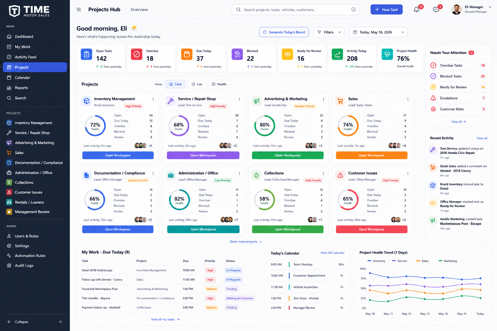

# Projects UI Source Of Truth

**Document:** Projects UI Source Of Truth  
**Last updated:** 2026-07-09  
**Status:** Active visual reference for Projects Hub refinement  
**Parent product:** Time Motor Sales Dispatch Board

---

## 1. Purpose

This document defines the approved visual source of truth for the Projects Hub UI inside the broader Dispatch Board.

Use it to:

- keep the `/projects` experience visually aligned during implementation
- preserve the enterprise command-center feel shown in the approved mockup
- separate authoritative layout guidance from non-authoritative placeholder content
- give Codex and human contributors one stable visual reference when refining the Projects module

---

## 2. Approved reference image

Reference image:

- [`docs/images/PROJECTS_HUB_SOURCE_OF_TRUTH.png`](/C:/Users/timem/OneDrive/Documents/GitHub/Dispatch%20Board/docs/images/PROJECTS_HUB_SOURCE_OF_TRUTH.png)

Preview:



---

## 3. What is authoritative in this mockup

The mockup is authoritative for the following UI decisions:

- one-page composition where the full Projects Hub fits on a single enterprise dashboard screen
- left app navigation, top utility bar, central project workspace, and right-side attention rail
- a KPI strip near the top with compact operational summary cards
- a dense but readable project card grid in the main content area
- a bottom row that supports operational follow-through with work, calendar, and trend panels
- strong visual hierarchy, clean spacing, white-surface cards, and dealership-friendly enterprise density
- a manager-first overview that favors scanning, prioritization, and action

---

## 4. What is not authoritative

The mockup should not be treated as truth for:

- exact numbers, counts, percentages, or activity timestamps
- final backend data model decisions
- exact tab names or route structure when they conflict with the real module guide
- fake analytics or placeholder widgets presented as production-ready features
- any feature that does not yet exist in the repository or approved roadmap

If the mockup and implementation reality differ, preserve the visual intent while staying honest about system state.

---

## 5. Visual rules we should preserve

When refining the Projects Hub, preserve these traits from the mockup:

- the page should read as a command center, not a generic admin table
- major content should remain visible without forcing a long vertical page
- cards should feel compact and information-rich without becoming crowded
- the right rail should surface urgency and recent activity, not duplicate the main grid
- supporting panels at the bottom should feel secondary but still usable in one screen
- colors should help distinguish project areas and health signals without overwhelming the layout

---

## 6. Implementation guidance

Use this image as the visual source of truth for:

- layout proportions
- section ordering
- information density
- card hierarchy
- enterprise polish

Do not use this image as the source of truth for:

- inventing new data fields
- implying completed workflows that do not yet exist
- adding fake metrics to make the screen look more advanced
- breaking the Projects module boundary defined in the module guide

---

## 7. Relationship to the module guide

This document complements, but does not replace:

- [`docs/projects/PROJECTS_MODULE_GUIDE.md`](/C:/Users/timem/OneDrive/Documents/GitHub/Dispatch%20Board/docs/projects/PROJECTS_MODULE_GUIDE.md)

Use the module guide for:

- architecture
- milestone planning
- ownership boundaries
- implementation order

Use this document for:

- visual alignment
- UX refinement
- layout sanity checks

---

## 8. Working rule for future Projects UI tasks

For every Projects Hub refinement task, use this rule:

```text
Use docs/images/PROJECTS_HUB_SOURCE_OF_TRUTH.png as the visual source of truth
for layout, density, hierarchy, and enterprise polish.

Use docs/projects/PROJECTS_MODULE_GUIDE.md as the implementation source of truth
for boundaries, architecture, milestones, and feature honesty.
```
