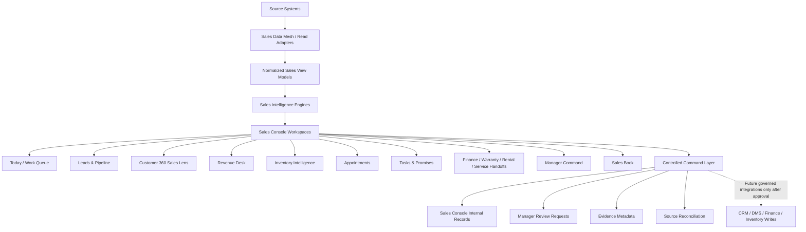

# Sales Console Enterprise Gap Closure Plan

**Product area:** Sales Console (`/sales`)  
**Related build area:** Customer 360 / CRM  
**Status:** Official pause-and-resume reference  
**Last updated:** July 30, 2026  

## 1. Purpose

This document records where the Sales Console stands today, what gaps remain against the original enterprise goal, and how Time Motor Sales should close those gaps over future implementation phases.

The Sales Console goal is not merely to create another dashboard. The goal is to build the dealership revenue operating brain: a system that helps staff decide who to work, what revenue lane applies, what source data matters, what action is allowed, what is blocked, what manager attention is needed, and what sale records or evidence must be created.

This plan is especially important before moving into the Customer 360 / CRM build, because Customer 360 is one of the most important missing source foundations for the Sales Console.

## 2. Enterprise Benchmark

The target operating level is inspired by elite systems such as:

- **vAuto** for automotive inventory intelligence, pricing, appraisal, stocking, merchandising, market position, and turn strategy.
- **Salesforce Sales Cloud / Revenue Intelligence** for CRM, pipeline, forecasting, revenue analytics, rep performance, activity intelligence, and next-best-action insights.
- **Microsoft Dynamics 365 Sales** for lead-to-order process, sales accelerator work lists, predictive lead/opportunity scoring, relationship intelligence, forecasting, sequences, and sales productivity.
- **ServiceNow-style workflow systems** for workflow orchestration, approvals, fulfillment, audit trails, governed handoffs, and cross-system process control.

The Sales Console should not blindly copy these systems. It should apply their best patterns to Time Motor Sales' own revenue model:

- Inventory cash sales
- Inventory BHPH sales
- Inventory lease-to-own sales
- Public auto repairs
- Daily rental
- Warranty products
- Financing products

## 3. Current Sales Console State

As of the current pause point, the Sales Console has moved beyond a static mockup and now has an operational MVP foundation.

Current strengths:

- Enterprise-style Sales Console shell
- Clean Sales Console sidebar
- Role-aware surfaces
- Operating tabs
- Search over current source-shaped records
- Work queue algorithm foundation
- Lead, pipeline, customer, inventory, appointment, task, finance, rental, service, and warranty orchestration concepts
- Revenue-lane model for Time Motor Sales revenue streams
- Manager Command Center foundation
- Sales record domain
- Revenue-lane completion rules
- Internal completed-sale record initiation
- Enterprise command / audit / idempotency pattern
- Source reconciliation foundation
- Guardrails against risky workflows

Current approved live/controlled workflow:

- Staff can initiate a **Sales Console-owned internal completed-sale record** when requirements pass.
- The workflow is auditable and idempotent.
- It does **not** write to CRM, DMS, inventory, finance, rental, service, warranty, or marketing systems.

Important boundary:

The Sales Console is currently an operational MVP foundation, not yet a complete enterprise sales platform.

## 4. Main Architectural Gap

The main gap is not visual design anymore.

The main gap is operating depth.

The Sales Console has the shell, contracts, algorithms, and guardrails forming, but the console still needs deeper live data, stronger Customer 360/CRM intelligence, stronger inventory intelligence, fuller sales record lifecycle, production-grade evidence handling, and more mature workflow automation.

In simple terms:

> The Sales Console brain is forming, but many of the live source-system nerves still need to be connected.

## 5. Gap Matrix

| Area | Current State | Enterprise Target | Gap Severity | Closure Strategy |
| --- | --- | --- | --- | --- |
| Customer 360 / CRM | Linked and source-shaped; not yet the full center of selling decisions | Complete customer identity, history, consent, activity, prior revenue, relationship context, and buying intent | High | Build Customer Revenue Profile and connect it to Leads, Pipeline, Revenue Desk, and Manager Command |
| Live source data | Partial adapters and source-shaped records | Real source-backed records with freshness, source owner, stale/error/empty states, and role filtering | High | Build Sales Data Mesh adapters for each source domain |
| Inventory intelligence | Vehicle match/readiness foundation exists | vAuto-like pricing, aging, turn risk, appraisal, market pressure, merchandising, recon, and gross logic | High | Build Inventory Revenue Intelligence Engine |
| Deal Desk execution | Revenue lanes and completion rules modeled | Lane-specific operational deal workflows with governed quote, review, handoff, and sale packet logic | High | Build controlled Revenue Desk execution by lane |
| Sales record keeping | Internal sale record initiation exists | Dedicated Sales Book, evidence upload, packet checklist, reconciliation workbench, void/correction workflow | High | Build Sales Book & Evidence module |
| Workflow automation | Next-action and queue logic started | Sales sequences, SLA automation, lead routing, stalled revenue rescue, coaching prompts | Medium-High | Build Sales Workflow Engine |
| Reporting / forecasting | Basic ledger and summary panels | Forecast, pipeline coverage, revenue intelligence, lead source ROI, gross/unit trends, coaching dashboards | Medium-High | Build Revenue Intelligence dashboards |
| Governance / permissions | Role-aware UI and guardrails exist | Field/action/store-level authority, separation of duties, audit export, policy gates | Medium | Build Sales Governance Layer |
| Cross-console integration | Links and orchestration concepts exist | Seamless movement between Sales, Customer 360, Inventory, Appointments, Tasks, Finance, Rental, Service, Warranty, Marketing | Medium-High | Build source navigation contracts and return-to-Sales patterns per domain |
| Enterprise integrations | Source-system writes intentionally blocked | Future governed integrations with CRM/DMS/finance/inventory after approval | Future | Add only after MVP stabilizes and governance is approved |

## 6. Gap 1: Customer 360 / CRM Is Not Yet the True Sales Center

### Why this matters

Elite CRM systems treat the customer as the center of sales activity. A seller should know who the customer is, what they want, what they already did with the business, what promises exist, what documents are missing, and what next action has the highest chance of creating revenue.

### Current challenge

The Sales Console can reference Customer 360, but Customer 360 is not yet deeply driving every Sales Console decision.

Missing customer intelligence:

- Prior purchases
- Prior repairs
- Prior rentals
- Warranty history
- Lead source history
- Marketing campaign response
- Contact consent
- Last touch
- Open promises
- Document readiness
- Buying intent
- Customer lifetime value
- Relationship history
- Next best revenue lane

### Plan to close

Build a **Customer Revenue Profile** inside the Customer 360 / CRM system and expose it to Sales Console.

The profile should include:

- Customer identity
- Contact preference and consent
- Active leads
- Active opportunities
- Prior revenue
- Related vehicles
- Appointments
- Tasks and promises
- Documents and evidence
- Revenue-lane eligibility
- Buying intent score
- Risk/blocker labels
- Recommended next action

### Sales Console dependency

Leads, Pipeline, Revenue Desk, Manager Command, and Sales Book should all consume Customer Revenue Profile data.

## 7. Gap 2: Live Source Data Depth Is Incomplete

### Why this matters

Top-tier systems reduce staff searching because they gather information from multiple sources and place it into one operating context.

### Current challenge

The Sales Console has source-shaped records and some integration logic, but not all source domains have deep live adapters.

### Plan to close

Create a **Sales Data Mesh** layer with read adapters:

- `Customer360SalesAdapter`
- `LeadPipelineSalesAdapter`
- `InventorySalesAdapter`
- `AppointmentSalesAdapter`
- `TaskSalesAdapter`
- `FinanceHandoffSalesAdapter`
- `RentalSalesAdapter`
- `ServiceSalesAdapter`
- `WarrantySalesAdapter`
- `MarketingAttributionSalesAdapter`
- `DmsSalesRecordAdapter`

Each adapter should provide:

- Source owner
- Source record ID
- Freshness timestamp
- Role visibility
- Empty state
- Error state
- Stale state
- Source link
- Confidence label
- Normalized Sales Console view model

## 8. Gap 3: Inventory Intelligence Is Far Below vAuto-Level

### Why this matters

For an automotive business, inventory is not just a list of vehicles. It is a revenue engine. vAuto-like capability means understanding pricing, aging, turn, market position, appraisal, merchandising, readiness, and gross potential.

### Current challenge

The Sales Console has inventory match and readiness concepts, but not deep inventory economics.

### Missing inventory capabilities

- Market price position
- Competitive set
- Days-to-turn
- Aging risk
- Gross potential
- Recon cost impact
- Title/readiness blocker
- Merchandising score
- Appraisal intelligence
- Trade acquisition logic
- Vehicle-to-customer demand logic
- Customer-to-vehicle fit logic
- Price adjustment recommendations
- Wholesale vs retail guidance

### Plan to close

Build an **Inventory Revenue Intelligence Engine**.

Core scores:

- Sellability score
- Gross opportunity score
- Aging urgency score
- Customer demand score
- Lane fit score
- Readiness score
- Market pressure score
- Holding cost score
- Advertising need score
- Manager attention score

Expected outcome:

The console should answer:

- Which vehicle should we sell today?
- Which customer is best matched to this vehicle?
- Which vehicle is aging into danger?
- Which inventory unit needs manager intervention?
- Which vehicle needs pricing, merchandising, recon, or advertising attention?

## 9. Gap 4: Deal Desk Is Modeled but Not Fully Executable

### Why this matters

The Revenue Desk should be where a sales opportunity becomes an executable deal path.

### Current challenge

Revenue lanes exist, but the console does not yet fully execute lane-specific deal workflows.

### Plan to close

Build a controlled **Revenue Desk Execution** layer.

Common workflow:

1. Select customer/opportunity
2. Select revenue lane
3. Verify source records
4. Complete required lane fields
5. Attach required evidence
6. Request manager review if needed
7. Initiate internal sale record
8. Open post-sale execution checklist
9. Reconcile against source systems

Lane-specific workflows:

- Cash sale workflow
- BHPH workflow
- Lease-to-own workflow
- Public repair workflow
- Daily rental workflow
- Warranty product workflow
- Financing product workflow

Guardrails:

- No uncontrolled quote submission
- No discount approval
- No finance decision
- No vehicle hold/reservation
- No customer messaging automation
- No contract execution

## 10. Gap 5: Sales Record Keeping Is Started but Not Complete

### Why this matters

Staff need to record completed sales, attach proof, reconcile source systems, and produce a reliable Sales Book.

### Current challenge

Internal completed-sale record initiation exists, but the full lifecycle is not complete.

### Missing capabilities

- Dedicated SalesRecord database model
- SalesEvidence database model
- File/photo upload UI
- Evidence metadata persistence
- Sale packet checklist
- Completed sale review UI
- Reconciliation workbench
- Void/correction workflow
- Final Sales Book posting
- Export/reporting

### Plan to close

Build **Sales Book & Evidence**.

Core records:

- SalesRecord
- SalesRecordLine
- SalesEvidence
- SalesPacketChecklist
- SourceReconciliation
- SalesRecordCorrection
- SalesRecordVoid
- SalesBookPosting

Expected outcome:

Staff can initiate, support, review, correct, reconcile, and report completed sale records.

## 11. Gap 6: Workflow Automation Needs More Depth

### Why this matters

Top systems use intelligent work lists, sequences, predictive scoring, and recommendations to reduce staff guesswork.

### Current challenge

The Sales Console has algorithmic foundations, but the operating workflows are still early.

### Plan to close

Build a **Sales Workflow Engine**.

Core algorithms:

- Lead Priority Score
- Customer Revenue Potential Score
- Appointment Conversion Score
- Pipeline Risk Score
- Inventory Match Score
- Stalled Revenue Score
- Manager Attention Score
- Follow-up SLA Score
- Deal Completion Readiness Score
- Source Reconciliation Confidence
- Next Best Action Engine

Each algorithm must return:

- Score
- Reason
- Source signals used
- Recommended action
- Role visibility
- Risk label
- Allowed action or governed action

## 12. Gap 7: Reporting and Forecasting Are Not Enterprise-Grade Yet

### Why this matters

Salesforce and Microsoft-style revenue intelligence gives leadership visibility into pipeline, forecast, team performance, risks, and coaching opportunities.

### Current challenge

Sales Console has early reporting and ledger summaries, but not full revenue intelligence.

### Plan to close

Build a **Revenue Intelligence Layer**.

Dashboards:

- Salesperson command center
- Manager forecast dashboard
- Revenue lane dashboard
- Inventory revenue dashboard
- Lead source ROI dashboard
- Appointment conversion dashboard
- Sales Book dashboard
- Source reconciliation dashboard
- Executive owner dashboard

Metrics:

- Revenue by lane
- Units by lane
- Gross by lane
- Gross by salesperson
- Pipeline coverage
- Forecast confidence
- Appointment show-to-sale conversion
- Lead source ROI
- Inventory turn impact
- Lost-sale reasons
- Coaching opportunities

## 13. Gap 8: Governance and Permissions Need Production Hardening

### Why this matters

Enterprise systems are powerful because actions are governed. Staff should only see and do what they are authorized to see and do.

### Current challenge

Role-aware behavior exists, but deeper action and field-level governance is still needed.

### Plan to close

Build a **Sales Governance Layer**.

Every action must be classified:

- Read
- Sales Console internal write
- Source-system write
- Governed action
- Manager approval required
- Disabled future action

Governance capabilities:

- Field-level permissions
- Action-level permissions
- Store-level visibility
- Manager approval authority
- Separation of duties
- Audit export
- Exception queue
- Immutable command ledger coverage

## 14. Target Architecture

## 15. Roadmap

### Phase 1: Customer 360 / CRM Foundation

Goal: make Customer 360 the center of sales intelligence.

Milestones:

1. Customer identity and relationship model
2. Contact preference and consent model
3. Lead and opportunity history
4. Prior purchase, repair, rental, and warranty history
5. Customer timeline
6. Documents and evidence summary
7. Open tasks and promises
8. Buying intent scoring
9. Customer Revenue Profile
10. Sales Console adapter for Customer Revenue Profile

Why this phase is next:

The upcoming Customer 360 / CRM work directly reduces the biggest Sales Console gap. Without Customer 360 depth, Leads, Pipeline, Revenue Desk, Manager Command, and Sales Book cannot become truly intelligent.

### Phase 2: Source Data Mesh

Goal: make every Sales Console tab source-backed.

Milestones:

1. Customer adapter
2. Lead/pipeline adapter
3. Inventory adapter
4. Appointment adapter
5. Task/promise adapter
6. Finance adapter
7. Rental/service/warranty adapters
8. Marketing attribution adapter
9. DMS/source sales-record adapter
10. Source freshness and no-dead-tab verification

### Phase 3: Sales Book & Evidence

Goal: complete internal sales record keeping.

Milestones:

1. SalesRecord database model
2. SalesEvidence database model
3. File/photo upload UI
4. Evidence metadata persistence
5. Sale packet checklist
6. Completed sale review UI
7. Source reconciliation workbench
8. Void/correction workflow
9. Sales Book ledger posting
10. Sales Book reporting and export

### Phase 4: Revenue Desk Execution

Goal: make every revenue lane operational.

Milestones:

1. Start revenue opportunity workflow
2. Lane-specific deal packet
3. Cash sale workflow
4. BHPH workflow
5. Lease-to-own workflow
6. Public repair workflow
7. Daily rental workflow
8. Warranty product workflow
9. Financing product workflow
10. Manager review and governed handoff logic

### Phase 5: Inventory Revenue Intelligence

Goal: move toward vAuto-like inventory intelligence.

Milestones:

1. Vehicle readiness model
2. Aging and turn-risk score
3. Gross opportunity model
4. Market pricing position
5. Recon/title/readiness blocker model
6. Customer-to-vehicle match logic
7. Vehicle-to-customer demand logic
8. Merchandising readiness
9. Appraisal/trade intelligence foundation
10. Inventory revenue command dashboard

### Phase 6: Sales Workflow Engine

Goal: make the Sales Console actively optimize sales work.

Milestones:

1. Lead Priority Score
2. Customer Revenue Potential Score
3. Appointment Conversion Score
4. Pipeline Risk Score
5. Inventory Match Score
6. Stalled Revenue Score
7. Manager Attention Score
8. Follow-up SLA Score
9. Deal Completion Readiness Score
10. Next Best Action Engine

### Phase 7: Manager Command Center Expansion

Goal: give managers true operating control.

Milestones:

1. Manager review workbench
2. Stalled revenue queue
3. SLA breach queue
4. Approval visibility queue
5. Salesperson coaching cards
6. Forecast confidence
7. Pipeline leakage
8. Inventory revenue blockers
9. Lead source performance
10. Daily manager command brief

### Phase 8: Revenue Intelligence and Forecasting

Goal: move toward Salesforce/Microsoft-style revenue intelligence.

Milestones:

1. Revenue by lane
2. Gross by salesperson
3. Units by salesperson
4. Forecast by week/month
5. Pipeline coverage
6. Lead source ROI
7. Appointment show/sold conversion
8. Inventory turn impact
9. Marketing attribution
10. Owner dashboard

### Phase 9: Governed Enterprise Workflows

Goal: add powerful enterprise actions safely.

Milestones:

1. Quote scenario builder planning
2. Manager approval workflow
3. Discount approval workflow
4. Finance handoff workflow
5. Vehicle hold/reservation workflow
6. Customer messaging workflow
7. Contract handoff workflow
8. DMS posting integration
9. Multi-store workflows
10. Full audit/compliance hardening

## 16. Recommended Return Strategy

When work resumes, do not start by adding more Sales Console tabs.

Start with the Customer 360 / CRM build.

Recommended next implementation sequence:

1. Customer 360 / CRM foundation
2. Customer Revenue Profile
3. Sales Console customer adapter
4. Lead/pipeline customer intelligence
5. Customer-driven Revenue Desk context
6. Customer-driven Manager Command risk logic
7. Customer-driven Sales Book and reconciliation context

This path reduces the largest Sales Console gap while also building one of the most important adjacent systems.

## 17. Decision Principles

Use these principles when continuing:

1. **No decorative tabs.** Every visible tab must have a business purpose and operating behavior.
2. **No fake buttons.** Every button must be live, disabled with reason, source-system, or governed future.
3. **Source systems remain authoritative.** Sales Console may coordinate and record internal context, but cannot silently replace CRM, DMS, inventory, finance, rental, service, warranty, or marketing systems.
4. **Customer 360 comes first.** Customer intelligence should drive the sales workflow.
5. **Inventory must become revenue intelligence.** Inventory should not just be searchable; it should help decide what to sell.
6. **Sales records need evidence.** Completed sales should be supported by proof, source links, and reconciliation.
7. **Algorithms must explain themselves.** Every score needs reasons, source signals, and recommended actions.
8. **Governance before automation.** Risky enterprise workflows require permissions, audit, approval, and rollback/correction planning.

## 18. Current Pause Assessment

Current status:

- MVP foundation: strong
- Enterprise UI direction: strong
- Operating logic: medium and improving
- Live data depth: incomplete
- Customer intelligence: early-to-medium
- Inventory intelligence: early
- Deal Desk execution: early
- Sales record lifecycle: started but not complete
- Reporting/forecasting: early
- Enterprise automation: early

Approximate position:

- Against internal MVP foundation: 75-80%
- Against official staff deployment with complete record keeping: 55-65%
- Against elite enterprise systems: 30-40%
- Against vAuto-level inventory intelligence: 20-25%
- Against Salesforce/Microsoft CRM sales operations: 25-35%
- Against ServiceNow-style workflow/order lifecycle: 25-30%

The next correct move is not to widen the console. The next correct move is to deepen the connected systems, beginning with Customer 360 / CRM.
