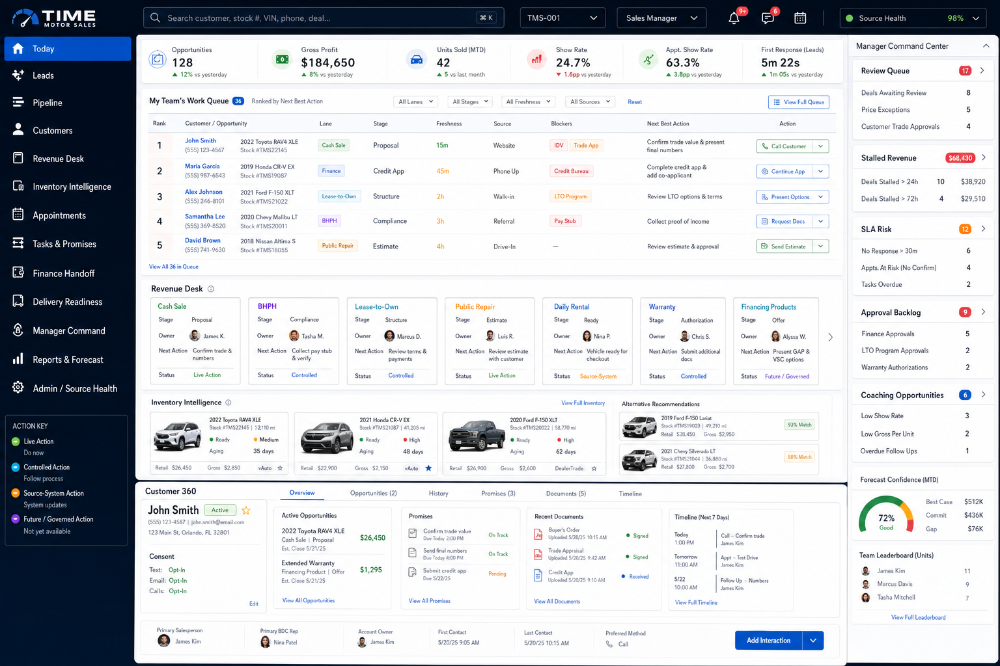

# Sales Console Milestone 37: Operational UI Source of Truth

**Status:** Build-ready UI contract; no app code activation
**Branch:** `codex/sales-console-m37-operational-ui-source-of-truth`
**Date:** 2026-07-29
**Primary asset:** `assets/elite-enterprise-sales-console-source-of-truth-m37.png`
**Implementation contract asset:** `assets/operational-sales-console-source-of-truth-m37.svg`

## 1. Purpose

Milestone 37 replaces the previous prototype-driven UI direction with a workflow-first operating mockup. This milestone exists so future implementation does not continue patching a confusing interface.

The new source of truth says: the Sales Console must be a daily operating workspace, not a milestone board, dogfood checklist, or decorative dashboard.

## 2. Source-of-truth mockup

This image is the official visual source of truth adopted for the Sales Console rebuild. Future UI work should match its organization, density, navigation, operating surfaces, revenue lanes, Manager Command Center rail, Customer 360 panel, and action-state language as closely as practical.

The companion SVG remains as an implementation contract reference for exact labels and testable UI states.

## 3. Required staff-facing experience

The staff-facing `/sales` route should open to a working console with:

- role-aware left navigation;
- a real global search control;
- operational status indicators;
- a ranked work queue;
- a selected-record detail model;
- Revenue Desk lanes;
- Manager Command Center;
- source, freshness, blocker, and permission labels;
- clear live vs governed action states.

The first screen must answer:

1. What should I work now?
2. Who owns it?
3. What stage is it in?
4. What is the next action?
5. What is blocking it?
6. What source owns the truth?
7. What action am I allowed to take?

## 4. Navigation contract

Every visible navigation item must either open a real workspace or be removed from the staff UI until it is ready.

| Navigation item | MVP behavior required |
| --- | --- |
| Today | Opens ranked seller/BDC work queue |
| Leads | Opens lead intake, SLA, dedupe, and assignment workspace |
| Pipeline | Opens opportunity/deal stage progression |
| Revenue Desk | Opens lane-aware revenue opportunity workspace |
| Inventory Match | Opens vehicle recommendation and readiness workspace |
| Appointments | Opens confirmation, arrival, no-show, and showroom sales lens |
| Manager Command | Opens manager risk, review, stalled work, and intervention queues |
| Admin Review | Opens implementation, readiness, and policy review panels only for authorized admin/owner users |

Planning, milestone, dogfood, and release-gate content must not appear in the normal staff workflow.

## 5. Global search contract

The top search bar must be operational before it appears enabled.

MVP search should support:

- customer name;
- phone/email when allowed;
- stock number;
- VIN;
- opportunity ID;
- deal/revenue opportunity ID;
- appointment reference.

Search behavior must include:

- visible results tray;
- loading state;
- empty state;
- error/unavailable state;
- keyboard submit;
- click-to-open result;
- source label per result;
- role-filtered visibility.

If real search is not ready, the search bar must be disabled or replaced with clear unavailable copy. It must not look clickable while doing nothing.

## 6. Revenue Desk contract

The old Deal Desk concept must become a broader Revenue Desk because Time Motor Sales has multiple revenue lanes.

Required lanes:

| Lane | MVP screen responsibility |
| --- | --- |
| Inventory cash sale | Customer, vehicle, price posture, manager review, delivery readiness |
| Inventory BHPH sale | Customer, vehicle, down payment intent, documentation readiness, manager review |
| Open lease-to-own | Customer, vehicle, eligibility checklist, payment intent, manager review |
| Public auto repair | Customer, vehicle/service need, estimate status, follow-up owner |
| Daily rental | Customer, rental need, date window, availability status, follow-up owner |
| Warranty product | Customer/deal context, product interest, eligibility, manager review if needed |
| Financing product | Finance intent, product/handoff status, source ownership, blocker labels |

Each lane must show:

- owner;
- source system;
- current stage;
- next action;
- blocker;
- freshness;
- allowed actions;
- governed actions.

## 7. Action contract

Buttons must never be decorative.

Allowed MVP actions:

- search;
- open record;
- filter/sort visible work;
- switch workspace;
- open source link;
- request manager review;
- view audit/source metadata.

Governed or future actions:

- customer messaging automation;
- quote submission;
- vehicle holds/reservations;
- finance decisions;
- discount approvals;
- CRM/DMS/inventory/finance record replacement.

Governed actions may appear only when visibly disabled with an explanation, or when placed inside Admin Review planning surfaces.

## 8. Role landing contract

The console should not ask staff to choose who they are every time. It should infer the user role and land them in the correct workspace.

| Role | Default landing |
| --- | --- |
| Salesperson | Today |
| BDC / Lead Coordinator | Leads |
| Sales Manager | Manager Command |
| Admin / Owner | Admin Review plus access to operating workspaces |

Role switching can exist for admin/demo review, but not as the main operating model for staff.

## 9. Visual density rules

The enterprise look should come from operational clarity, not from adding more panels.

Use:

- compact rows;
- strong hierarchy;
- clear table/list structures;
- status chips;
- right-side context rail;
- visible source labels;
- restrained color with meaningful urgency accents.

Avoid:

- large marketing-style hero blocks in daily workflow;
- milestone status cards in staff view;
- tabs without real workspace behavior;
- repeated explanation cards;
- controls that look live but are not live.

## 10. Implementation gates for M38+

Future implementation branches should not ship a workspace unless all of these are true:

- route or workspace opens consistently;
- search/filter behavior works where visible;
- rows/cards open records or panels;
- empty/loading/error states exist;
- permissions are respected;
- source/freshness/blocker labels are visible;
- risky actions are blocked;
- tests prove the behavior;
- staff UI contains no dogfood/prototype/milestone language.

## 11. Next milestone

Recommended next milestone:

**M38 — Lean Staff Shell Reset**

M38 should start from this source of truth and rebuild the staff-facing `/sales` shell into a smaller operating surface while moving planning/admin evidence out of the normal staff flow.
